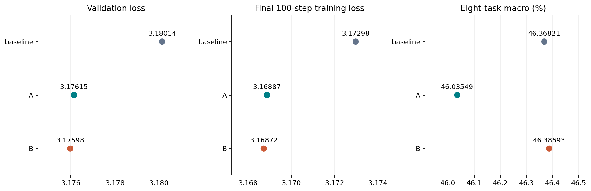
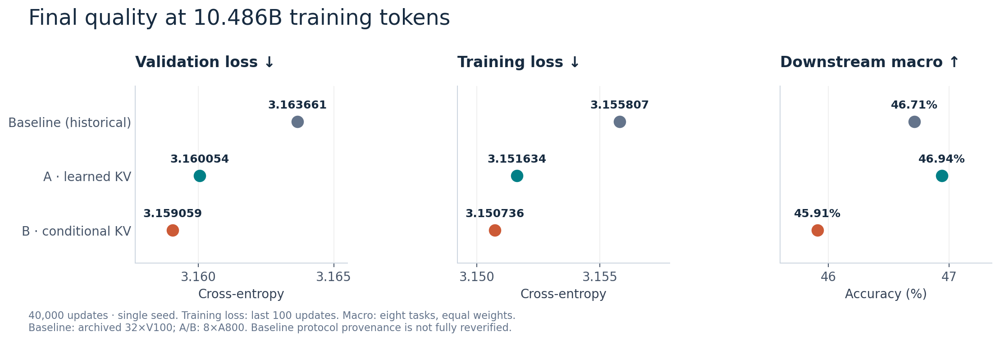
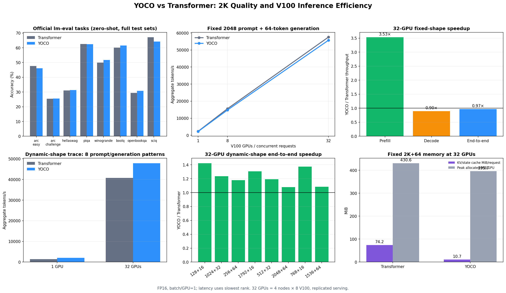

# YOCO 160M: learned and conditional depth K/V aggregation

This repository combines the previously separate YOCO and Transformer baseline
trees into one reproducible project. It contains model and training code,
evaluation and inference benchmarks, pinned dataset metadata, measured tables,
and figures. Checkpoints and training data are intentionally excluded.

## Completed SWA 160M baseline / A / B experiment

All three YOCO **sliding-window self-decoder** arms completed 40,000 updates and
eight full zero-shot tasks each on 8×A100, finishing on November 8, 2026.
The window is 1,024 tokens; the later cross-decoder reads shared global K/V.
The 102 common initialization tensors are bitwise equal, and all three use the
same approved FineWeb-Edu/tokenizer/FP16 mixed recipe and execution settings.
Each arm consumed 10,485,760,000 tokens and retained all eight scheduled checkpoints.

| Arm | Parameters | Validation loss | Eight-task macro (%) |
| --- | ---: | ---: | ---: |
| baseline | 163,155,456 | 3.180143 | 46.3682 |
| A / learned_kv | 163,155,462 | 3.176147 | 46.0355 |
| B / conditional_kv | 163,156,230 | 3.175976 | 46.3869 |

A has slightly lower validation loss and a **0.3327 percentage-point lower**
downstream macro. B has a **0.0187 percentage-point higher** macro, essentially
tied with baseline. These descriptive single-seed results do not establish a
stable overall downstream gain.

All 24 full evaluations, paired document/prompt/target hashes, and 24 retained
checkpoint hashes were verified. Validation losses decreased throughout; raw
batch noise and isolated pre-clip gradient peaks remain visible. Each arm had
five normal AMP rejected attempts, with no nonfinite forward events or checkpoint
rollbacks. The training settings were unchanged.

[Final report: seven PNG/PDF/SVG figures and raw CSVs](evaluation/swa_160m_ab_20261107/README.md) ·
[Design formulas, frozen settings and recovery tools](docs/SWA_160M_AB.md) ·
[Final verification](docs/evidence/swa-160m-final-review-20261108.json)



The [reproduction skill](.agents/skills/yoco-reproduction/SKILL.md) locks the recipe
during fixes, acceleration and recovery. The supervisor supports bounded recovery
from a verified full checkpoint with the same data order; repeated failures enter
diagnosis. This completed cohort required no rollback and must not be restarted.
The corpus is the repository's approved FineWeb recipe; paper comparisons require
separate corpus and parameter-budget matching.

## Nine completed models: curves, compute and downstream

All nine gRet160M / gRet400M / SWA160M baseline/A/B models completed 40,000
updates and eight full zero-shot tasks per model. The [combined report](evaluation/model_comparison_20261111/README.md)
contains raw train/validation plots, downstream accuracy and relative gains, and
**two common-coefficient compute–loss endpoint plots: six gRet points and three SWA points**.
Each figure is available as PNG, PDF and SVG, with numeric CSV and source hashes.
Compute uses the same trunk 6ND proxy with coefficient 6 for all models; it is not measured FLOPs.

[Six-point gRet compute–loss](evaluation/model_comparison_20261111/figures/05_compute_loss_gret.png) ·
[Three-point SWA compute–loss](evaluation/model_comparison_20261111/figures/06_compute_loss_swa.png) ·
[Downstream macro and relative gain](evaluation/model_comparison_20261111/figures/09_downstream_macro_and_relative_gain.png)

The [complete gRet400M baseline/A/B report](evaluation/gret_400m_3way_20261108T194918Z/README.md)
retains all 24 checkpoints locally and publishes the raw curves and full evaluation summaries.
Their final validation losses are 3.005298 / 2.918184 / 2.913688; macro accuracies
are 47.7947% / 48.5270% / 48.3513%. The baseline finished its full pipeline on
November 10, 2026 at 00:27 CST. A retains a historical compiled/repaired prefix;
baseline and B use the repaired native path throughout. Baseline gradient and
validation excursions remain visible in the raw plots. Results are descriptive, single-seed comparisons.

[400M settings and B recovery workflow](docs/PLAN_B_400M_8GPU.md) ·
[Baseline queue and completion history](docs/GRET_400M_BASELINE_QUEUE.md) ·
[Publication checks](docs/evidence/model-comparison-final-review-20261111.json)

## Completed 400M A training

Method A at **400.59M parameters on 8×A100** completed 40,000 updates and eight
full downstream tasks on November 7, 2026: validation loss **2.918184**,
eight-task macro average **48.5270%**. The final checkpoint SHA256 and all eight
evaluation provenance records were verified independently. This run resumed after
the documented retention arithmetic repair, with compilation disabled; its
post-repair segment recorded no nonfinite forward events. That run trained A;
the completed baseline/B results are tracked above. See the [completed run and repair record](docs/PLAN_A_400M_8GPU.md).

## Completed gRet 160M A/B experiment

The earlier gRet experiment compares two ways to aggregate K/V from all six
self-decoder layers, constructing shared memory once before layers 7–12:

| Model | Aggregation weights | Sources |
| --- | --- | --- |
| A (`learned_kv`) | Six global trainable softmax logits; shared across tokens | Layers 1–6 |
| B (`conditional_kv`) | Per-token scores from normalized source hidden states | Layers 1–6 |
| Original YOCO baseline | K/V from the final self-decoder output | Layer 6 |

**Completed three-way comparison (2026-11-05):** the original YOCO baseline
completed 40,000 updates on **8×A100**; A/B retain the published **8×A800** runs.
All three consumed 10,485,760,000 tokens and completed all eight full zero-shot tasks.

| Metric | New YOCO baseline · 8×A100 | A | B |
| --- | ---: | ---: | ---: |
| Final validation loss | 3.177219 | 3.160054 | 3.159059 |
| Eight-task macro average (%) | 45.6268 | 46.9417 | 45.9075 |
| Trunk 6ND (PFLOP-days) | 0.065308109 | 0.065308114 | 0.065308673 |

The baseline above is the newly completed eight-A100 run. Full-size model checks
confirm the same common backbone tensors at initialization; A adds 6 parameters,
B adds 774. Model/training hyperparameters and all task YAMLs, seeds and zero-shot
counts match. Baseline saves every 5,000 steps and retains all eight checkpoints;
its compiler/fused-optimizer execution options are documented separately. Remote A/B step-zero payloads and token-shard hashes are not available
for a fresh check, so baseline differences remain descriptive. A has the highest
downstream macro; B has the lowest final validation loss. The accelerated FP16 baseline trained in 3.97 hours
and completed training plus evaluation in 4.13 hours.
Its validation curve has no sustained regression like the superseded run.
See [reusable acceleration settings and commands](docs/BASELINE_A100_ACCELERATION.md).
6ND remains a compute proxy; timings across different execution options do not isolate architecture effects. See the [complete report, backbone audit, seven figures and CSVs](evaluation/ab_baseline_20261104/README.md).

[七张三组对比图 / Comparison figures](evaluation/ab_baseline_20261104/figures/README.md) · PNG / PDF / SVG



- [A/B design and execution](docs/PLAN_AB_4GPU.md)
- [Design formulas](docs/plan.md)
- [Documentation index](docs/README.md)
- [Training and evaluation scripts](scripts/README.md)
- [Test commands](tests/README.md)

The original three-source `token` and `static` hidden-state fusion experiments
remain available as historical implementations. They differ from the six-source
K/V aggregation in A/B. Existing two-GPU baseline / token-v2 validation results
are documented separately in [the training review](docs/evidence/full-v2-convergence-review.md).

## Earlier YOCO / Transformer reproduction

The reports below describe the earlier 32-V100 YOCO/Transformer comparison,
separate from the completed A/B experiment above.

## Earlier reproduction result



The paired 40,000-step runs have nearly identical validation loss and aggregate
downstream accuracy. YOCO uses much less inference cache and has substantially
faster prefill. On the measured dynamic-shape workload it reaches 1.18x the
32-GPU end-to-end throughput; on fixed 2K prompt + 64-token generation it is
0.97x because decode dominates and the current V100 eager decode is slightly
slower.

See [the concise report](evaluation/YOCO_BASELINE_REPORT.md) for the results and
[the detailed 2K report](evaluation/INFERENCE_2K_32GPU.md) for methodology.

## Repository layout

```text
runtime/                 unified YOCO and Transformer model/training code
configs/                 original reproduction, historical fusion, and A/B configurations
tools/                   data preparation, deployment, verification, and summaries
docs/                    current A/B design, historical results, and tutorials
evaluation/              lm-eval adapter, reports, summaries, raw metrics, figures
benchmarks/              fixed, dynamic-shape, long-context, and plotting scripts
tests/                   architecture and recovery checks
provenance/              upstream commit and pinned public-data metadata
```

## Environment

Python 3.12 and CUDA are recommended. Install the CUDA-compatible PyTorch build
for the target machine, then install the remaining dependencies:

```bash
python -m venv .venv
source .venv/bin/activate
pip install -r requirements.txt
```

The measured runs used PyTorch 2.7.1, FP16, and 32 V100 32GB GPUs.

## Data and training

Prepare the pinned FineWeb-Edu sample-10BT corpus once. Both configurations
refer to the same relative manifest.

```bash
python tools/prepare_data.py --config configs/yoco_160m.json
python tools/verify_data.py --config configs/yoco_160m.json
```

Single-GPU synthetic smoke tests do not require the corpus:

```bash
python -m runtime.train \
  --config configs/yoco_160m.json \
  --run-dir runs/yoco-smoke --smoke --stop-after 2

python -m runtime.train \
  --config configs/transformer_160m.json \
  --run-dir runs/transformer-smoke --smoke --stop-after 2
```

For the formal run, invoke the generic launcher on every node. Set a different
`NODE_RANK` from 0 to 3 and the same `MASTER_ADDR` on all nodes:

```bash
NODE_RANK=0 MASTER_ADDR=10.0.0.1 \
  bash scripts/run_4node_training.sh configs/yoco_160m.json runs/yoco
```

The configuration requires exactly 32 ranks. The same launcher accepts the
Transformer configuration.

## Downstream evaluation

The eight task dataset revisions are pinned in `evaluation/data_locks/`.

```bash
python evaluation/run.py \
  --config configs/yoco_160m.json \
  --checkpoint checkpoints/yoco/checkpoint_00040000.pt \
  --task arc_easy --output runs/eval/yoco/arc_easy --device cuda:0
```

Use the same command with `configs/transformer_160m.json` for the baseline.

## Inference benchmarks

Single-GPU or `torchrun` fixed 2K benchmark:

```bash
torchrun --standalone --nproc-per-node=8 \
  benchmarks/benchmark_2k_distributed_inference.py \
  --config configs/yoco_160m.json \
  --checkpoint checkpoints/yoco/checkpoint_00040000.pt \
  --output runs/inference/yoco_w8_b1.json
```

Dynamic-shape benchmark:

```bash
python benchmarks/benchmark_dynamic_shape_inference.py \
  --config configs/yoco_160m.json \
  --checkpoint checkpoints/yoco/checkpoint_00040000.pt \
  --output runs/inference/yoco_dynamic_w1_b1.json
```

The dynamic trace uses a fixed seed and eight non-monotonic prompt/generation
patterns from 128 to 2048 prompt tokens and 16 to 64 generated tokens.

For the measured 4-node layout, run this on each node with its own rank:

```bash
NODE_RANK=0 MASTER_ADDR=10.0.0.1 MASTER_PORT=29501 \
  bash scripts/run_4node_benchmark.sh dynamic \
  configs/yoco_160m.json checkpoints/yoco/checkpoint_00040000.pt \
  runs/inference/yoco_dynamic_w32_b1.json
```

## Recreate the checked-in figures

The small raw inference JSON files are included, so the main figures can be
regenerated without checkpoints:

```bash
python benchmarks/plot_2k_32gpu_inference.py \
  --raw-dir evaluation/raw/2k_32gpu
python benchmarks/plot_long_context_inference.py
```

Training plots require the two `rank0.jsonl` logs from a new formal run:

```bash
python benchmarks/plot_training_efficiency.py \
  --transformer-log runs/transformer/rank0.jsonl \
  --yoco-log runs/yoco/rank0.jsonl
```

## Scope

This is a method reproduction on public data. It does not contain official
pretrained weights and does not claim to reproduce the original private-data
training run. Context lengths above 2K in the long-context figure measure
system efficiency only, because these checkpoints were trained at 2K.
