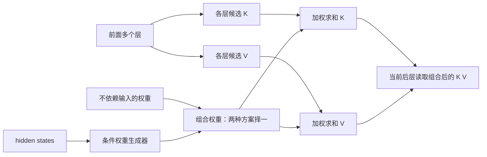
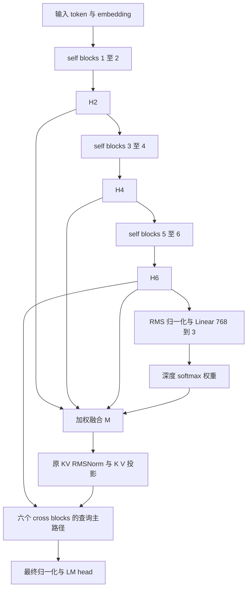
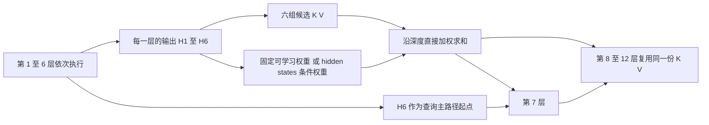

# 动态 YOCO 的理论动机 公式与实验

**2026-11-03 当前状态：**用户明确要求 A（全局可学习六层 K/V 聚合）和 B（conditional 六层 K/V 聚合），两组实现与测试已完成。四卡作业 794750 已提交，完整训练和下游结果待定；原始两卡 baseline 已完成，不再重训。执行入口以 [PLAN_AB_4GPU.md](PLAN_AB_4GPU.md) 为准。下文包含历史动机、旧三来源 v2 结果及阶段性规划，其中“未实现/未启动”描述属于当时记录。

更新日期：2026-11-02。对象：ABC 提出的多层 K/V 加权组合思路，以及当前 160M YOCO-gRet 上的 token 动态记忆融合 v2。

第 1 节是原始思路的规范化总结，区分原话、形式化解释与未定设计；第 2–7 节保留已有方案和实验记录。后续新增的第 8 节依据本地代码核对，规划 160M 待测版本。本轮只读代码并更新设计文档，不修改实现、不启动实验，也不重新核验远端训练状态。

## 1 ABC 原始架构与想法的规范化总结

### 1.1 来源与核心主张

直接来源是 本地原始转录（不随代码仓库发布），现有带时间戳的内容覆盖 02:02–04:02，已包含架构、权重生成、梯度动机和实验建议。开头重复句按同一内容处理；02:36 的“等量面”等不明确转写不据以增加技术要求。对话提及某篇 DeepSeek paper 和 attention residual，但没有给出论文题目或具体机制；本节只记录其类比，不确认论文归属或补写论文细节。

**ABC 的核心建议是：把后层复用某一个前层 K/V，扩展为对多个前层 K/V 直接加权求和；先尝试不依赖输入的权重，再尝试由 hidden states 决定的条件权重。希望这种直接混合提供更直接的梯度路径，减少递归构建 memory 时连续门控乘积可能带来的衰减，并用简单实验和 loss 曲线检验。**

| 原话位置 | 明确提出的内容 | 规范化含义 |
| --- | --- | --- |
| 02:02 | 以十层为例，0–5 层用自己的 K/V，6–9 层复用第 5 层 K/V | 从“固定单一来源的跨层 K/V 复用”出发 |
| 02:22 | 第 6 层可以学习之前 0–5 层 K/V 的 mixture | 将记忆来源扩展为多个深度的组合 |
| 02:40–02:50 | 先用 fixed weights 组合之前各层 K/V，并提到 K、V 的 vector | 先研究不依赖输入的组合；K/V 权重是否独立仍需明确 |
| 03:04 | conditional on hidden states 生成权重，将之前 K/V 加权求和作为当前 K/V | 再研究输入相关的组合；类比 attention residual 的加权思路 |
| 03:29–03:39 | 相比每一步用 gate 构建 memory，可能更利于梯度传播 | 梯度路径是动机，收益尚需验证 |
| 03:53–04:02 | 挑几种简单方式先跑，沿用之前的 loss plot 和 formula | 先做简单方案与对照，再比较学习曲线；原文未给出该公式 |

### 1.2 架构：从单层复用到多层 K/V 直接组合

沿用原话的 **0-based** 层号，记来源集合为 \(\mathcal S=\{0,1,2,3,4,5\}\)，后续读取层为 \(r\in\{6,7,8,9\}\)。这是说明思路的十层例子，不是要求当前模型改成十层，也不能直接对应本文后面 **1-based** 的 H2/H4/H6。

令 \(K^{(j)},V^{(j)}\) 表示来源层 \(j\) 的、供后层读取的 K/V 张量。固定复用的示意形式是

\[
\widetilde K^{(r)}=K^{(5)},\qquad
\widetilde V^{(r)}=V^{(5)}.
\]

ABC 提出的扩展可写成

\[
\boxed{
\widetilde K^{(r)}=\sum_{j\in\mathcal S}a^K_{r,j}K^{(j)},\qquad
\widetilde V^{(r)}=\sum_{j\in\mathcal S}a^V_{r,j}V^{(j)}
}.
\]

当前层以组合后的 \(\widetilde K,\widetilde V\) 作为 attention 的记忆输入。这里写成分别作用于 K、V 的权重，是为了保留原话允许的设计空间；令 \(a^K=a^V\) 就得到共享权重的特例。下标 \(r\) 标明使用者，不代表原话已经要求每个后层拥有独立路由器。

这个表达采用“每来源一个标量权重、在对应 token 位置对齐后求和”的最简单解释。来源张量必须有兼容的维度、head 布局和位置语义；投影、归一化与位置编码的放置属于后续实现设计，原话没有规定。若要引入对齐投影，应明确记录为额外设计。



图中的两类权重是对照方案，不要求同时存在。原话没有提出动态跳层、改变前后层分界或新的优化器；“动态”在这里首先指组合权重随输入改变。

### 1.3 固定权重与条件权重：哪些已明确，哪些仍需选择

**不依赖输入的组合。** “fixed weights”至少明确排除了随当前输入改变权重，但结合前文“learn a mixture”，不能只据此判断权重在整个训练中是否固定。因此可区分两种简单候选：

- 人工固定组合，例如等权 \(a_j=1/|\mathcal S|\)，训练中不更新。
- 全局可学习组合，例如 \(a_j=\operatorname{softmax}(b)_j\)，参数 \(b\) 随训练更新，但同一模型状态下不依赖输入。

这一区分是为了消除转写中的歧义，不是说 ABC 明确指定了两种都必须实现。

**条件组合。** 记条件信息为 \(C\)，一种简单的规范化实例是

\[
a^K_{r,j}(C)=
\operatorname{softmax}_{j}\!\left(f^K_r(C)/\tau\right),\qquad
a^V_{r,j}(C)=
\operatorname{softmax}_{j}\!\left(f^V_r(C)/\tau\right).
\]

\(C\) 来自 hidden states 是原话明确的方向；softmax、温度 \(\tau\)、线性层或 MLP 则是可选实现，不是原话要求。若采用 softmax，权重非负且和为一，组合是凸组合；一般加权求和本身没有这个限制。

条件粒度直接影响架构，后续必须选定：

| 待定问题 | 可行解释 | 对实现的影响 |
| --- | --- | --- |
| 条件来自哪里 | 来源 token 的表示、当前读取层的表示，或其他因果 hidden states | 决定是写入时组合还是读取时组合 |
| 条件沿哪个轴变化 | 每个 token、每个序列，或每个读取层 | 决定权重形状、计算频率与缓存复用范围 |
| 后层是否共享组合 | 所有后层共用一份，或每层独立组合 | 决定是否仍只有一份最终共享 K/V |
| K/V 是否共享权重 | 一套权重共同作用，或两套独立权重 | 决定表示能力和路由参数 |
| 来源范围与粒度 | 例子中的全部前层，或作为简化实验取子集；标量、head 或通道权重 | 子集和更细粒度都是需要记录的具体选择 |

尤其不能从“conditional on hidden states”直接推出“必须用最后一个 self 层 H6 产生每 token 三个权重”，也不能反向推出“必须由每个 cross 层独立路由”。原话留出了多种实现方式。

### 1.4 梯度动机：直接求和与连续门控乘积

为说明 ABC 所说的门控衰减，考虑一个**示意递归模型**，其中 \(i\) 表示 memory 构建步骤，而非指定的时间或层轴：

\[
M_i=g_i\odot M_{i-1}+u_i.
\]

暂时将 \(g_i,u_i\) 当作独立输入，旧 memory 沿这条递归边传到后续步骤的直接导数含有

\[
\left.\frac{\partial M_n}{\partial M_j}\right|_{\text{递归边}}
=\prod_{i=j+1}^{n}\operatorname{Diag}(g_i).
\]

若相关门值持续小于 1，这条路径可能衰减。该公式是对担忧的说明，不是从对话恢复出的既有算法，也不表示实际网络的总梯度只有这一条路径。

对直接组合 \(\widetilde K=\sum_j a_j^K K^{(j)}\)，暂时固定权重，则

\[
\left.\frac{\partial\mathcal L}{\partial K^{(j)}}\right|_{\text{直接组合边}}
=a_j^K\frac{\partial\mathcal L}{\partial\widetilde K},
\qquad
\left.\frac{\partial\mathcal L}{\partial V^{(j)}}\right|_{\text{直接组合边}}
=a_j^V\frac{\partial\mathcal L}{\partial\widetilde V}.
\]

每个来源在组合处有一条直接贡献路径，不必先经过上述一串 memory 更新门。这就是梯度动机的结构依据。但来源层之间仍有网络依赖，条件权重也有自身梯度；小权重、饱和路由和表示尺度等仍可能妨碍学习。因此只能说“可能改善梯度传播”，不能写成“已经解决梯度消失”或“必然收敛更快”。本文第 4 节分析的是现有 hidden-state 融合方案，不能直接代替 K/V 组合方案的推导。

### 1.5 缓存与效率：需要验证的约束

原话以节省 K/V 为背景，但没有给出组合后的缓存布局。以下是从公式推导出的工程约束，不是 ABC 已规定的方案：

- 若在来源 token 写入时完成组合，权重以后不随读取查询改变，且所有后层共享组合结果，则后层共享记忆部分可以只长期保存最终的一组 K/V；构建时仍有候选来源的计算与临时存储成本。前层自身 attention 或 retention 所需的缓存另计，不能据此宣称整个模型只保留这一组状态。
- 若每个后层使用独立组合，通常需要不同的组合结果，或保留候选来源以供重算，不能直接宣称与单组共享 K/V 相同的缓存成本。
- 若权重依赖当前读取位置的 query hidden state，则历史 K/V 的有效组合可能随 query 改变；不能将旧位置只组合一次就当作等价缓存，必须另行设计读取和存储方式。

所以“多层混合保留原有缓存收益”应当是待验证的目标。固定候选层全部计算后再加权，也不会自动减少层计算。

### 1.6 先跑哪些简单实验，以及能得出什么结论

ABC 明确建议挑几种简单实现先跑，并沿用之前的 loss 图与公式。对话没有包含公式本身，也没有给出数据、模型规模、训练预算或结果。本文第 2 节的 compute–loss 定义是项目采用的评价框架，不应归因为已从这段原话恢复出的精确公式。

据此可以形成以下**建议实验顺序**，本次仅整理，不提交实验：

| 对照 | 组合方式 | 需要回答的问题 |
| --- | --- | --- |
| 单一来源复用 | 只读取最终来源层 K/V | 提供固定复用基线 |
| 固定等权 | 所选来源 K/V 等权求和 | 多来源本身是否有帮助 |
| 全局可学习权重 | 与输入无关的可学习组合 | 学习配比是否优于等权 |
| 条件权重 | hidden states 决定组合 | 动态条件是否带来额外收益 |

这组顺序是本次规范化后的实验建议；现有代码中的同名模式是否操作相同对象，需要下一步审查。对照需统一来源、K/V 构造和训练条件，并记录新增参数与计算成本。固定等权实验可作为独立基线；全局可学习与条件组合应尽量匹配初始配比，以免把初始化差异当成条件路由收益。

主要证据应包括同 tokens 和同计算预算下的验证 loss、达到相同 loss 所需的训练量与时间，以及实际缓存、训练峰值显存和吞吐。梯度统计用于检查机制，不能替代学习曲线；若要声称优于连续门控构建 memory，还需要明确该门控方案并设置配对对照，单独胜过 YOCO baseline 不能证明这一点。

### 1.7 后续实现核对的标准与本次边界

已有第 3–5 节记录的当前方案是：取 H2/H4/H6，用 H6 产生每 token 的一套权重，先融合 hidden states，再归一化和投影成一份 K/V，所有 cross 层共享。**这一记录与原话中的“组合各层 K/V”存在必须检查的结构区别；本次不据此宣布一致，也不据此直接修改实现。**

例如，同一个线性投影 \(W\) 且使用同一组标量权重时，有

\[
W\!\left(\sum_j a_j h^{(j)}\right)=\sum_j a_jWh^{(j)}.
\]

但若归一化发生在混合前后不同位置，一般有

\[
W\operatorname{Norm}\!\left(\sum_j a_jh^{(j)}\right)
\ne \sum_j a_jW\operatorname{Norm}(h^{(j)}).
\]

使用各层不同投影、K/V 独立权重或不同位置变换时，也不能直接套用第一个等式。因此“都是 mixture”不足以证明两种架构相同。

下一步应按下面的表逐项读代码并记录证据，而不是继续以“缺少架构原话”为由搁置：

| 核对项 | 原话依据与判定标准 |
| --- | --- |
| 融合对象与运算顺序 | 是否直接组合多层 K/V；若采用表示融合，需说明与 K/V 融合的等价条件或差异 |
| 来源层集合 | 原例使用 0–5 全部来源；H2/H4/H6 属于来源子集选择，需说明映射与简化理由 |
| 固定与条件权重 | 明确固定常数、全局可学习和输入相关三种含义，不混用术语 |
| 条件位置与共享范围 | 查明权重依赖的 hidden states、token 轴、后层轴及 K/V 是否共享权重；原话未定项不能直接判为违反要求 |
| 梯度路径 | 是否是来源直接求和、是否保留可学习来源的梯度，是否额外引入递归门控或 detach |
| 缓存与收益证据 | 检查实际存储与读取方式；区分实现正确、结构符合和性能收益三个结论 |

以上是首轮总结的交付边界。后续 160M 代码核对与待测版本规划见第 8 节；新实现与新实验尚未执行。

## 2 从训练目标定义效率

给定 token 序列 \(x_{1:T+1}\)，训练目标仍是标准自回归交叉熵：

\[
\mathcal L_{\mathrm{train}}(\theta)
=-\frac{1}{T}\sum_{t=1}^{T}
\log p_\theta(x_{t+1}\mid x_{1:t}).
\]

这里为简化记号省略 batch 和无效位置掩码。动态版没有改变目标 token、损失函数或监督方式。

令 \(C(s)\) 为完成第 \(s\) 个训练更新时累计使用的计算量，\(L(C)\) 为对应的验证 loss。研究目标是检验共同预算上的

\[
L_{\mathrm{dynamic}}(C)<L_{\mathrm{baseline}}(C),
\]

或者比较达到目标 loss \(\ell\) 所需的计算量：

\[
C^*(\ell)=\inf\{C:L(C)\leq\ell\},\qquad
R(\ell)=\frac{C^*_{\mathrm{baseline}}(\ell)}{C^*_{\mathrm{dynamic}}(\ell)}.
\]

\(R>1\) 才表示达到该质量时节省计算；未达到的目标不外推。实际验证是离散采样，且曲线可能波动，因此应报告首次观测到的达标区间，并核查后续是否稳定。

相同步数或 token 数不必然意味着相同计算量。若动态版每步计算开销增加 \(\rho\)，在每步成本近似恒定的简化条件下，达到相同 loss 时必须满足

\[
\frac{s_{\mathrm{dynamic}}}{s_{\mathrm{baseline}}}
<\frac{1}{1+\rho}
\]

才有计算节省。训练 FLOPs、GPU 时间和峰值显存分别回答计算量、硬件执行成本和容量问题，需要分别报告；不能把 GPU 秒直接写成 FLOPs。

## 3 从 YOCO 的固定记忆构建到动态融合

### 3.1 YOCO baseline 的接口

记第 \(l\) 个 self-decoder block 在位置 \(t\) 的输出为 \(h_t^{(l)}\in\mathbb R^d\)。当前模型有六个 self blocks，表示包含该 block 的 retention、FFN 和 residual 运算。

Baseline 用最终 self 表示构建共享记忆：

\[
m_t=h_t^{(6)},\qquad
k_t=\operatorname{RoPE}_t(W_K\operatorname{RMSNorm}_{KV}(m_t)),\qquad
v_t=W_V\operatorname{RMSNorm}_{KV}(m_t).
\]

此处采用列向量记法。后六层 cross-decoder 共享这组 K/V，但各层仍根据自身当前表示生成 Q。第一个 cross block 的输入是

\[
c_t^{(0)}=h_t^{(6)}.
\]

以单个 attention head 为例，其读取可以概括为

\[
a_t^{(r)}=\sum_{s\leq t}
\frac{\exp(\langle q_t^{(r)},k_s\rangle/\sqrt{d_h})}
{\sum_{u\leq t}\exp(\langle q_t^{(r)},k_u\rangle/\sqrt{d_h})}v_s,
\]

其中 \(q_t^{(r)}\) 由第 \(r\) 个 cross block 的当前输入归一化、投影并应用位置变换得到。多头合并、输出投影、FFN 和 residual 沿用原实现。

### 3.2 动态版本的路由公式

选择 self 深度集合 \(\mathcal S=\{2,4,6\}\)。用最终表示作为路由输入：

\[
u_t=\frac{h_t^{(6)}}{\sqrt{\frac1d\sum_{i=1}^{d}(h_{t,i}^{(6)})^2+\varepsilon}},
\qquad z_t=W_ru_t+b_r,
\]

\[
\alpha_{t,j}=\frac{\exp(z_{t,j}/\tau)}
{\sum_{k\in\mathcal S}\exp(z_{t,k}/\tau)},\qquad j\in\mathcal S.
\]

当前 \(d=768\)、\(W_r\in\mathbb R^{3\times768}\)、\(b_r\in\mathbb R^3\)，温度 \(\tau=1\) 固定。路由输入的 RMS 归一化没有可学习缩放；后续原有的 KV RMSNorm 仍有其原来的可学习参数。

动态记忆为

\[
\boxed{m_t=\alpha_{t,2}h_t^{(2)}+\alpha_{t,4}h_t^{(4)}+\alpha_{t,6}h_t^{(6)}}.
\]

将这个 \(m_t\) 代入原有 K/V 构建公式。查询主路径仍为 \(c_t^{(0)}=h_t^{(6)}\)。因此模型可以为不同 token 写入不同深度配比的记忆，同时保留原有的深层查询表示。

这里的“动态”是**融合权重依赖输入 token 及其因果上下文**。每个 token 只有三个标量权重，同一权重作用于该来源的所有通道，也共同影响 K 和 V。所有 cross 层读取同一份融合后的记忆，没有为每个查询层重新选择深度。

还应区分两个 softmax：路由 softmax 在同一 token 的三个深度之间分配权重；attention softmax 在历史 token 位置之间分配读取权重。

### 3.3 为什么可能有用

第一个假设是多深度信息互补。不同深度的表示可能对局部模式与上下文组合保留不同的信息，直接访问中间表示可能帮助共享记忆表达。这里不预设“浅层一定负责词法、深层一定负责语义”，应通过消融和表示分析验证。

第二个假设是优化路径改变。融合让浅层表示在经过全部后续 self blocks 之前，就能通过共享 K/V 影响 loss。这个结构事实不自动推出更快收敛。

第三个假设是 token 对深度信息的需求不同。如果全局固定的融合权重已能获得全部收益，那么 token 路由并没有展示额外价值。

## 4 梯度路径与表示混合的理论边界

### 4.1 直接梯度项与总梯度

令 \(g_t=\partial\mathcal L/\partial m_t\)，其中已包含所有通过记忆读取到达该位置的 loss 贡献。把路由权重和各来源暂视作独立节点，融合边上的直接梯度为

\[
\left.\frac{\partial\mathcal L}{\partial h_t^{(j)}}\right|_{\text{直接融合边}}
=\alpha_{t,j}g_t.
\]

这解释了新增的浅层梯度路径。但真实网络中的 \(h^{(2)},h^{(4)},h^{(6)}\) 互相依赖：浅层还通过后续 self blocks 影响深层，\(h^{(6)}\) 又影响路由和查询主路径。因此总梯度包含所有这些路径，不能用 \(\alpha_{t,j}g_t\) 代替总梯度。

对于路由器的未除温度 logits，保持来源表示固定，可得

\[
\frac{\partial\mathcal L}{\partial z_{t,j}}
=\frac{\alpha_{t,j}}{\tau}\,g_t^\top(h_t^{(j)}-m_t).
\]

该式说明路由学习取决于来源相对当前混合表示的差异，以及这个差异与 loss 梯度的方向关系。仅观察梯度范数增大，不能证明方向更好或拟合更快。当某分支的权重很小时，它的直接融合梯度与对应 logit 梯度都可能受到抑制。

### 4.2 多深度表示不是独立专家

定义 self block 的整体增量 \(\Delta_t^{(l)}=h_t^{(l)}-h_t^{(l-1)}\)。由于权重之和为一，有恒等式

\[
m_t=h_t^{(6)}
-\alpha_{t,2}\sum_{l=3}^{6}\Delta_t^{(l)}
-\alpha_{t,4}\sum_{l=5}^{6}\Delta_t^{(l)}.
\]

这给出另一种解释：当前融合也可以理解为按 token 调整深层变换对记忆的贡献。三个来源来自同一条 residual 链，可能高度相关，不能默认把它们看成三个独立专家。即使使用较浅层比例，所有深层增量仍已实际计算，因而该式不意味着跳层省算力。

### 4.3 尺度与融合能力

Softmax 使 \(m_t\) 位于三个来源的凸包内。当前没有来源投影 \(P_j\)，也没有分别归一化每个来源，因此不同层的范数会影响实际混合贡献。下游 KV RMSNorm 可以调节混合后的整体尺度，却不能恢复混合时被压低的信息或消除所有方向差异。

分析时应同时看 \(\alpha_{t,j}\)、\(\|h_t^{(j)}\|\)、\(\|\alpha_{t,j}h_t^{(j)}\|\) 和来源间相似度。若后续加入单独归一化、投影或通道级路由，它们都属于新的机制，应独立比较。

## 5 在 YOCO baseline 上的实现



### 5.1 代码调用顺序

| 步骤 | 实现 | 作用 |
| --- | --- | --- |
| 创建模型 | [runtime/model.py](../runtime/model.py) | 读取可选 `memory_fusion` 字段，构造 `MemoryFusionYOCO` |
| 取中间表示 | [SelfDecoder.forward](../runtime/yoco_official/yoco.py) | `return_layers=[2,4,6]` 收集完整 block 输出，并移除块对齐 padding |
| 计算权重与融合 | [DepthMemoryFusion](../runtime/memory_fusion.py) | 归一化 H6、计算 softmax、逐来源累加 |
| 进入后半网络 | [MemoryFusionYOCO.forward](../runtime/memory_fusion.py) | 调用 `cross_decoder(final, memory=memory)` |
| 构建共享记忆 | [CrossDecoder.forward](../runtime/yoco_official/yoco.py) | `memory` 生成 K/V，`final` 保留为查询主路径起点 |
| 恢复训练 | [runtime/train.py](../runtime/train.py) | 将融合配置纳入恢复 fingerprint，防止不同机制混用 |

核心计算可概括为下列伪代码；实际实现没有构造完整的四维来源堆叠张量，以减少额外临时分配：

```python
final, states = self_decoder(x, return_layers=[2, 4, 6])
alpha = softmax(router(rms_normalize(final)) / temperature, dim=-1)
memory = sum(alpha[..., j, None] * states[j] for j in range(3))
hidden = cross_decoder(final, memory=memory)
logits = output_layer(layer_norm(hidden))
```

### 5.2 v2 的初始化

[当前配置](../configs/yoco_160m_fusion_token_v2_2gpu.json)为：

```json
{
  "memory_fusion": {
    "mode": "token",
    "source_layers": [2, 4, 6],
    "temperature": 1.0,
    "initial_weights": [0.05, 0.05, 0.90]
  }
}
```

设初始分布 \(p=(0.05,0.05,0.90)\)，代码令

\[
W_r=0,\qquad b_{r,j}=\tau\log p_j,
\]

于是初始 \(\alpha_t=p\)，对所有 token 相同；学习后才可能形成输入相关的差异。v1 使用均匀初始分布，v2 只改变这个初始化策略，没有增加额外损失或来源归一化。

v2 的初始记忆是 \(0.05h^{(2)}+0.05h^{(4)}+0.90h^{(6)}\)，更偏向 baseline 的最终层，但并不与 baseline 严格等价。新增参数数目为 \(768\times3+3=2307\)。

### 5.3 因果性与缓存

三个来源表示都只依赖 \(x_{\leq t}\)，路由只读取同位置的 H6，因此融合仍满足因果性。Prefill 为各前缀位置构建融合记忆；decode 只计算新位置的 H2/H4/H6，生成并追加其 K/V。已有历史位置的融合结果已经保存在 K/V 中，无需重新路由。

长期缓存仍是一组全局 K/V 加各 self 层的 retention state。训练则需要保存或重算选中的中间激活，并承担融合反向开销。缓存份数保持不变，不代表训练显存和每步耗时不变。

归一化和 softmax 使用 FP32 运算，router linear 遵循现有混合精度，融合权重转换回表示 dtype。现有 [正确性测试](../tests/test_memory_fusion.py)覆盖关闭时等价、来源和查询路径、因果与缓存一致性、梯度、初始化以及保存恢复；这些检查支持实现正确性，不能代替收益实验。此前文档记录：2026-11-02 使用 `CUDA_VISIBLE_DEVICES='' OMP_NUM_THREADS=2 .venv/bin/python tests/test_memory_fusion.py` 检查，9 项 CPU 测试全部通过。本次总结未重跑这些测试；该历史结果验证代码行为，不代表已经完成与第 1 节 ABC 思路的符合性审查。

## 6 已完成的配对实验

### 6.1 训练条件

| 项目 | baseline 与动态 v2 |
| --- | --- |
| 模型主体 | 12 层 YOCO-gRet，6 self 加 6 cross，宽度 768 |
| 参数量 | baseline 166,708,224；动态 166,710,531 |
| 数据 | 固定 revision 的 FineWeb-Edu sample-10BT，使用同一数据准备结果 |
| 序列长度 | 2,048 |
| 每组资源 | HPC3 单节点 2 张 H100 |
| Batch | 每卡 microbatch 4，梯度累积 16，每步 262,144 tokens |
| 训练预算 | 40,000 步，每组 10,485,760,000 tokens |
| 优化 | AdamW，峰值学习率 0.00015，warmup 375 步，相同 schedule |
| 随机种子 | 42，当前只有一个 seed |
| 验证 | 每 250 步，相同验证配置，共 160 个验证点 |

两组先从头运行配对 1,000 步，再从各自 checkpoint 续训到 40,000 步，保留 optimizer、scaler、RNG 和原 schedule。正式比较采用两卡对两卡；早期四卡 baseline 与两卡 v1 的差距不能直接归因于融合机制。执行细节见 [完整训练说明](FULL_2GPU_V2_TRAINING.md)。

### 6.2 验证结果与成本

| 步数 | baseline loss | 动态 v2 loss | 动态减 baseline |
| ---: | ---: | ---: | ---: |
| 1,000 | 5.744995 | 5.747028 | +0.002034 |
| 5,000 | 4.319502 | 4.324021 | +0.004519 |
| 10,000 | 3.797888 | 3.799303 | +0.001415 |
| 20,000 | 3.464346 | 3.456925 | −0.007421 |
| 30,000 | 3.337816 | 3.333967 | −0.003848 |
| 40,000 | 3.288449 | 3.284284 | −0.004165 |

单 seed 的动态版最终验证 loss 略低；前期并未持续领先。训练阶段累计 GPU 秒分别为约 119,932 和 122,229，动态版高约 1.9%。该统计来自 step timers，排除验证、保存、诊断和排队；节点差异也可能影响时间，因此不能直接把这 1.9% 解释为融合的严格计算开销。

当前证据支持“这轮训练的动态版最终 loss 略低”。它还不能证明跨 seed 的稳定提升、同等 FLOPs 下的优势，或梯度路径带来的因果收益。原始 160 点曲线、阈值区间和梯度诊断见 [验收 JSON](evidence/full-v2-convergence-review.json) 与 [验收摘要](evidence/full-v2-convergence-review.md)。

两组 40,000 步权重的八项下游评测已迁往 HPC3 两卡作业，覆盖 ARC Easy、ARC Challenge、BoolQ、HellaSwag、OpenBookQA、PIQA、WinoGrande 和 SciQ。本文暂不填写下游分数，需以完整评测结果为准。

## 7 如何判断动态机制是否值得保留

代码已有四种模式，但本轮完整配对训练仅比较 baseline 与 token v2。其他模式的实现不等于已完成其完整实验。

| 对照 | 记忆来源 | 要区分的贡献 |
| --- | --- | --- |
| `last` | H6 | 原始 YOCO |
| `mean` | H2/H4/H6 固定等权 | 多深度融合本身 |
| `static` | 全局可学习的三个权重 | 可学习配比 |
| `token` | 依赖 H6 的每 token 权重 | 输入相关的动态选择 |

判断 token 路由的价值时，应让 static 与 token 使用一致的初始化先验；现有早期四卡配置的均匀初始化不能直接与 v2 的 5%/5%/90% 混为同一控制条件。相同参数初始化、数据顺序、batch、schedule、验证集和恢复边界都需要核对。

优先分析完整训练后路由的均值、熵、token 间方差、饱和比例以及不同上下文下的变化。若几乎所有 token 都使用相同比例，应检验固定配比是否足够；若大多数权重集中在 H6，应检验浅层分支是否实际改善了结果。权重分布本身不能代替这些消融。

机制解释还需要把“信息融合”与“梯度路径”分开。冻结路由、固定平均权重、诊断时替换路由都可提供线索，但训练后直接替换会改变输入分布；若要作因果主张，应设计匹配的训练对照。不要仅用某个小样本的梯度范数支持更快收敛。

当前最稳妥的研究定位是：**利用 token 相关的多深度表示融合，改进 YOCO 共享记忆的构建方式，并检验其是否改善 compute–loss。** 扩大规模之前，关键证据是简单融合对照、多 seed 稳定性和包含真实新增开销的效率曲线。

## 8 按全部前层融合、后层统一复用收敛的 160M 计划

本节取代上一轮“四个新版本、六组核心比较”的规划。用户指出应先落实全部前层参与的主体架构，再讨论消融。本轮因此收敛为 **两个新版本，加原 baseline，共三组核心比较**；只更新计划，未修改实现或启动训练。

### 8.1 原话支持的主体结构

ABC 的例子是“0–5 层作为来源，第 6 层使用这些来源的 mixture”。映射到当前 160M 的 6 self + 6 cross，本文统一用 **1-based** 层号：

- 前半部分第 1–6 层全部提供候选 K/V。
- 在进入第 7 层之前，沿来源深度计算组合权重，形成一份融合 K/V。
- 第 7 层首先读取这份 K/V，第 8–12 层复用同一份。
- 第 7–12 层仍分别产生自己的 Q，查询主路径从 H6 开始。

不把“0–6”解释成必须有七个来源，也不把 embedding H0 默认加入来源。H2/H4/H6 是旧实现的来源子集选择，ABC 没有提出这一限制；本轮不再以它为新方案默认，也不再把全来源版本推迟到消融阶段。

“融合后所有后层共用”是沿用 YOCO 缓存结构、结合用户本轮理解确定的设计。原话明确举了第一个后层的例子，但没有逐层规定其他后层的路由方式；应将这一共享选择记录为本项目的落地约定。



“第 7 层使用”并不要求先执行完第 7 层再生成 K/V，那会产生依赖循环。这里先用前六层已算出的因果表示生成共享记忆，再执行第 7 层。

### 8.2 两类权重：静态可学习与输入相关

对每个位置 t，统一写成

\[
K_t^*=\sum_{j=1}^{6}\alpha_{t,j}K_{t,j},\qquad
V_t^*=\sum_{j=1}^{6}\alpha_{t,j}V_{t,j}.
\]

**版本 A：全来源静态可学习组合。**

\[
\alpha_{t,j}=\operatorname{softmax}_j(b).
\]

学习六个全局权重，对不同 token 使用相同比例。这里“固定”指不依赖输入，不是训练中冻结参数；这是结合原话的 fixed weights 与 learn a mixture 选定的简单解释。人工固定等权仅用于检查和后续消融，不单独列为主方案。

**版本 B：全来源条件组合。**

\[
\alpha_{t,j}=\operatorname{softmax}_j\bigl(f_\theta(H_{t,1},\ldots,H_{t,6})\bigr).
\]

根据当前 token 的前六层表示，生成六个来源权重，直接求和后供后半部分共享。一个简单的候选实现是

\[
s_{t,j}=q^\top\widehat H_{t,j}/\sqrt d+b_j,\qquad
\alpha_{t,j}=\operatorname{softmax}_j(s_{t,j}),
\]

其中 q 是可学习向量，\(\widehat H\) 是供打分的无参数 RMS 归一化表示。这让每个来源的内容直接参与打分，是对原话中 attention residual 类比的一种具体化，不声称复现某篇论文。权重随 token 及其因果上下文变化，但不随后半部分的读取层重新生成。

A/B 初始来源配比保持一致。作为与已有 v2 接近的起点，可取前五层各 0.02、最后层 0.90，令 \(b_j=\log p_j\)，B 的 \(q=0\)。这不是 ABC 规定的配比，也不是已证实的最优初始化；均匀初始化可在主方案跑通后单独检验。A/B 共用 K/V 权重、候选构造和模型主体，以比较条件信息是否有用。

### 8.3 “残差形式 gating”需要拆开理解

03:04 的“类似 attention residual”后面接的是：为之前的 K/V 学习权重，再求和作为当前 K/V。03:29–03:39 则把“每一步弄一个 gate，再 build memory”作为可能更难传梯度的比较对象。

因此，依据这段原话，**不能把第二个建议认定为连续递归 gating**。更有依据的两类仍是 A 的静态可学习组合与 B 的条件组合，两者都直接加权求和。

还应区分三种不同的“残差/门控”写法：

| 形式 | 例子 | 在本计划中的位置 |
| --- | --- | --- |
| 对多深度来源作条件加权求和 | \(K^*=\sum_j\alpha_jK_j\) | 版本 B；这是原话直接支持的操作 |
| 将最终来源写成基准，加其他来源的修正 | \(K^*=K_6+\sum_{j=1}^{5}\alpha_j(K_j-K_6)\) | 权重和为 1 时与直接组合严格相等，只是重写，不另算新架构 |
| 每个深度步骤递归更新记忆 | \(M_j=(1-g_j)M_{j-1}+g_jU_j\) | 研究者可另设的门控对照，不列入 ABC 建议的两种主版本 |

第二行展示了“残差形式”可以只是同一公式的表达。它不等于给 H6 额外加一个不受约束的新分支，也不能据此把它当成第二种独立算法。

第三行展开后，早期来源的有效权重包含多个后续门因子。这才对应讨论中连续乘积可能影响梯度的动机。直接组合则给每个来源一条直接贡献边，但不保证总梯度不会衰减或训练一定更快。若以后验证这个机制，再另立配对门控实验；首轮不为它增加主版本。

### 8.4 在 YOCO-gRet 上具体融合什么

本地代码已确认：旧动态版混合 H2/H4/H6 后，再经过 KV RMSNorm 和投影。前半部分 gRet 内部使用 3 heads × 256，后半部分 cross 使用 12 heads × 64；其投影和位置处理也不同。因此“前六层 K/V”在当前模型中必须明确含义。

A/B 的计划采用每个完整 self block 输出构造 **面向 cross 的候选 K/V**：

\[
U_{t,j}=N_{KV}(H_{t,j}),\quad
K_{t,j}=R_tW_KU_{t,j},\quad
V_{t,j}=W_VU_{t,j},\qquad j=1,\ldots,6.
\]

复用 baseline 的同一个 KV RMSNorm、K/V 投影及位置变换。这是对当前 YOCO 的适配选择，不冒充直接复用各 gRet 层内部已有的原始 K/V。如果研究目标改为直接复用原始内部 K/V，需要另行设计跨 head/位置语义的对齐。

由于各来源共用线性投影与同位置变换，实际可先计算 \(\bar U_t=\sum_j\alpha_{t,j}N_{KV}(H_{t,j})\)，再各投影一次，数学上等价于候选 K/V 求和。融合后不再加一次 KV RMSNorm。

旧版则是 \(N_{KV}(\sum_j\alpha_{t,j}H_{t,j})\) 后再投影，通常不等价。由此，现在能明确说旧版有两项偏离本轮目标：**仅选三个来源；混合与归一化的顺序不同。** 它仍可保留为历史实验，但不能代表这里的全部前层 K/V 融合方案。

候选在当前 token 写入时完成组合；长期保存一份供 cross 共享的 K/V，加原有 gRet states。无需给每个 cross 层独立保留六组历史 K/V。训练仍会增加来源激活、归一化与路由成本，必须实际测量。

### 8.5 首轮只检查三组

| 组别 | 记忆构造 | 要回答的问题 |
| --- | --- | --- |
| Baseline | H6 生成一份 K/V | 160M 原始参考 |
| A：全六层静态可学习组合 | 六组候选 K/V，全局学习六个配比 | 全来源可学习融合是否优于单一来源 |
| B：全六层条件组合 | 六组候选 K/V，根据 hidden states 生成配比 | 输入相关权重是否进一步优于 A |

旧 v2 作为历史参考，不要求为它新增运行；固定等权、独立 K/V 权重、每读取层路由、连续门控和普通附加残差都不扩展为首轮主版本。A/B 相比旧 v2 同时改变了来源集合和融合位置，直接性能差异不能归因于其中某一项；后续需要解释旧新差异时再做单因素消融。

检查依次完成：

1. **架构正确性。** H1–H6 全部进入候选；共享记忆在第 7 层之前构建一次；第 7–12 层读取同一份 K/V，查询主路径不被融合替换。
2. **公式与梯度。** 显式六来源 K/V 求和与合并投影实现的前向、反向在 dtype 容差内一致；最后层 one-hot 退化到 baseline；来源及路由梯度连通且有限。
3. **条件与缓存。** A 不依赖输入；B 在非零路由参数下能随输入变化；未来 token 不影响过去；整段、分块 prefill、decode 一致；只有一份 cross K/V 缓存。
4. **训练比较。** A/B 使用相同主体初始化、候选构造、初始配比和数据顺序；检查混合精度、两卡累计梯度及 checkpoint 恢复，再比较 loss 和实际成本。

沿用 160M 的两卡配对条件：每组 2×H100，序列 2,048，每卡 microbatch 4，累积 16，全局每步 262,144 tokens，原 40,000 步 LR schedule。新架构从共同初始主体参数训练，不在旧版训练中途替换机制。

先用 1,000 步检查稳定性与开销，再将 A/B 续到 5,000 步观察曲线；早期轻微落后不能直接判无效，旧 v2 曾到较晚阶段才领先。完整 40,000 步和额外配对 seed 根据前阶段证据安排。历史 baseline 质量曲线仅在配置、初始化、数据顺序等核对匹配后复用；速度需同环境测量。

当前交付仍为计划：**新增 A/B 两种实现，连同 baseline 共三组；不把“残差”与“gating”混称为第三个已确定的架构。**
