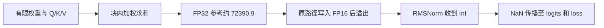

# gated retention 的 NaN / Inf：历史根因、验证与复现边界

诊断日期：2026-11-17；文档归档：2026-11-18。

本报告回答：为什么本仓库 gated retention（gRet）历史训练中较多出现异常，原始 baseline 是否也受影响，哪些是代码缺陷、哪些尚未定位，如何避免，以及为什么不能直接用 DeepSeek-V4.1 的训练表现推断本地实现的稳定性。

**结论：已捕获的两类关键前向故障，由本地 FP16 复现后端在 RMSNorm 之前产生不可表示的中间结果引起；另有一个独立的 AMP 成功计数 bug。830M 原始 baseline 的三份故障现场均能复现，因此问题不限于 A/B 融合模块。这些证据不能证明官方 YOCO baseline 必然发散，也不能解释每一次历史异常。**

本文区分本地故障回放、已发布的历史证据、官方资料和机制推断。文档归档没有修改训练代码、配置、冻结 release 或正在运行的作业。

## 1. 先区分三种现象

| 现象 | 含义 | 应如何处理 |
| --- | --- | --- |
| 前向 loss / logits 出现 NaN 或 Inf | 前向计算已经产生非有限结果；不能当作普通动态 loss scaling 事件 | 捕获权重、输入和首个异常算子，停止污染后续状态 |
| 前向有限，但缩放后的梯度溢出 | AMP 可能遇到的正常拒绝尝试；并不自动意味着模型发散 | 按原策略同步降低 scale、清零成功计数并重试相同更新和数据 |
| loss、梯度始终有限，但验证持续退化 | 可能存在优化或数值稳定性问题；正常退出也不能证明健康收敛 | 检查原始曲线、梯度、精度敏感性和训练血统，另做归因 |

例如，已完成的 SWA400M baseline/A/B 分别记录 6/6/8 次正常 AMP 拒绝尝试，但三组非有限前向均为 0；SWA830M baseline 为 5 次 AMP 重试、0 次非有限前向。gRet400M baseline 为 12 次 AMP 重试、0 次非有限前向，同时存在真实的有限梯度尖峰和验证回升。不能把这些记录统一称为“loss Inf”。参见 [SWA400M 完成证据](evidence/swa-400m-final-review-20261114.json)、[gRet400M 完成证据](evidence/gret-400m-final-review-20261111.json)。

## 2. 哪些历史故障已经定位

| 事件 | 已建立的结论 | 尚不能推出的结论 |
| --- | --- | --- |
| 400M A，第 24935 次尝试 | q/k/v、chunk 内项和 FP32 recurrent state 有限，但跨块乘法输出被 autocast 压成 FP16，产生 Inf，之后在 RMSNorm 扩散为 NaN | 不能倒推此前第 14311 次故障也必然由同一算子触发 |
| 830M baseline，第 6438、6494、5926 次尝试 | 400M 修复覆盖了跨块项，块内加权求和仍可在 FP16 输出边界溢出；三份真实现场均已重现 | 不能据此认定所有规模、seed、输入或官方 BF16 训练都会失败 |
| 旧 AMP 退避实现 | 手动 `scaler.update(new_scale=...)` 降低 scale 后没有清零成功计数，违背既定连续成功计数规则 | 不能仅凭该 bug 解释一个没有成功复现的前向 NaN |
| 旧 160M baseline，约第 21354 步后持续退化 | 原始 train/valid 日志确认退化；后期 checkpoint 的梯度对精度和 loss scale 敏感 | 缺少触发前的即时现场，尚未确立第一次尖峰的唯一根因 |
| 400M A，第 14311 次尝试 | 原 run 失败；使用旧冻结代码从 10000 步重放到该步未再次出现前向 NaN | 不能把重放正常当作“没有 bug”，也不能宣称唯一根因已定位 |

历史来源：[400M A 故障核查](evidence/400m-A-failure-review.json)、[400M A 数值修复说明](PLAN_A_400M_8GPU.md)、[160M baseline 数值审计](evidence/baseline-numerical-audit.json)。

### 2.1 400M：跨块项在归一化前溢出

第 24935 次尝试的捕获现场显示，第一个异常在 `self_decoder.layers.0.mixer.subln` 的输入处：

- q/k/v 均有限，块内项最大绝对值为 7452，FP32 recurrent state 最大绝对值约 910.696。
- 跨块矩阵乘法的 FP16 输出有 69 个非有限值。
- 原 FP16 加和后有 94 个非有限值；此时再转换 FP32 已无法找回丢失的有限值。
- 关闭 compile、关闭 FP16 reduced-precision reduction 均不能消除该现场故障；不能仅归因于编译。

修复让跨块乘法和最终加和维持现有 FP32 state 的累积类型，经原 RMSNorm 后再恢复 FP16 激活接口。这里明确改变了局部中间运算类型，不能宣称旧、新所有中间结果逐位相同。修复后该现场的 logits/loss 恢复有限。

来源：[逐算子定位](evidence/400m-A-retention-fix/retention-operation-check.json)、[修复前](evidence/400m-A-retention-fix/before.json)、[修复后](evidence/400m-A-retention-fix/after.json)。这些是历史实验，本次审计复查了记录，没有重新运行该 400M 全程实验。

### 2.2 830M：跨块修复之后，块内项仍未被覆盖

830M 失败对象是未添加 A/B 融合模块的 baseline。旧 run 两次从健康完整 5000 步 checkpoint 回退，分别在 6438、6494、5926 次尝试出现前向异常，达到有界恢复上限后停止。

本次独立重放全部三份快照；又对第 5926 次尝试捕获第一层 retention 的输入，并重建块内和跨块运算：

| 位置 | dtype / 路径 | 最大有限绝对值 | 非有限元素数 |
| --- | --- | ---: | ---: |
| Q | FP32 | 19.9233418 | 0 |
| K | FP32 | 18.6043072 | 0 |
| V | FP16 | 139.25 | 0 |
| 门控加权后的 scores | 该诊断中的 FP32 中间值 | 102.7306213 | 0 |
| 块内加权和 `scores @ V` | 原 autocast FP16 输出 | 65088.0，仅统计尚有限的元素 | **14** |
| 同一加权和，保留原输入舍入边界 | FP32 诊断参考 | **72390.8828125** | **0** |
| 跨块项 | 已修复 FP32 路径 | 48484.71484375 | 0 |

所有模型权重均有限。72390.9 明显超过 FP16 最大有限值 65504；首个溢出发生在块内矩阵乘法的输出边界，随后原 RMSNorm 收到 Inf。scores 行指门控加权后的中间量，不与其他诊断中未加权的 QK 打分最大值混用。

在相同捕获输入上，旧 FP16 路径有 14 个非有限输出；旧代码的 BF16 **局部诊断**和修复后的 FP16 路径均有限。修复后原 RMSNorm 的 FP16 输出最大绝对值为 15.984375：最终激活可以正常表示，并不代表归一化前的和也可以表示。

原始实测：[830M 逐算子定位](evidence/gret-830m-operation-localization-20261117.json)。BF16 比较只用于局部诊断，没有将正式训练改成 BF16，也没有证明完整 BF16 训练的最终效果。

### 2.3 AMP 成功计数 bug 是另一件事

旧训练器手动调用 `scaler.update(new_scale=...)`，只修改 scale，没有重置 `_growth_tracker`。历史记录中一次溢出后仅成功 64 步就再次增长 scale，而原策略要求连续成功 2000 步。

修复通过公开 state API 同步降低 scale，并将成功计数归零；初始 scale、growth/backoff 系数和 growth interval 均不变。本次 CPU 回归再次核对：原生 AMP、修复逻辑和“其他 rank 溢出”的同步退避结果一致，保存/恢复 state 检查通过。参见 [AMP 回归证据](evidence/400m-A-amp-backoff-check.json)和[验证工具](../tools/check_amp_backoff.py)。

这解释了错误的 scale 增长时序，可能增加不必要的梯度拒绝尝试；但前向溢出发生在 loss scaling 之前，不能把二者视为同一个故障，也不能宣称修复 scale 计数就足以解决前向 NaN。

## 3. 为什么 gated retention 更容易暴露这个问题

省略多头和 batch 维度后，retention 的递推可写为：

$$
S_t = \gamma_t S_{t-1} + k_t^{\mathsf T}v_t / \sqrt{d_k},
\qquad o_t = q_t S_t.
$$

其中门控衰减满足 $0 < \gamma_t < 1$，但并没有约束 $S_t$ 或 $o_t$ 必须小于 1，更没有保证它们小于 65504。与 softmax 注意力的归一化权重和相比，这里的有符号历史贡献可以在归一化之前累积到更大的幅度。**数值风险来自这个计算路径与有限表示范围的组合，不意味着公式本身必然产生 NaN。** 公式来源见 [YOCO 论文 §3.1](https://arxiv.org/html/2405.05254v1#S3.SS1)及[官方 retention 内核](https://github.com/microsoft/unilm/blob/master/YOCO/yoco/models/decoder/kernel/gate_recurrent.py)。

“中途才出错”的机制解释是：训练改变 Q/K/V 与 gate 的分布，部分权重和输入组合在后期才越过表示边界。序列、head 维度、gate 和输入幅度都影响中间结果；仅凭模型参数量增大，不能断定唯一触发因素。该解释与捕获现场相容，但不是对每一步演化的完整因果重建。

另一个关键点是：**FP32 参数、FP32 recurrent state 不代表每个中间算子的输出也是 FP32。** autocast 可能让矩阵乘法返回 FP16；即使内部用较宽累加器，最终写回 FP16 仍可能溢出。先写出 Inf 再调用 `.float()` 或 RMSNorm，无法恢复原来的有限结果。[PyTorch AMP 文档](https://docs.pytorch.org/docs/2.7/amp.html)也明确指出 FP16 的有限范围以及 AMP 并非适用于所有模型。

## 4. 已验证的修复、边界与后续预防

830M 的最终修复保留原有限 AMP 路径，仅在块内求和出现不可表示结果时，按原输入舍入边界使用现有 FP32 状态累积类型重算，并替换非有限结果；随后沿用原 RMSNorm 和 FP16 激活接口。没有裁剪或替换输入，没有改 gate、epsilon 或 token 顺序，也没有用 BF16/全 FP32 正式训练掩盖故障。

本次独立验证结果如下；FP32 列为诊断参考，正式配方仍为 FP16 mixed / FP32 parameters：

| 捕获的失败尝试 | 旧代码 | 修复 loss | FP32 参考 loss | 绝对差 | 修复后完整模型梯度 |
| --- | --- | ---: | ---: | ---: | --- |
| 5926 | 非有限前向重现 | 3.414406538 | 3.414433718 | 0.000027180 | 全部有限 |
| 6438 | 非有限前向重现 | 3.330815315 | 3.330643177 | 0.000172138 | 全部有限 |
| 6494 | 非有限前向重现 | 3.102327347 | 3.102136850 | 0.000190496 | 全部有限 |

独立 FP64 逐 token 递推与 chunk 实现的前向、全部输入梯度核验通过。一个正常范围控制批次中，旧/新 loss 均为 3.273478985，梯度相对 L2 差为 0。该结论限定在受检批次；loss 接近不能替代梯度检查，更不能证明所有未来输入或最终指标完全一致。此前三个改变正常路径的修复候选超过原 0.5% 梯度容差，已被拒绝，没有通过放宽容差接受。

证据：[本次独立三快照重放](evidence/gret-830m-independent-replay-20261117.json)、[正式修复证据](evidence/gret-830m-numerical-repair-20261117.json)、[回归测试](../tests/test_gret_830m_repair.py)。完整续训流程见 [830M 修复与恢复说明](GRET_830M_NUMERICAL_REPAIR.md)。

预防此类故障需要：

1. 检查归一化之前的块内和、跨块和、状态更新及 dtype 转换边界；只检查最终 loss 或权重有限性不够。
2. 修复必须同时验证捕获现场、参考前向和反向、正常范围梯度，以及完整 checkpoint 恢复。
3. 记录首个异常算子、rank、microbatch、输入、权重和 scaler；诊断快照不能作为缺少 optimizer/RNG 的续训 checkpoint。
4. 将正常 AMP 重试与非有限前向分别计数；重复前向故障需要诊断，不能靠无限回滚处理。
5. 保持冻结训练配方。若另做 BF16 等新实验，应单独记录并保持比较组一致，不能静默修改已有 FP16 实验。

**降低 loss scale、梯度裁剪、反复回滚都不能修复已经发生的前向溢出。** 已修复的现场通过，也不保证尚未覆盖的 scores、state contribution、其他模块或任意新输入永远安全，仍需完整曲线和有界监控。

### 4.1 恢复一致性另有执行层问题

830M 后续恢复验收还发现两类需要单独记录的问题：默认 SDPA 反向的重复误差，以及 DDP 首次迭代后重建分桶导致的分段恢复归约顺序差异。它们影响续训轨迹和验收，**没有证据将它们认定为上述三个前向 Inf 的根因**。

最终恢复版本显式新增 `deterministic_algorithms=true`、`ddp_find_unused_parameters=true`，并设置 `CUBLAS_WORKSPACE_CONFIG=:4096:8`。这是执行路径变化，不能描述为 execution 完全不变；模型、training/data、FP16 mixed 精度及其他训练配方保持原值。

2026-11-17 的真实八卡 `5000→5002→5004`、连续运行与独立重复检查通过原阈值，受检模型和 loss 差均为 0；任何前向之前的模型、optimizer、scaler 和八卡 RNG 按位恢复通过。这只是该短程验收的结果，不保证跨硬件或任意长度的最终指标逐位相同。参见 [八卡恢复证据](evidence/gret-830m-repaired-resume-check-20261117.json)、[注意力重复性证据](evidence/gret-830m-attention-repeatability-20261117.json)。

完整训练、全量下游和发布验收仍应独立查看对应运行状态及完成证据，本根因报告不替代全流程验收。

## 5. 官方 baseline 和其他复现者是否也会这样

需要区分“原始 baseline 架构”和“官方训练实现、精度、数据配方”。本地 830M baseline 没有 A/B 模块仍能重现故障，证明该实现风险不依赖融合结构；它不证明微软官方完整训练栈存在同一个已确认 bug。

[官方 YOCO README](https://github.com/microsoft/unilm/blob/master/YOCO/README.md)的预训练示例明确使用并推荐 BF16。BF16 与 FP16 都占 16 bit，但指数范围不同；因此不能因为两者都叫半精度，就认为 72390 这样的数在两者中具有相同溢出风险。本地采用的是固定 FineWeb 配方、FP16 mixed / FP32 parameters 和 PyTorch 替代后端，并非官方数据与完整训练栈逐项相同的复刻。

如果其他复现者采用相同的不安全 FP16 输出边界，并遇到类似幅度，机制上同样存在风险。若其使用官方推荐的 BF16 或另一套保持安全累积类型的内核，则不能直接外推这些现场的结果。2026-11-17 的公开检索未建立与本地后端、冻结配方和故障现场相匹配的独立训练失败报告；这只是本次检索范围内的证据限制，不意味着无人遇到过，也不支持宣称社区普遍失败。

## 6. 为什么不能用 DeepSeek-V4.1 的稳定训练否定这些故障

这里的 dsv4.1 按本仓库教程对应的 **DeepSeek-V4.1-Flash** 解释。它借鉴 YOCO 的共享 KV 思路，但不等于采用本地 gated retention 运算和精度路径。

| 对比项 | 本地 YOCO-gRet 复现 | DeepSeek-V4.1-Flash 公开资料 |
| --- | --- | --- |
| 底层注意力/记忆机制 | gated retention 加后续 cross-decoder | CED，配合 SWA / CSA2 |
| 本文定位的风险 | retention 归一化前的 FP16 块内/跨块中间结果 | 未使用本文这个本地 gRet 后端，不能假定有相同故障链 |
| 数值实现证据 | 有实际权重、输入、逐算子及梯度回放 | 技术报告与发布的参考推理代码；不等于完整生产训练日志 |
| 激活与精度处理 | 原冻结配方；修复明确记录局部累积变化 | 报告描述 SwiGLU 限幅；参考推理代码对部分状态、归一化等使用 FP32 |

[技术报告 §2、§4.2](https://arxiv.org/html/2609.19969v1)说明其 CED/SWA/CSA2 架构、不同优化器和训练设置，并报告完成 45T tokens 训练而无不稳定。该表述不等于披露了每一步的 AMP 拒绝计数，也不能证明本地 FP16 后端安全。

[官方 Flash-1017 参考推理代码](https://huggingface.co/deepseek-ai/DeepSeek-V4.1-Flash-1017/blob/main/inference/model.py)可见部分状态、归一化与累加显式采用 FP32。低精度权重或 FP4 KV 存储不意味着所有运算都在同一低精度中累积。推理代码也不足以确定完整训练栈的所有 dtype；不能据此声称 DeepSeek 全部使用某一种训练精度。

合理推断是：不同注意力机制、数值边界处理和训练系统，使其不必经历本文这条故障链；不能把稳定性简单归因于参数更多、训练数据更多或“共享 KV 天然稳定”。也不能把 DeepSeek 的激活限幅等设计直接加入既有 YOCO 实验而宣称没有改变模型或训练设置。

## 7. 证据定位与复核

所有下列 JSON 均为诊断或验收输出，不是可用于续训的模型 checkpoint：

- [830M 逐算子定位](evidence/gret-830m-operation-localization-20261117.json)：有限权重/输入、块内溢出计数、FP32 参考幅度、BF16 局部诊断与修复 FP16 对照。
- [830M 独立现场重放](evidence/gret-830m-independent-replay-20261117.json)：三份快照 SHA、修复 loss、有限梯度、正常控制批次及模型源文件 hash。
- [400M 跨块逐算子定位](evidence/400m-A-retention-fix/retention-operation-check.json)与[修复 manifest](evidence/400m-A-retention-fix/model-repair.json)。
- [AMP 计数回归](evidence/400m-A-amp-backoff-check.json)。
- [160M 历史数值审计](evidence/baseline-numerical-audit.json)：包含归因限制，不能删除这些限制后引用结论。
- [830M 八卡恢复验收](evidence/gret-830m-repaired-resume-check-20261117.json)：后续确定性执行与固定分桶的受检恢复结果。

独立重放使用已有 [验证工具](../tools/check_gret_830m_repair.py)，只做前后向诊断，不执行 optimizer 更新。复核需要本地保留的故障快照和健康 checkpoint；这些多 GB 文件没有随本文上传 GitHub。文档及 JSON 中的 `runs/...` 或 `/root/yoco/...` 路径是本机历史证据位置，不承诺远程读者能够直接下载这些文件。
