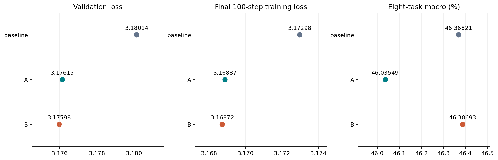

# YOCO-SWA 160M：baseline、方法 A、方法 B

三组已在本机 **8×A100** 分别完成40000步训练及八项完整零样本评测，最后一组B于北京时间 **2026-11-08 08:43** 完成。每组消费10485760000 tokens、保留8份每5000步的完整checkpoint；共24项评测和24份checkpoint均通过核验。此前gRet160M三组及gRet400M A保持原样。

## 最终结果

| 组别 | 实际参数量 | 验证loss ↓ | 困惑度 ↓ | 八项宏平均 (%) ↑ | 相对baseline (百分点) |
| --- | ---: | ---: | ---: | ---: | ---: |
| baseline | 163,155,456 | 3.180143 | 24.0502 | 46.3682 | +0.0000 |
| A / learned_kv | 163,155,462 | 3.176147 | 23.9543 | 46.0355 | -0.3327 |
| B / conditional_kv | 163,156,230 | 3.175976 | 23.9502 | 46.3869 | +0.0187 |

A的验证loss较baseline低约0.003996，但下游宏平均低0.3327个百分点。B的验证loss低约0.004167，下游宏平均仅高0.0187个百分点，基本持平。本次单seed结果不支持宣称A/B带来稳定的整体下游提升。

[完整报告与七张图](../evaluation/swa_160m_ab_20261107/README.md) · [数值汇总](../evaluation/swa_160m_ab_20261107/summary.json) · [120000个原始训练点](../evaluation/swa_160m_ab_20261107/training_curves.csv) · [480个验证点](../evaluation/swa_160m_ab_20261107/validation_curves.csv) · [逐任务CSV](../evaluation/swa_160m_ab_20261107/downstream.csv) · [最终验收与图形hash](evidence/swa-160m-final-review-20261108.json)



八项均使用全部21465条样本/组；BoolQ和WinoGrande使用acc，其余使用acc_norm。宏平均为八个任务得分的算术平均。A/B与baseline逐条核对doc/prompt/target hash一致，任务YAML、数据锁、seed、零样本和无limit设置也一致。

| 任务 | 样本/组 | baseline (%) | A (%) | B (%) | A−baseline (百分点) | B−baseline (百分点) |
| --- | ---: | ---: | ---: | ---: | ---: | ---: |
| arc_easy | 2376 | 46.7172 | 45.9596 | 46.1279 | -0.7576 | -0.5892 |
| arc_challenge | 1172 | 24.3174 | 24.7440 | 25.0853 | +0.4266 | +0.7679 |
| boolq | 3270 | 61.9878 | 57.2171 | 60.2752 | -4.7706 | -1.7125 |
| hellaswag | 10042 | 31.1193 | 31.0197 | 30.7409 | -0.0996 | -0.3784 |
| openbookqa | 500 | 28.8000 | 29.2000 | 30.6000 | +0.4000 | +1.8000 |
| piqa | 1838 | 62.6224 | 61.5887 | 61.3166 | -1.0337 | -1.3058 |
| winogrande | 1267 | 49.8816 | 51.8548 | 52.2494 | +1.9732 | +2.3678 |
| sciq | 1000 | 65.5000 | 66.7000 | 64.7000 | +1.2000 | -0.8000 |

## 两种方案和共同基座

[YOCO论文§4.2](https://arxiv.org/html/2405.05254v2#S4.SS2)的SWA窗口为1024。前六层为因果滑动窗口self-decoder，后六层仍通过共享全局K/V读取整个前缀。

以第1–6层输出构造候选K/V，baseline只取第六层。两种方法均在第7层前融合一次，K/V共用配比；后六层共享融合后的K/V。候选K/V沿用原共享投影和位置处理。

方法A学习六个全局logits，所有样本和token共用：

$$
\alpha_i=\operatorname{softmax}_i(a/T),\qquad
K=\sum_{i=1}^{6}\alpha_iK_i,\quad V=\sum_{i=1}^{6}\alpha_iV_i .
$$

方法B由每个来源的当前token表示决定配比，学习一个共享768维score向量和六个层bias：

$$
e_{i,t}=\frac{v^\top\phi(h_{i,t})}{\sqrt{768}}+b_i,\qquad
\alpha_{i,t}=\operatorname{softmax}_i(e_{\cdot,t}/T).
$$

此处 $\phi(h)=h/\sqrt{\operatorname{mean}(h^2)+10^{-5}}$；按上述逐token权重融合K/V。温度 $T=1$ 始终固定。A的6个logits及B的768+6个控制参数均零初始化，初始六来源等权；随后是模型权重正常学习，没有手动调整训练setting。

三组从新的SWA随机初始化开始，102个公共state tensors按位相同；不加载已训练的gRet权重。只选末来源时A/B与baseline输出精确一致，融合控制参数梯度非零且有限。共同结构为dim768、12层、FFN2304、12个self/attention/KV heads、词表100288及tied embeddings。

保留本仓库160M档宽度后，SWA移除了retention gates，实际为163.16M档。论文跨架构参数匹配会调整FFN；本轮沿用获批宽度，不与此前gRet166.7M宣称等参数。

实现采用现有PyTorch SDPA和显式因果窗口mask，没有安装原生flash-attn。[CPU核验](evidence/swa-160m-preflight.json)覆盖1024窗口边界、未来token扰动为零、末来源退化，以及三组逐token/分块缓存与整段输出对照。默认max_batch_size=0缓存分配问题已在启动前修复；正式训练无缓存公式不变。

三组均通过真实数据八卡0→2→4恢复、连续0→4及独立重复对照。恢复前模型/optimizer/scaler/八卡RNG按位相同，续训数值在原容差内：[baseline](evidence/swa-160m-baseline-resume-check.json)、[A](evidence/swa-160m-A-resume-check.json)、[B](evidence/swa-160m-B-resume-check.json)。

## 冻结训练设置

三组data、training、model、seed和execution完全一致，仅memory_fusion存在已声明结构差异。[复现skill](../.agents/skills/yoco-reproduction/SKILL.md)已注册到本机全局目录；修bug、加速和恢复都不能改动任何训练setting。

- FineWeb-Edu sample-10BT固定revision：`87f09149ef4734204d70ed1d046ddc9ca3f2b8f9`。分词manifest SHA256：`090868c9e65f7042d8126c420803eabcbb7381d552912956e4c802477d53f0ba`。沿用cl100k YOCO wrapper、token顺序和seed42。
- 每组8 ranks × microbatch4 × accumulation4 × sequence2048，每步262144 tokens，共40000步。采用本仓库已批准的FineWeb配方，未宣称获得微软论文原始预训练语料。
- AdamW：LR1.5e-4、warmup375、线性衰减到0、betas0.9/0.98、eps1e-8、weight decay0.05、grad clip1.0。
- **FP16 mixed / FP32 parameters**；AMP初始scale128、growth2、backoff0.5、growth interval2000。动态scale按固定策略演化，不属于手动改训练设置。
- 每250步验证2048条序列；每5000步保存并全部保留模型、optimizer、scaler、八卡RNG。
- fused AdamW开启，activation recomputation关闭，TF32沿用原值，compile和compile_loss关闭。三组执行设置相同。

配置：[baseline](../configs/yoco_160m_swa_baseline_8gpu.json)、[A](../configs/yoco_160m_swa_A_8gpu.json)、[B](../configs/yoco_160m_swa_B_8gpu.json)。

## 收敛和执行成本

每组40000个成功更新、160个定期验证点齐全；三组验证loss均持续下降，最大验证回升为0，未记录非有限前向或checkpoint回退。原始batch loss有正常波动，裁剪前梯度有孤立峰值；图中全部保留，没有用平滑掩盖。后期B在38286步的裁剪前grad norm为1.12636，接受的loss为3.17195，仍沿用原grad clip1.0。

每组均记录5次AMP拒绝尝试：baseline和B各分成4组重试，A分成5组。八卡均同步按原策略退避、growth tracker归零，并在相同更新及未变的数据索引上成功重试。相同数据索引由固定stateless sampler和相同步号推导，未另外捕获token字节。完整八卡scaler时序从受检第4步至40000步均核验通过，未出现旧的提前增长问题。

| 组别 | 成功更新 tokens/s | 成功更新 GPU-hours | rank0峰值已分配显存 (GiB) |
| --- | ---: | ---: | ---: |
| baseline | 467,178 | 49.8776 | 16.7783 |
| A | 442,195 | 52.6955 | 17.1505 |
| B | 431,477 | 54.0045 | 17.2915 |

这些时间只统计成功更新的活动耗时，排除AMP失败尝试、验证、checkpoint I/O、准备和下游评测；不能当成整个作业的GPU占用时长。现有日志没有逐次失败尝试的精确活动耗时。本次无checkpoint回退，丢弃后缀耗时为0。显存取rank0的torch.cuda.max_memory_allocated。

本次A/B成功更新吞吐均低于baseline。图中的6ND及额外K/V投影修正只是计算量代理，不是设备实测FLOPs；6ND主图明确排除重复K/V及attention算子，不能由该图宣称实际计算优势。当前显式窗口mask实现的测量也不能冒称官方窗口内核吞吐。

## 完整证据与保留文件

完成证据：[baseline](evidence/swa-160m-baseline-completed-20261107.json)、[A](evidence/swa-160m-A-completed-20261108.json)、[B](evidence/swa-160m-B-completed-20261108.json)。三组最终模型和optimizer张量均有限，实际optimizer step均40000，完整RNG/scaler和冻结配置均已核验。

| checkpoint步数 | baseline | A | B |
| --- | --- | --- | --- |
| 5000 | [核验](evidence/swa-160m-baseline-5000-checkpoint.json) | [核验](evidence/swa-160m-A-5000-checkpoint.json) | [核验](evidence/swa-160m-B-5000-checkpoint.json) |
| 10000 | [核验](evidence/swa-160m-baseline-10000-checkpoint.json) | [核验](evidence/swa-160m-A-10000-checkpoint.json) | [核验](evidence/swa-160m-B-10000-checkpoint.json) |
| 15000 | [核验](evidence/swa-160m-baseline-15000-checkpoint.json) | [核验](evidence/swa-160m-A-15000-checkpoint.json) | [核验](evidence/swa-160m-B-15000-checkpoint.json) |
| 20000 | [核验](evidence/swa-160m-baseline-20000-checkpoint.json) | [核验](evidence/swa-160m-A-20000-checkpoint.json) | [核验](evidence/swa-160m-B-20000-checkpoint.json) |
| 25000 | [核验](evidence/swa-160m-baseline-25000-checkpoint.json) | [核验](evidence/swa-160m-A-25000-checkpoint.json) | [核验](evidence/swa-160m-B-25000-checkpoint.json) |
| 30000 | [核验](evidence/swa-160m-baseline-30000-checkpoint.json) | [核验](evidence/swa-160m-A-30000-checkpoint.json) | [核验](evidence/swa-160m-B-30000-checkpoint.json) |
| 35000 | [核验](evidence/swa-160m-baseline-35000-checkpoint.json) | [核验](evidence/swa-160m-A-35000-checkpoint.json) | [核验](evidence/swa-160m-B-35000-checkpoint.json) |
| 40000 | [核验](evidence/swa-160m-baseline-40000-checkpoint.json) | [核验](evidence/swa-160m-A-40000-checkpoint.json) | [核验](evidence/swa-160m-B-40000-checkpoint.json) |

| 组别 | 最终checkpoint SHA256 |
| --- | --- |
| baseline | `7e7090838efc84f13b18ff4926d0df090ebb1650eead456c585e9e5d5c7aeb38` |
| A | `10862041ce74354fc5b1d3d9abf436e6d1e24c22f68ed4cc4fc0ea1c5a35b9b0` |
| B | `09e6fe16bdedd26891b2c2964483add9205f005b858553bd9047312bdb51979e` |

[来源hash清单](../evaluation/swa_160m_ab_20261107/source_hashes.json)记录冻结release、配置、实现、初始化、数据manifest、恢复/完成状态、全部checkpoint及元数据、原始日志和各任务结果/来源的hash。所有24份checkpoint文件都重新核对SHA；全量任务样本数和逐样本得分均值、来源协议及配对文档hash均已核验。公开报告仅含数值与hash，训练数据、权重、私有任务文本及原始运行日志留在本地。

## 自动检测、恢复与复用

[监督器](../tools/watch_swa_training.py)每10秒检查八卡日志。非有限前向/验证、worker退出或停滞600秒会触发处理；验证loss连续3次超出历史最佳max(0.15, 5%×best)触发持续退化处理。普通batch波动、单次验证波动和正常AMP重试不触发checkpoint回退。

故障时先保留现场，再按PID/start-time仅清理所属进程树；验证健康完整checkpoint的SHA、fingerprint、模型/optimizer有限性和八卡RNG/scaler后，回退重放相同数据。不跳过batch、不清空optimizer/RNG/scaler，不改LR、精度、batch或任何训练setting。每组最多自动恢复2次，重复故障进入只读诊断并交由持续Goal定位兼容原设置的修复。代码、配置和数据manifest由guard-contract.json锁定，旧release不作原位修改。8项故障检查见[监督器测试](../tests/test_training_guard.py)。

当前cohort `runs/yoco-swa-160m-ab-8gpu-20261107` 已全部完成，root及三组均有PIPELINE_SUCCESS；监督器状态为training_and_evaluation_complete，recoveries为空。**禁止重复启动本cohort或已完成的gRet训练。**

只读检查与重新导出报告：

```bash
cat runs/yoco-swa-160m-ab-8gpu-20261107/pipeline-status.json
cat runs/yoco-swa-160m-ab-8gpu-20261107/guard-state.json
python tools/export_swa_ab.py \
  --run-dir runs/yoco-swa-160m-ab-8gpu-20261107 \
  --output evaluation/swa_160m_ab_20261107
```

导出器拒绝未完成的cohort，重新核对全部保留checkpoint、全量评测及共同配置，再输出120000行训练点、480行验证点、八项得分、七组PNG/PDF/SVG。七张PNG已逐张审查，七份PDF经独立解析并核对单页及文本，七份SVG通过XML解析，验收记录见[最终核验](evidence/swa-160m-final-review-20261108.json)。
