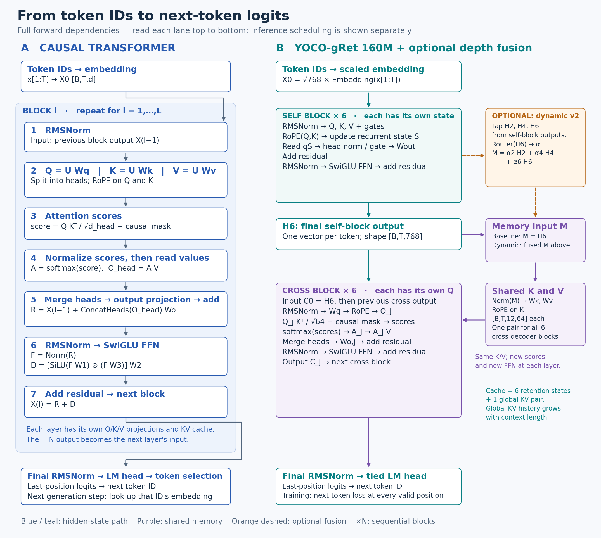
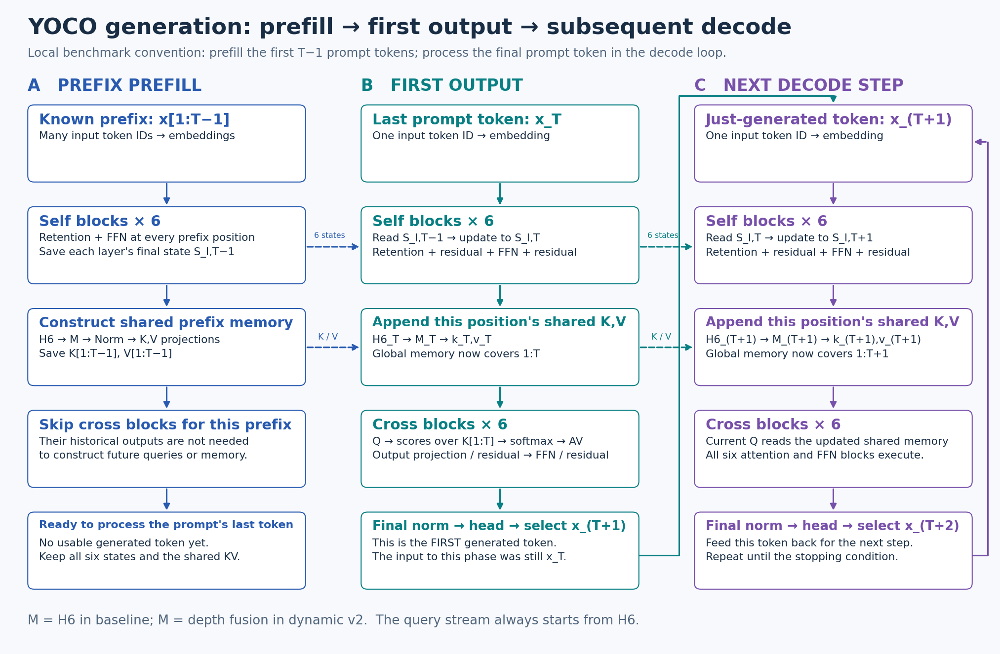

# YOCO 解读：为什么分成两个 decoder，为什么只缓存一次

这篇文章从普通自回归 Transformer 出发，沿着 token 的计算路径解释 YOCO 的设计动机、两个 decoder 的分工，以及 prefill、decode 和 KV cache。最后结合本仓库的 160M YOCO-gRet 说明我们研究的改动。

建议对照 [YOCO 原论文 Figure 2 和 §2](https://arxiv.org/html/2405.05254v1#S2) 阅读。论文提出的是一类 decoder-decoder 架构；本文讲 retention 的具体细节时，以本仓库当前 YOCO-gRet 实现为例，不代表所有 YOCO 变体都必须使用 retention。

## 1. YOCO 想解决什么问题？

语言模型逐个 token 生成文本。假设已经有 `T` 个 token，要预测下一个 token：

```text
x₁, x₂, ..., xₜ  →  模型  →  预测 xₜ₊₁
```

模型需要利用之前的内容。普通 Transformer 通常把各层历史 token 的 K/V 保存起来，也就是 **KV cache**，这样下一次生成时无需重算整个历史。

但随着上下文越来越长，需要保存的 KV 也越来越多；而且普通 Transformer 的**每一层都有自己的历史 KV**。YOCO 的设计问题就是：

> 能否先构造一份历史记忆，让后面的多层共同读取它，减少需要保存的逐层全局 KV？

YOCO 的回答是将模型分成前后两部分：前半产生共享 KV，后半的不同层使用各自的 Q 查询这份 KV。

## 2. 先回顾普通自回归 Transformer

### 2.1 token 怎样通过一层

输入 token ID 首先查 embedding 表，变成隐藏向量。每一层收到上一层的隐藏表示，再依次计算：

```text
上一层输出 X
   ↓
归一化 → 分别投影成 Q、K、V
   ↓
Q 与 K 点积 → 注意力分数 → causal mask → softmax 权重
   ↓
权重对 V 加权求和 → 合并多头 → 输出投影 → 残差相加
   ↓
归一化 → FFN → 残差相加
   ↓
下一层的输入
```

对于当前位置 `t`，因果 mask 只允许它读取 `1 ... t`，防止看到未来 token。经过最后一层后，输出层把隐藏向量变成词表上的 logits，再选出下一个 token。

### 2.2 为什么每层都需要自己的历史 KV？

第 1 层生成第 1 层的 K/V；第 2 层接收第 1 层处理后的表示，用自己的投影生成第 2 层的 K/V；后面每层同理：

```text
输入 → 第 1 层 → 第 2 层 → ... → 第 L 层 → 下一个 token
        │          │                   │
        ↓          ↓                   ↓
      KV₁ 缓存   KV₂ 缓存           KVL 缓存
```

生成新 token 时，该 token 在每层都生成当前的 Q、K、V，并用当前 Q 查询**这一层**的历史 K/V。因为每层的输入和参数不同，这些历史 KV 也不同；通常不能直接把第 1 层 KV 当成第 2 层的 KV。

以 12 层、1000 个历史 token 为例，若每层 KV 维度相同，就有 `12 × 1000` 个逐层、逐位置的 KV 条目。实际字节数还要乘 KV head 数、head 维度、K/V 两份以及每个数的字节数。

## 3. YOCO 的整体结构



[查看可放大的 SVG](assets/background_architecture_overview.svg)。右侧以本地 160M 模型的 6+6 层为例；橙色分支是本项目实验，并非 YOCO 原论文的必选组件。

先看 YOCO 的基本路径：

```text
输入 token → embedding
                 ↓
          self-decoder（前半）
                 ↓
          各位置的因果表示 H
             ┌───┴─────────────┐
             ↓                 ↓
       生成共享 K、V      作为后半的初始输入
             │                 ↓
             ├────→ cross-decoder 第 1 层：自己的 Q 查询共享 K/V
             │                 ↓
             ├────→ cross-decoder 第 2 层：自己的 Q 查询共享 K/V
             │                 ↓
             └────→ ... 后续层继续读取同一份 K/V
                               ↓
                       输出层 → 下一个 token
```

可以把共享 KV 想成一份资料库：后半各层拿着**各自不同的问题 Q**查询同一份资料。Q 不同，注意力分数和读取结果就可以不同。每一层仍会执行自己的 attention 输出投影、残差连接和 FFN。

## 4. 什么是 decoder-decoder？还是 decoder-only 吗？

YOCO 的两个部分都具有**因果性**：

- **Self-decoder**：位置 `t` 的输出只能依赖 `x₁ ... xₜ`，它形成逐位置的因果表示，用于生成全局 KV。
- **Cross-decoder**：位置 `t` 用自己的 Q 查询共享 KV 时，也只能读取 `1 ... t` 的位置。

所以，**decoder-decoder 描述的是内部把两个因果模块串联起来**。不是前半先生成一段文本，再把文本交给后半。

从外部使用方式看，YOCO 依然是自回归语言模型：输入前缀预测下一个 token，加入该 token 后再预测下一个。这与传统翻译式 encoder-decoder 的双向 encoder 也不同：YOCO 的前半不能读取未来 token，否则会泄漏预测目标。

| 问题 | 普通 causal decoder-only Transformer | YOCO |
| --- | --- | --- |
| 怎么生成 | 逐个 token 自回归生成 | 同样逐个 token 自回归生成 |
| 内部组织 | 多层 self-attention blocks | self-decoder 接 cross-decoder |
| 全局历史 K/V | 通常每层各有一份 | 前半生成共享 K/V，后半各层共同读取 |
| 查询 Q | 每层各自生成 | 后半各层仍各自生成 |
| 因果约束 | 不能读取未来 token | 两个部分都不能读取未来 token |

## 5. 先看 self-decoder：如何形成共享记忆的来源

Self-decoder 的输入是 embedding；它的输出是一串上下文化后的隐藏向量：

```text
x₁, x₂, ..., xₜ
      ↓ embedding
X⁰₁, X⁰₂, ..., X⁰ₜ
      ↓ 多层 self-decoder
H₁, H₂, ..., Hₜ
```

`Hₜ` 是位置 `t` 的表示，包含该位置及此前的因果信息。**这里仍然是每个 token 一个向量，不是把整个输入压成一个向量。**

YOCO 论文允许不同的高效 self-decoder 设计。本仓库 160M baseline 使用 gated retention：每个 self block 先用 retention 混合历史信息，再经过残差、FFN 和第二个残差。直观地说，retention 为每层维护一个状态：当前 token 更新这个状态，再从中读取信息。

在单个 head 的简化表示中：

```text
当前层输入 → 生成 qₜ、kₜ、vₜ 和门控
Sₜ = 衰减门 × Sₜ₋₁ + outer(kₜ / √d_head, vₜ)
读取结果 rₜ = qₜ Sₜ
```

输出还经过归一化、输出门控和投影。`S` 是本层历史的矩阵状态；每个 self 层都有自己的状态。它不是标准 softmax attention 的一张历史注意力权重表。推理逐 token 更新状态；整段训练或 prefill 则可用分块计算对应的因果结果。具体实现见 [gate_retention.py](../runtime/yoco_official/gate_retention.py)。

## 6. 再看 cross-decoder：Q 来自哪里？K/V 又来自哪里？

Self-decoder 的最终输出 `H` 在分界处经过归一化和投影，生成一组共享 K/V：

```text
H → RMSNorm → W_K → K   （K 施加 RoPE）
H → RMSNorm → W_V → V
```

同时，`H` 也是第一个 cross block 的隐藏输入。对于第 `j` 个 cross block：

```text
上一层隐藏表示 Cⱼ₋₁ → 归一化 → 本层 W_Q → Qⱼ
                                      ↓
                    Qⱼ 与共享 K 点积，得到注意力分数
                                      ↓
                         causal mask → softmax
                                      ↓
                         对共享 V 做加权求和
                                      ↓
                      输出投影 → 残差 → FFN → 残差
                                      ↓
                              本层输出 Cⱼ
```

第一个 cross 层的输入 `C₀=H`；下一层收到上一层经过 FFN 和残差后的输出。不同层有不同的 Q 投影、输出投影和 FFN，但读取的共享 K/V 相同。这里的 cross-attention 是**后半查询同一模型前半产生的记忆**，不是对另一段双向编码文本做查询。

## 7. 为什么 KV cache 更少？

以 12 层的示意模型为例：

```text
普通 Transformer
  12 层：每层保存一份随上下文增长的全局历史 KV

YOCO 6 + 6
  前 6 层：各自保存有界的 retention 状态
  分界处：保存一组随上下文增长的全局历史 KV
  后 6 层：各自生成 Q，共同查询这一组 KV
```

所以 YOCO 的 “Only Cache Once” 指的是**全局 KV 的跨层共享**。前半部分仍需要自己的推理状态；共享全局 KV 也仍然为历史位置保存条目，大小仍会随上下文长度增长。

如果比较普通 Transformer 的 12 份逐层全局 KV 与 YOCO 的 1 份共享全局 KV，条目数看起来少了很多。但**不能直接断言总缓存恰好缩小 12 倍**：两边的 KV head 数和维度可能不同，YOCO 还要计算 retention 状态、精度和实际内存分配。模型本身、配置和上下文长度都会影响实际比例。

同样，共享 KV 不代表只做一次 attention。后半的每层都重新计算 Q、注意力分数、读取结果和 FFN；YOCO 主要减少的是要保存的逐层全局历史 KV。

### 7.1 “once” 究竟是哪个维度上的一次？

论文脚注明确：这里的 once 指**全局 KV cache**。[YOCO §1 脚注](https://arxiv.org/html/2405.05254v1#S1) 它说的是**跨层只有一组全局历史 KV**：一个历史 token 的全局 K/V 在分界处生成并存入这组缓存，后半所有 cross 层复用这组 K/V。

不要把 once 理解为“整个 prompt 压成一个 KV”“模型这一生只写一次缓存”或“每个 token 只做一次 attention”。序列不断增长时，**每个新 token 仍生成并追加自己的 K/V**；不同 cross 层也仍各自执行 attention。若开启 chunked prefill，新增输入块同样会逐块写入这组缓存。前半 self-decoder 的 retention 状态或局部窗口缓存另算。

例如 prompt 是 `[A, B, C]`：

```text
self-decoder → A、B、C 各自的因果表示 → (kA,vA), (kB,vB), (kC,vC)
全局 cache：[(kA,vA), (kB,vB), (kC,vC)]    ← 一组缓存，含三个位置

cross 第 1 层 Q₁ → 查询这组 cache
cross 第 2 层 Q₂ → 查询同一组 cache
... 后续 cross 层同样查询它

生成 D 并将 D 输入模型 → 计算 (kD,vD) → 追加到同一组 cache
```

这里“一组”不等于一个 KV head：本地 160M 配置的每个位置有 12 个 KV heads。也不意味着相比普通 Transformer 输出相同：YOCO 本身是另一种模型架构。

## 8. Prefill 和 decode：首个 token 到底怎么产生？



[查看可放大的 SVG](assets/background_yoco_prefill_decode.svg)。这里采用[本地 benchmark](../benchmarks/benchmark_long_context_inference.py)的划分：先处理 prompt 的前 `T−1` 个 token，再用最后一个 prompt token 产生首个输出。假设 `T≥2` 且缓存最初为空；`T=1` 时直接处理最后一个 token。

### 8.1 前缀 prefill：处理 x₁ ... xₜ₋₁

1. 输入前缀经过 embedding 和全部 self-decoder 层。
2. 保存各 self 层的最终 retention 状态。
3. 将每个前缀位置的最终表示投影为共享 K/V，并保存。
4. 对这些前缀位置跳过 cross-decoder，因为后续只需要它们生成的共享记忆，不需要它们的后半输出。

这个阶段**还没有产生可用的第一个生成 token**。前缀并行或分块处理，但因果依赖仍然成立。

### 8.2 处理 prompt 最后一个 token xₜ

`xₜ` 经过 embedding 和每个 self 层。各层利用并更新前缀的 retention 状态；随后当前位置产生的 K/V 被追加到共享 cache。此时共享 KV 覆盖 `1 ... T`。

接着，`xₜ` 的表示经过**完整的所有 cross 层**。每层用当前 Q 查询共享 KV，再执行 FFN。最后的 logits 选出第一个新 token `xₜ₊₁`。

### 8.3 后续 decode

将刚选出的 `xₜ₊₁` 输入模型：它更新每层 retention 状态，向共享 KV 追加当前的位置，再经过全部 cross 层，得到 logits 并选择 `xₜ₊₂`。继续重复，直到结束。

一个只有三个 token 的例子：

```text
前缀 prefill [x₁, x₂] → 保存各层 retention 状态 + 共享 K₁:₂、V₁:₂
输入 x₃              → 更新状态、追加 k₃/v₃ → 全部 cross 层 → 选择 x₄
输入 x₄              → 更新状态、追加 k₄/v₄ → 全部 cross 层 → 选择 x₅
```

不同系统可能把处理 `xₜ` 的时间归入 prefill 或 decode；阶段计时名称可以不同，但“位置 `t` 的输出用于预测 `t+1`”不变。

### 8.4 为什么早退能加快 prefill？

先看普通 Transformer。未来的新 token 到第 10 层时，需要读取**第 10 层的历史 KV**；这些 KV 来自历史 token 在第 9 层的输出。因此，要给未来的第 10 层准备 KV，历史 token 必须先通过前面九层。第 11、12 层同理。即使只需要 prompt 最后位置的 logits，前面的历史 token 也要逐层计算，才能为深层准备逐层 KV。

YOCO 改变了这一依赖。所有 cross 层未来要读取的全局 KV，**已经由 self-decoder 的输出生成**。因此，前 `T−1` 个 prompt token 只要经过 self-decoder 并写好共享 KV，就不再需要计算这些历史位置的 cross 层输出：后续 cross 层不会把这些输出作为自己的历史 KV 使用。最后的 prompt token 仍需经过全部 cross 层才能产生第一个输出。

```text
普通 Transformer 的历史 token：
  embedding → 第 1 层 → 第 2 层 → ... → 第 L 层的历史 KV

YOCO 的历史前缀 token：
  embedding → self-decoder → 共享 KV → 在进入 cross-decoder 前结束
                                      ↓
        未来当前 token 的各 cross 层查询这份历史 KV
```

这有两个不同的加速来源：

1. **跳过后半计算**：前缀历史位置无需运行各 cross 层的 Q、attention、输出投影和 FFN；最终 prompt 位置与后续生成 token 仍需完整计算。
2. **前半使用高效序列混合**：论文选用 gated retention 或固定窗口 attention，让长前缀处理更高效。以论文给出的 attention 部分复杂度为例，普通 dense attention 的长序列计算随长度近似平方增长，而其 YOCO prefill 设计按所述假设近似线性增长；这不是说所有模块的实际耗时都是这个简单公式。[YOCO §2.3](https://arxiv.org/html/2405.05254v1#S2.SS3)

因此，论文展示的大幅加速**不只是因为省掉一半层**，也依赖前半所选的高效模块和长上下文工作负载。论文在其特定对照和测量条件下报告：512K 上下文从约 180 秒降到不到 6 秒；这是论文实验结果，不是我们当前 160M 两卡实验已经达到的速度。加速幅度取决于模型、长度、硬件、实现及计时口径。[YOCO Figure 8 / §4.4](https://arxiv.org/html/2405.05254v1#S4.SS4)

### 8.5 论文那句“before entering the self-decoder”怎么理解？

你引用的引言确实写了 “before entering the self-decoder”。但同一篇论文的 Figure 2 和 §2.3 表明：输入先经过 self-decoder，产生全局 KV；然后在**进入 cross-decoder 前**提前退出。§4.4 也明确写 cross-decoder。本地 benchmark 对前缀采用 `skip_cross_decoder=True`，与后者一致。[论文 Figure 2 与 §2.3](https://arxiv.org/html/2405.05254v1#S2.SS3) · [本地 benchmark](../benchmarks/benchmark_long_context_inference.py)

因此，引言中的 self-decoder 很可能是笔误；论文没有在该处声明更正。不要按字面理解为跳过 self-decoder，否则连生成共享 KV 所需的前半表示都没有。

## 9. 训练与推理有什么区别？

前述跳过 cross-decoder 的优化针对生成：前缀历史位置不需要各自产生最终 logits，准备好未来要读取的状态即可。

预训练则通常在所有有效位置预测下一个 token：输入 `x₁ ... xₜ`，目标是 `x₂ ... xₜ₊₁`。因此这些训练位置需要通过完整 self-decoder、共享记忆构建、cross-decoder 和输出层，计算 loss 再反向传播。

所以：**推理时 KV 更少或 prefill 更快，并不自动证明训练也更快，或者相同训练计算下 loss 更低。** 这些要分别测量。

## 10. 对照我们正在研究的 160M 模型

当前配置总共 12 层、宽度 768，前 6 层为 gated-retention self-decoder，后 6 层为 cross-decoder；共享 KV 有 12 个 heads，每个 head 64 维。[本地配置](../configs/yoco_160m_baseline_2gpu.json)

Baseline 使用前半最后一层的输出 `H⁶` 生成共享 KV：

```text
H⁶ ──→ 共享 K/V 的输入
 │
 └───→ cross-decoder 的初始隐藏输入
```

我们当前的动态融合实验在**共享 KV 的输入处**加入另一个选择：从 self-decoder 第 2、4、6 层取同一 token 的表示，由路由器产生权重并融合，然后用融合结果生成共享 K/V：

```text
H²、H⁴、H⁶ → 加权融合 M → 生成共享 K/V
             H⁶ ─────────→ cross-decoder 的初始隐藏输入
```

查询主路径依然从 `H⁶` 开始；后半每层仍使用自己的 Q、attention 和 FFN。动态融合依然只有一组全局 KV，增加的是融合路径和路由计算。它检验多个深度的信息能否帮助训练收敛，是否有收益需要看受控实验与计算成本，不能预先假设。[动态融合理论与实现](DYNAMIC_YOCO_THEORY_AND_EXPERIMENTS.md) · [配对训练说明](FULL_2GPU_V2_TRAINING.md)

## 11. 读完后可以用这几个问题自测

1. 普通 Transformer 的第 2 层历史 KV 为什么通常不能直接用第 1 层的 KV？
2. YOCO 的两个 decoder 为什么都必须遵守因果约束？
3. YOCO 后半各层使用同一份 K/V，为什么仍可以有不同的 attention 输出？
4. YOCO 哪些缓存随上下文增长？哪些状态在固定模型配置下大小有界？
5. 前缀 prefill 跳过后半层之后，哪一步产生第一个新 token？
6. 我们的动态融合改的是共享记忆来源，还是后半每层的 Q？

如果能沿图把这六个问题回答清楚，再读 [YOCO 原论文 §2–3](https://arxiv.org/html/2405.05254v1#S2) 和 [DeepSeek V4.1 的 CED 设计](https://arxiv.org/html/2609.19969v1#S2.SS2)，会更容易把公式与实际数据流对上。
