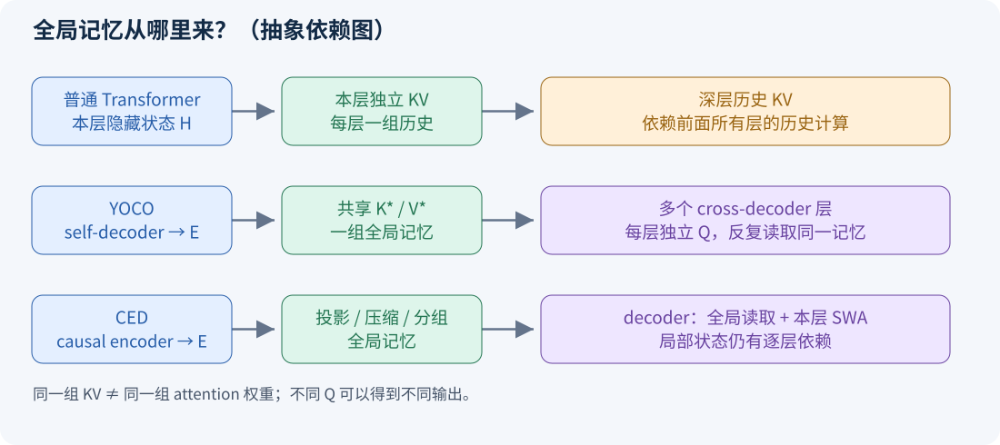
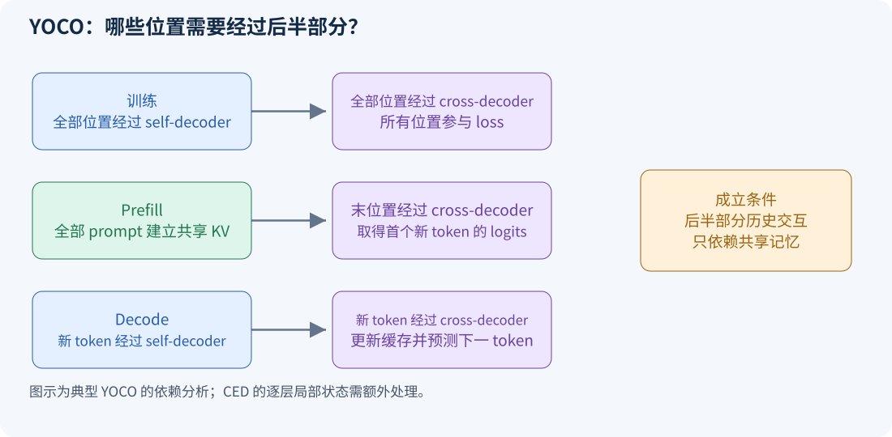
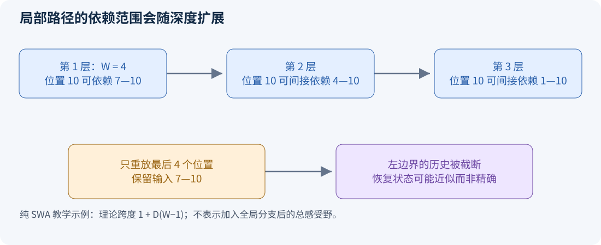

# 从 Transformer 到 YOCO 与 CED：理解记忆、计算依赖和推理缓存

这份教程面向已经听说过 Attention、但还不能从计算图解释 KV cache 的读者。目标是让你能独立画出三种架构，判断哪些计算可以跳过，算出缓存的主要组成，并把理论映射到当前仓库代码。先读第 1—5 节建立直觉，再读第 6—10 节学习实现与实验。

本文的数值小模型和伪代码都是教学构造。正式结构参照 [YOCO 原论文](https://arxiv.org/html/2405.05254v1)、[CED 技术报告 §2.2](https://arxiv.org/html/2609.19969v1#S2.SS2)，代码解释对应本仓库 `25c9492`。V4.1 的其他模块见[另一份教程](DEEPSEEK_V41_TUTORIAL.md)。

## 1 先理解问题：语言模型到底在预测什么

考虑输入「今天 天气 很」。分词后的每个 token 是一个编号，embedding 把编号变成向量。模型在“很”的位置输出一个分布，决定后面更可能是“好”还是“冷”。数学上，位置 t 的输出预测 x[t+1]，只能使用 x[1:t]。

因此“当前位置可以看自己”不构成泄漏：输入中的 x[t] 已经给出，标签是下一个 token。真正的泄漏是输出位置 t 看到了输入 x[t+1]。训练时所有位置并行计算，必须用因果 mask 保证这一点。

训练通常以交叉熵为目标：`loss = -mean_t log p(x[t+1] | x[1:t])`。这解释了两个事实：所有 token 的输出都有训练价值；但推理时读完 prompt，通常只需要最后位置的输出来生成第一个新 token。

### 1.1 Attention 是一次带内容的查询

把一段历史想成带索引的笔记。Q 是当前要问的问题，K 是每条笔记的检索标签，V 是真正要取出的内容。一个简化注意力头计算：

```text
score[t,j] = dot(Q[t], K[j]) / sqrt(d_head)     j ≤ t
weight[t,:] = softmax(score[t,:])
output[t] = sum_j weight[t,j] * V[j]
```

这个比喻的边界是：Q、K、V 都是训练得到的连续向量，K 不是字符串关键词，注意力也不是数据库的精确匹配。不同层可以形成不同的问题和不同的历史表示。

### 1.2 Prefill、decode 和训练不是同一回事

| 阶段 | 输入与并行方式 | 需要哪些输出 | 主要任务 |
| --- | --- | --- | --- |
| 训练 | 整段 token，位置间受因果 mask 约束 | 通常所有位置 logits | 计算 loss 和梯度 |
| Prefill | 一次读入 prompt，可并行处理位置 | 通常最后位置 logits | 建立后续生成所需状态 |
| Decode | 每次追加一个已生成 token | 新位置 logits | 读取历史、更新状态、生成下一 token |

如果把生成结果“好”追加到输入，模型不是从头重算「今天 天气 很 好」的所有中间表示；它通常读取之前保存的 K/V，只计算新 token。这样的持久状态就是 KV cache。

## 2 普通 Transformer 为什么会有很多份 KV

普通 decoder-only Transformer 的每一层都从本层输入生成自己的 Q/K/V。暂时忽略归一化、位置编码、多头变形和残差：

```text
Q_l = H_(l-1) Wq_l
K_l = H_(l-1) Wk_l
V_l = H_(l-1) Wv_l
H_l = Block_l(H_(l-1))
```

深层历史 KV 的来源是深层历史隐藏状态。为了取得第 12 层对 prompt 的 KV，prompt 必须先经过前 11 层。这就是“依赖链”，而不是一个可以靠少保存几份数组就消掉的工程细节。



**读图方法：** 蓝色框是隐藏状态计算，绿色框是全局记忆。普通模型每层都产生一份；YOCO 把同一份交给多个读取层；CED 允许从同一 encoder 输出产生多组投影。图中省略所有 FFN、位置编码和具体注意力头，仅比较全局记忆来源。

### 2.1 手算缓存大小

对于普通 GQA，若每层有 h_kv 个 KV 头、头维度 d_h、每个元素 b bytes，batch 为 B，长度为 T，层数为 L：

```text
M_standard = 2 × B × T × L × h_kv × d_h × b
```

系数 2 来自 K 与 V 两份数组。教学例子取 B=1、T=32768、L=32、h_kv=8、d_h=128、b=2，得到 4,294,967,296 bytes，即 **4 GiB**。这是 KV 的理论有效载荷，不含权重、激活、分配器空洞和工作区。

GQA 减少 h_kv；量化减少 b；滑动窗口减少每层保存的位置数；跨层共享减少独立缓存组数。它们作用在不同维度，不能只看一种优化名称就推断总显存。

## 3 YOCO：先形成记忆，再让不同层反复读取

YOCO 的官方结构是 self-decoder 加 cross-decoder。前半部分形成因果表示，后半部分共享其产生的全局 K/V；前半部分自己仍需要有限大小的推理状态。“Only Cache Once”指全局 KV，而不是整个模型没有其他状态。[YOCO §2](https://arxiv.org/html/2405.05254v1#S2)

### 3.1 第一步：self-decoder 如何读完整个前缀

把前半部分输出记为 E。每个 E[t] 都只能依赖 x[1:t]。self-decoder 需要高效处理序列，但并不要求每层都保存所有历史 token 的完整 K/V。

两种典型选择是 SWA 和 gated retention：

- **SWA：** 每层只关注附近 W 个位置，历史缓存有固定窗口上限。一个 token 的信息仍能通过层间传播影响更远位置，但这种间接传播与一次直接读取任意远处内容不同。
- **Gated retention：** 用递归状态汇总历史，状态尺寸主要由通道和头维度决定，而不是随前缀长度增长。历史被压入状态，不能把它理解成逐 token 完整存档。

教学版 retention 可以写成 `S[t] = gamma[t] S[t-1] + outer(k[t], v[t])`，再计算 `o[t] = q[t] S[t]`。S 是矩阵，gamma 控制遗忘程度。这只是单头、略去缩放和门控细节的解释式。

假设 gamma 恒为 0.9，十步前一次写入的权重衰减到 `0.9^10 ≈ 0.349`。真实模型的门控随输入变化，不是所有信息都用固定 0.9 衰减。这个例子只帮助理解“状态更新”和“显式保存历史数组”的区别。

### 3.2 第二步：将 E 写成全局记忆

教学式为 `K* = Norm(E) Wk`、`V* = Norm(E) Wv`。这些矩阵仍包含所有被保留位置的条目，所以 YOCO 的全局记忆仍随 T 增长；常数大小的是前半部分的某些局部或递归状态。

### 3.3 第三步：cross-decoder 多次提问

后半部分第 l 层使用自己的隐藏状态生成 Q_l，但读取公共 K*、V*：

```text
Q_l[t] = Query_l(H_(l-1)[t])
A_l[t] = Attention(Q_l[t], K*[1:t], V*[1:t])
H_l[t] = TokenwiseFFNAndResidual(H_(l-1)[t], A_l[t])
```

**同一份材料，不同的问题。** 例如第一层可以更关注主语，第二层更关注时间，第三层根据这些结果判断语气。共享 K/V 没有强制 Q 相同，也没有强制 softmax 权重或层输出相同。后半部分仍有层级计算能力。

对应本仓库的直接证据是：`CrossDecoder` 只有一对 `k_proj/v_proj`，其 `forward` 在循环外产生 key/value；各 `CrossAttention` 对象各自持有 `q_proj/out_proj`。[本地源码](../../runtime/yoco_official/yoco.py)、[cross attention 源码](../../runtime/yoco_official/cross_attention.py)。

## 4 为什么 YOCO 可以跳过大部分 cross-decoder prefill

这是学习两阶段架构最值得自己推导的一步。

假设 prompt 有 T 个 token，下一步只需要位置 T 的 logits。位置 T 在 cross-decoder 的第 l 层需要：上一层在位置 T 的隐藏状态，以及 E 形成的历史 K*/V*。它不需要其他历史位置在 cross-decoder 第 l−1 层的输出，因为后半部分没有从这些输出再建立逐层历史 KV 的要求。

由此得到一条精确计算路径：

1. 对全部 prompt 执行 self-decoder，得到 E[1:T] 和前半部分状态。
2. 由全部 E[1:T] 建立一次 K*/V*。
3. 只把 E[T] 送过所有 cross-decoder 层，得到首个新 token 的分布。
4. 生成 x[T+1] 后，让这个新 token 再走完整 self-decoder 与 cross-decoder，并更新缓存。



这一推导假设 cross-decoder 的跨 token 交互只来自共享全局记忆，FFN 和归一化按 token 执行，且位置索引、mask 和缓存内容正确。它说明为什么训练仍需要所有位置：训练要用所有位置的 logits 计算 loss。

**实现细节：** 本仓库 `skip_cross_decoder=True` 会返回一个占位零张量，表示“只建立缓存”。它本身不是“首 token 的有效 logits”。如果使用这种 API，必须另外正确处理末位置查询，并防止末 token 被重复写入缓存。读到一个叫 skip 的参数，不能自动认定整个推理入口已经满足上面的四步。

## 5 CED：全局记忆由 encoder 提供，局部深层状态继续存在

CED 的关键改变是 decoder 的全局 KV 来自 encoder 的最终表示；decoder 的局部 SWA 状态仍从各层自身隐藏状态生成。官方形式还区分 KV 内容投影与压缩权重投影，并允许层相关投影。与 CSA2 配合后，某些层共享这些全局条目。[CED §2.2](https://arxiv.org/html/2609.19969v1#S2.SS2)

为避免与论文里的压缩权重 Z 混淆，本文始终把 encoder 输出叫 **E**。抽象记号如下：

```text
E = CausalEncoder(tokens)
GlobalMemory_g = Compress_g(E; parameters_g)

对 decoder 层 l：
    Q_global_l = Query_l(H_(l-1))
    K_local_l, V_local_l = LocalKV_l(H_(l-1))
    GlobalRead_l = Attend(Q_global_l, GlobalMemory_group(l))
    LocalRead_l = CausalWindowRead(..., K_local_l, V_local_l)
    H_l = DecoderBlock_l(...)
```

这里的 GlobalRead/LocalRead 是解释依赖关系的拆分，不能据此认定官方一定用“两次独立 softmax 后相加”。具体实现可能把选中的全局条目和局部条目放进共同注意力计算。

### 5.1 为什么 encoder 必须 causal

假如训练时 E[t] 已经编码了未来的 x[t+1]，即使 decoder 的注意力只读取 E[1:t]，未来答案仍然通过 E 泄漏。因此前后两部分的因果性都要保证。

传统翻译式 encoder-decoder 可以让 encoder 双向读取已经完整给定的源句；同一序列的 next-token 预训练中，encoder 读到的是待预测序列本身，条件不同。一个“causal encoder”是计算职责命名，不是 BERT 式双向 encoder。

### 5.2 CED 与 YOCO 的实质差别

| 问题 | YOCO 的典型结构 | V4.1 CED 的关键设计 |
| --- | --- | --- |
| 全局记忆从哪里来 | self-decoder 输出 | causal encoder 输出 |
| decoder 是否只有一组全局 KV | 典型为一组跨层共享 | 取决于投影和 CSA2 共享组 |
| 后半部分是否还产生本层局部状态 | 典型 cross-decoder 不需要自己的 SWA 缓存 | 每层保留 SWA 路径 |
| 历史后半层能否完全不执行 | 对首 token 推理可按依赖关系精确跳过大部分位置 | 局部状态还需要准备或恢复 |
| decode 是否只执行半个网络 | 否 | 否 |
| 是否自动实现固定大小总缓存 | 否 | 否 |

CED 增强了 decoder 对近期信息的逐层加工能力，同时让 prefill 的跳过问题更复杂。这是一种架构取舍，不能只用“YOCO 的新名字”来概括。

## 6 SWA replay：为什么最后一个窗口不一定足够精确

先暂时只看局部路径，窗口 W 包含当前位置。第一层位置 t 的最大历史范围是 `[t-W+1, t]`；第二层读取这些位置的第一层表示，因此能间接依赖 `[t-2(W-1), t]`。堆叠 D 层后，理论范围扩展到：

```text
[t-D(W-1), t]     共 1+D(W-1) 个位置
```

这是纯局部依赖的教学推导；加入全局分支后，总感受野不能再用这一个区间概括。它仍足以说明：只截出最后 W 个输入位置重新计算，会切断片段左边界处的局部上下文。



例子取 W=4、D=3。位置 10 的局部依赖可能经三层延伸到位置 1。如果只重放 7—10，重放片段内位置 7 的中间表示已经缺少更早的局部上下文，最终位置 10 也可能受到影响。

因此要区分两个命题：

- “恢复的缓存数值和完整 prefill 一致”，这是数值等价性命题。
- “恢复后任务质量变化很小”，这是实证质量命题。

V4.1 的 bounded replay 接受近似状态，并分别处理 encoder 的局部状态缺失与 decoder 的局部状态准备。[报告 §3.2.2](https://arxiv.org/html/2609.19969v1#S3.SS2.SSS2)。研究实现应先做完整 prefill 基线，再独立评估 replay 引入的差异。

### 6.1 为什么仍可能值得做

假设 encoder 和 decoder 各 D 层，prompt 长 T，replay 长 R。把每个 token-layer 的成本粗略看作相同，完整路径约 `2DT`，缩短 decoder 路径后约 `DT + DR`，计算比为：

```text
ratio ≈ (T+R)/(2T) = 1/2 + R/(2T)
```

取 T=32768、R=128，比例约 0.502，即按这个理想化模型接近一半。当 T=256、R=128，比例变成 0.75。短输入时固定 replay 成本更明显。

这不是端到端加速预测。真实系统还要计算 KV 投影、索引、MoE、通信、量化和 kernel 启动；不同层成本也不相同。

## 7 缓存账本：不能只数全局 K/V

把缓存拆成以下几类再相加：

| 类别 | 随长度怎样变化 | 容易漏掉什么 |
| --- | --- | --- |
| 全局主 KV | 通常随保留条目数增长 | 压缩比例、独立组数、量化尺度 |
| 稀疏 indexer K | 通常随全局条目数增长 | 不是 main KV 的免费附件 |
| 每层 SWA KV | 窗口饱和后有界 | 每层都可能有一份 |
| retention 递归状态 | 固定模型维度下有界 | 状态可能用较高精度 |
| 当前 query 的候选池/Top-K | 通常短期使用 | 与长期缓存生命周期不同 |
| 压缩尾块状态 | 与压缩块大小有关 | 不完整块仍要正确维护 |

对于保持普通双数组布局的共享 KV 教学模型，若 G 个全局组：`M_global ≈ 2BTG h_kv d_h b`。若 L_s 个 SWA 层，每层保留 W 个条目，局部项近似 `2B min(T,W)L_s h_local d_local b_local`。

使用前面的 32 层、32K 长度例子：单组全局 KV 是 128 MiB；16 个局部层、窗口 128、其他头维度相同，局部缓存是 8 MiB，合计约 136 MiB。这是一个**自定义共享 KV + SWA 布局**的算例，既不是本仓库 gRet 的精确内存，也不是 V4.1 的 latent KV 布局。

对压缩 latent cache，应重新按“实际条目数 × 实际存储通道 × 每通道位宽 + 元数据”计算，不能把普通 GQA 的公式直接套上。

## 8 最小伪代码：先做正确，再做跳过

```python
# 教学 CED；每个 block 内部仍需正确处理因果性、位置和残差。
def full_training_forward(tokens):
    E = encoder(tokens, causal=True)
    global_groups = [build_memory(E, p) for p in memory_projections]
    H = E
    for layer in decoder_layers:
        H = layer.full_sequence(
            H, memory=global_groups[layer.group], causal=True
        )
    return lm_head(H)  # 所有位置 logits 用于 next-token loss

# 单步 decode：新 token 经过两部分，不能跳过 encoder。
def decode_one(token, state):
    e = encoder.step(token, state.encoder)
    for group in global_groups:
        group.append_or_update_compressed_block(e)
    h = e
    for layer in decoder_layers:
        h = layer.step(h, global_groups[layer.group], state.local[layer.id])
    return lm_head(h), state
```

重要实现原则：共享的 memory 不是 `detach()` 的代名词。训练中多个读取层对它的梯度应汇总回正确的生成位置。激活重计算时也不能错误复用另一个 microbatch 的共享对象。

本伪代码没有实现完整 CSA2、融合注意力、mHC 或 MoE。它的用途是确定数据依赖和测试边界，而不是直接作为可运行的 DeepSeek 实现。

## 9 对照当前仓库读代码

| 阅读顺序 | 文件或对象 | 带着什么问题读 |
| --- | --- | --- |
| 1 | [runtime/model.py](../../runtime/model.py) | 如何选择 YOCO/Transformer，如何启用重计算 |
| 2 | [YOCOArgs / DecoderLayer](../../runtime/yoco_official/yoco.py) | sliding_window 的有无如何选择 SWA/gRet |
| 3 | 同文件 SelfDecoder | 哪些层生成 E，递归状态如何分层保存 |
| 4 | 同文件 CrossDecoder | K/V 是否在层循环外产生，缓存是否只写一次 |
| 5 | [cross_attention.py](../../runtime/yoco_official/cross_attention.py) | 每层独立 Q 如何读取共享 key/value |
| 6 | [backend.py](../../runtime/yoco_official/backend.py) | 因果 mask、chunk recurrence 和累积精度如何实现 |
| 7 | [train.py](../../runtime/train.py) | 全序列训练、梯度累积和验证采样是否符合实验定义 |

当前 160M 配置没有设置 `sliding_window`，走的是 YOCO-gRet；不是已经实现的 V4.1 CED。模型含 12 层、宽度 768，前后各 6 层，词表 100288，cross 部分 12 个 KV 头、头维度 64。参数量约 166.7M。该配置中的共享全局 K/V 在 batch=1、长度 2048、FP16 下有效载荷约为 6 MiB，另外还要计入 gRet 状态和实际分配策略。[本地配置](../../configs/yoco_160m_4gpu.json)

### 9.1 实现 CED 时先通过哪些真正有意义的检查

1. **因果性：** 改动未来 token，前缀 logits 应保持一致。前半部分、中间投影、压缩和后半部分都要检查。
2. **训练与增量推理一致：** 关闭随机性，用完整序列与逐 token 运行比较对应 logits，容许预先规定的浮点误差。
3. **共享一致性：** 共享引用和显式复制的无优化实现应产生相同数值；修改共享组的映射应有可解释影响。
4. **边界条件：** 长度 1、窗口边界、压缩块边界、最后不完整块、分块 prefill 均要覆盖。
5. **replay 单独评估：** 完整 prefill 为参照，记录最大 logits 差、loss 差和任务差，而不是只检查程序能跑。
6. **资源真实计量：** 汇总所有缓存对象的实际 dtype、shape、存储是否共享，随后报告 GPU 实测峰值。

## 10 自测与答案

**问题一：把每层的 Wk/Wv 设成相同权重，是否就实现了共享 KV？**

答案：不一定。即使 W 相同，输入 H_(l−1) 不同，生成的 KV 仍然不同。参数共享与激活缓存共享是两件事。

**问题二：为什么所有 decoder 层都读取相同 E，却仍需要很多层？**

答案：查询由逐层更新的隐藏状态产生；每层可以基于上一次读取结果提出新问题，FFN 和残差进一步变换表示。

**问题三：只保存一个窗口，是否意味着模型只能利用这个窗口？**

答案：不能这样判断。YOCO/CED 还可能有全局记忆，retention 也可以携带更早信息。要看全部信息路径。

**问题四：缓存量减半是否意味着延迟也减半？**

答案：只有相应内存读写确实是瓶颈时才可能接近。额外压缩、索引、通信或低效 kernel 都会改变结果。

**问题五：为什么静态 CED 必须作为动态 CED 的直接对照？**

答案：否则无法判断收益来自“采用 CED 结构”还是“在 CED 上添加动态机制”。组件、数据、预算、学习率搜索和实现优化程度应尽量对齐。

完成本教程后，请自己画出“当前位置的一条 Q 路径”和“历史位置的一条 KV 路径”。如果能说明这两条路径分别依赖哪些层、什么时候写缓存、哪些状态在未来仍会读取，就真正掌握了两阶段架构的核心。
