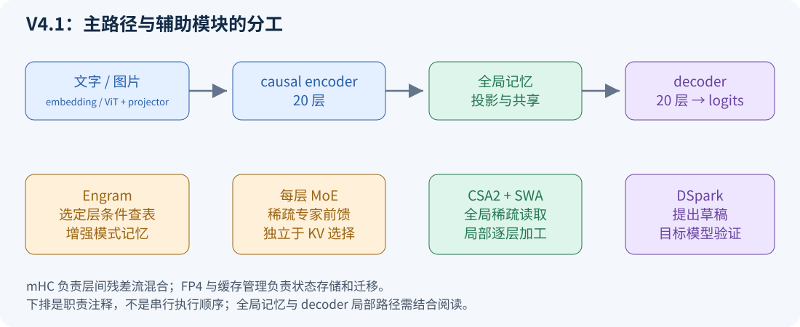
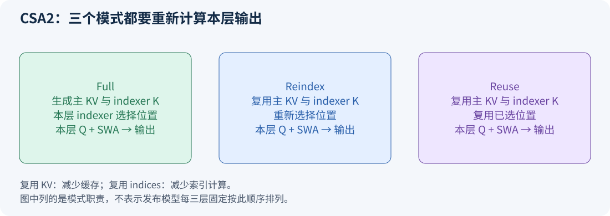
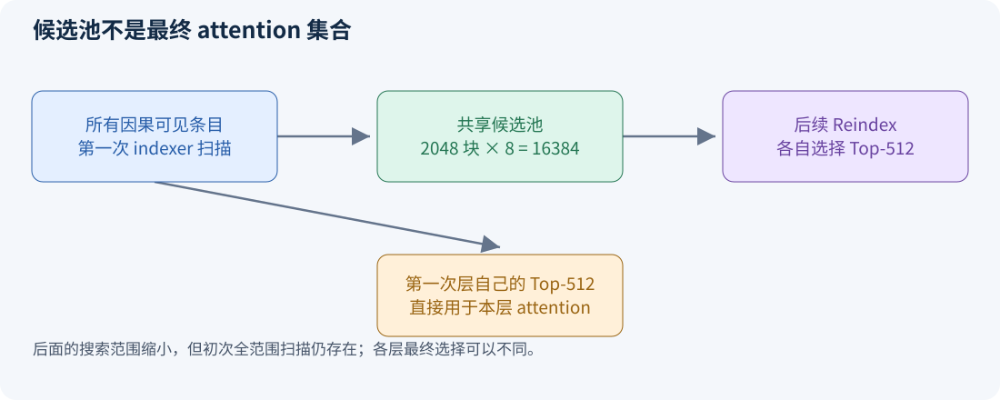
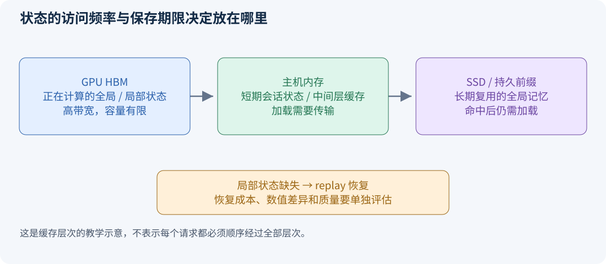

# DeepSeek V4.1 架构图解：从长上下文瓶颈到完整计算流程

学习一个新架构，不应从记缩写开始，而应从四个问题开始：模型把历史信息放在哪里？每次生成需要读取多少？哪些层重复做了相似的工作？减少计算以后，哪些能力和数值条件还必须保留？

本教程以 **DeepSeek-V4.1-Flash 技术报告**解释设计动机，以官方 **Flash-1017 配置和参考推理代码**核对可读出的结构。1017 模型卡将它描述为更新版；本教程不把两个版本的评测成绩混为一谈，也不把参考代码中的小模型默认值当作发布配置。[1017 模型卡](https://huggingface.co/deepseek-ai/DeepSeek-V4.1-Flash-1017)

建议学习顺序：先读第 1—4 节；再读 [CED 与 YOCO 专题](CED_YOCO_TUTORIAL.md)；回来读第 5—12 节。正文中的“教学算例”用于理解数量级，不是官方实测吞吐。所有图均为重新绘制的教学示意。

## 1 从一个真实使用场景理解架构动机

假设你让一个 coding agent 修改大型项目。它不断读源码、查看测试输出、调用工具、继续分析。一次工具返回可能带来几千 token，但这轮真正生成的回答可能只有几十或几百 token。

于是，模型面临三笔不同的账：

1. **读入成本：** 新工具结果需要 prefill；没有命中缓存的旧内容也要重新处理。
2. **在线缓存成本：** 正在服务的请求需要把历史状态放在高速显存中。
3. **长期复用成本：** 暂时不用、稍后还可能命中的前缀，值得放到主存或 SSD，但传输和存储都不是免费的。

用一个自己构造的工作负载：每轮输入 20,000 token、输出 200 token。输入量是输出量的 100 倍。即使生成每个 token 很快，反复重算输入仍可能主导总成本。因此，“让长 prompt 更便宜”本身就是重要的架构目标。

**必要背景：** prefill 是并行处理已知输入，decode 是逐步处理生成 token；KV cache 保存的是历史中间状态，不是模型参数。详细公式与例子见专题第 1—2 节。

## 2 先看整体，再拆模块

官方报告描述的语言主干为 20 层 causal encoder 加 20 层 decoder；552B 是 backbone 参数口径，另有 196B Engram 参数。报告给出的 prefill/decode 激活参数口径分别为 8B/16B。CED、CSA2、FP4 主 KV、局部状态 replay 分别作用于计算依赖、缓存/索引复用、存储精度和状态恢复。[技术报告 §2—3](https://arxiv.org/html/2609.19969v1)



**如何读图：** 实线表示主要数据流；旁边的卡片标出作用位置。mHC 是贯穿层间的信息混合机制，Engram 是选定层的附加记忆，MoE 是每层的前馈模块，DSpark 在生成阶段提供草稿。不能把这些东西都理解成“又一种 attention”。

### 2.1 一个模块只回答一个问题

| 模块 | 它首先回答的问题 | 学习时最应避免的混淆 |
| --- | --- | --- |
| CED | decoder 的全局记忆从哪里来 | 不等于 decoder 不再计算 |
| CSA2 | 哪些层生成 KV、哪些层重新选位置 | 共享索引不等于共享注意力权重 |
| 层级 indexer | 后面的检索还要搜整个历史吗 | 首次全局搜索仍然存在 |
| SWA | 如何保留近期位置的逐层加工 | 局部窗口不代表总感受野只有一个窗口 |
| MoE | 当前 token 使用哪些前馈网络 | 总参数量不等于本次激活量 |
| Engram | 哪些模式可以通过条件查表提供 | 不是互联网检索或外部文档 RAG |
| Single-Pass mHC | 残差流如何混合且减少访存 | 不是减少 Transformer 层数 |
| FP4 KV | 一个缓存条目用多少位保存 | 存储位宽不等于所有算术都用该位宽 |
| DSpark | 一次目标模型验证能产出多少 token | 草稿长度不等于最终接受长度 |

## 3 基础层：Q/K/V、latent KV 与 RoPE

先把注意力分成两个过程：**给历史位置打分**，再**按权重读取内容**。普通多头注意力有多个查询头，每个头可形成不同的关注模式。GQA 用较少 KV 头供多个查询头读取，以降低历史存储。

latent KV 更进一步，把共享的历史内容编码在较紧凑的向量中，再由查询和输出变换完成不同头的计算。这里最重要的不是背某个维度，而是区分：

- 查询头数量决定“提出多少组问题”；
- 历史实际存储的向量布局决定“每个历史位置占多少 bytes”；
- attention 输出的投影决定“如何把读取结果送回隐藏状态”。

这三者不一定是相同维度。因而看到“64 个 attention heads”，不能直接认定缓存中有 64 份完整 K 和 64 份完整 V。

RoPE 则负责把位置信息融入查询/键的部分通道。直观地说，相同内容出现在不同位置时，旋转后的向量会不同；查询和键的点积能够反映相对位置关系。做压缩后，一个条目对应多个原始 token，其位置约定也必须明确，不能随便沿用数组下标。

官方参考代码把局部窗口 KV、压缩 KV、索引器和输出变换拆成不同路径，适合带着上述问题读 `Attention`、`Compressor` 和 `Indexer`。[参考代码](https://huggingface.co/deepseek-ai/DeepSeek-V4.1-Flash-1017/blob/main/inference/model.py)

## 4 CED：解除深层全局 KV 对深层历史计算的依赖

普通 decoder 的深层历史 KV 来自深层历史隐藏状态，因此为了准备深层缓存，整个 prompt 要穿过很多层。CED 将后半部分全局记忆的来源提前到 encoder 输出。

把 encoder 最终表示记成 E，把 decoder 某一组记忆记成 G：`G = BuildMemory(E)`。decoder 当前层的问题仍来自当前隐藏状态，即 `Q_l = Query_l(H_(l−1))`。于是“记忆生成”和“多层查询”被分开。

这种分离为什么有用？对于一个很长的 prompt，多数历史位置在后续只扮演被读取的记忆，不必都产生完整的 decoder 末层输出。但是 decoder 仍保留逐层局部状态，因此还需处理局部状态准备。完整推导、首 token 输出和近似 replay 的边界都在 [CED 专题第 4—6 节](CED_YOCO_TUTORIAL.md)。

### 4.1 “输入 8B、输出 16B”该怎样理解

它表达不同推理阶段的主要激活路径不同，并不表示模型在读输入时永久删除了一半参数，也不意味着训练只更新半个模型。

一个教学成本模型是：若 encoder 的成本为 E，decoder 的成本为 D，长输入长度 T，局部补算长度 R，则输入侧近似 `T×E + R×D`，而新 token 的 decode 仍近似 `E+D`。当 E≈D 且 T 远大于 R，输入平均成本趋近完整路径的一半。这个推导解释设计方向，不能替代真实硬件计时。

## 5 CSA2：把“保存材料”和“选择材料”拆成两个决策

先假设历史有 100,000 个可读取条目。即使每次真正的 attention 只读取 512 个条目，也要先回答“读哪 512 个”。这个筛选过程本身可能昂贵，因此主 KV、indexer K、Top-K 位置必须分清。

- **主 KV：** 最终 attention 要使用的内容表示。
- **Indexer K：** 为快速选择位置准备的检索表示。
- **Top-K indices：** 当前 query 选出的地址列表；不是 K/V 数值，也不是注意力权重。



官方三个模式可以用这张职责表理解：[技术报告 §2.3](https://arxiv.org/html/2609.19969v1#S2.SS3)。

| 模式 | 主 KV / indexer K | 新索引查询与筛选 | 本层主 Q / 局部 SWA | 本层 attention 输出 |
| --- | --- | --- | --- | --- |
| Full | 生成 | 执行 | 生成 | 重新计算 |
| Reindex | 复用 | 执行 | 生成 | 重新计算 |
| Reuse | 复用 | 复用已有位置 | 生成 | 重新计算 |

### 5.1 用图书馆的比喻走一遍

第一层 Full 整理好书架，给每本书建立检索卡，并选出一批相关书。第二层 Reuse 直接使用这批书，但会用自己的问题重新阅读。第三层 Reindex 不重建书架和检索卡，却根据新问题再选一批书。

对应到张量：缓存共享减少物理存储，索引共享减少选址计算，而重新形成 Q、计算 attention 和执行 FFN 保留逐层变换。不能因为名字是 Reuse 就把整个层输出直接复制过去。

### 5.2 压缩比例也有自己的含义

教学例子把 8 个历史 token 分为四组，每两个 token 产生一个条目：`[1,2]→a, [3,4]→b, [5,6]→c, [7,8]→d`。每组可以学习内容权重，不是简单随机删除其中一个 token。

官方参考 `Compressor` 使用内容投影和学习得到的 pooling 权重，保留未完成分组的状态。读取代码时要关注压缩块尾部：刚生成第 7 个 token 时，最后一组还没完成，不能把未来第 8 个 token 当作已经存在。因果可见性必须在压缩和索引两处都成立。[Compressor 源码](https://huggingface.co/deepseek-ai/DeepSeek-V4.1-Flash-1017/blob/main/inference/model.py)

## 6 层级稀疏索引：先缩小搜索范围，再细选

如果每个 Reindex 层都给全部历史条目打分，多个索引器会重复扫描长历史。层级搜索让较早的查询构造较大的候选池，后续查询在这个池内选取自己的最终位置。



以当前官方配置为例，候选池设置是 2048 个块、每块 8 个位置，最多形成 16,384 个候选位置；最终 Top-K 为 512。[配置文件](https://huggingface.co/deepseek-ai/DeepSeek-V4.1-Flash-1017/blob/main/config.json)

这个池不是最终读取集合。后续不同层仍可以从 16,384 个位置里选出不同的 512 个。若总历史有 1,000,000 个可选条目，后续一次打分范围从百万缩到约 1.64 万，候选数量约减少到 1/61；但这只是候选数之比，不等于总计算或延迟加速 61 倍。

第一次全范围扫描仍然存在。还有一个能力代价：如果有用位置根本没进入候选池，后面的索引器不能把它“选回来”。这就是候选池大小需要同时考虑效率和质量的原因。报告指出该机制在训练与推理中采用一致限制。[报告 §2.3.2](https://arxiv.org/html/2609.19969v1#S2.SS3.SSS2)

## 7 MoE：大量参数不等于每个 token 都计算全部专家

标准 FFN 对所有 token 使用同一组参数；MoE 则先计算路由分数，选择少数专家，组合其输出。一个抽象式是：

```text
output(x) = SharedExpert(x) + sum_{i in selected(x)} gate_i(x) × Expert_i(x)
```

专家通常是前馈网络，不是外部工具，也不是各自生成自然语言的独立 agent。路由选择发生在 token 表示上，因此同一句话里不同 token 可能选择不同专家。

1017 配置的主干设置为 384 个 routed experts，每 token 选择 6 个，并有 1 个 shared expert。选 6/384 并不意味着全模型仅使用 1.5625% 的计算：attention、共享专家、路由、归一化和通信还在。[官方配置](https://huggingface.co/deepseek-ai/DeepSeek-V4.1-Flash-1017/blob/main/config.json)

### 7.1 为什么多模态还要考虑负载均衡

假设文字 token 喜欢专家 A，图片 token 喜欢专家 B。总量平均可能看起来均衡，但某种模态的 batch 仍可能集中压到少数设备。用“每个班都平均”与“全校人数平均”的区别，就能理解为什么只看总体负载可能掩盖问题。

V4.1 对文字和图片分别维护路由校正偏置；用于选择专家的校正与用于加权专家输出的原始分数需要区分。[报告 §2.1.1](https://arxiv.org/html/2609.19969v1#S2.SS1.SSS1)。学习重点是：负载均衡服务于训练和设备利用率，不是说每个 token 应该使用完全相同的专家分布。

## 8 Engram：把一部分模式记忆变成条件查表

先理解 embedding：给 token ID 查一个向量。Engram 把查表的“键”扩展到局部 token 模式，例如最近的二元组、三元组、四元组，再通过上下文相关门控决定查到的信息如何参与当前计算。

教学流程如下：

```text
最近若干 token → 构造 n-gram → 多个 hash 地址
             → 查可训练向量表 → 上下文门控 → 注入隐藏状态
```

多头 hash 的直觉类似从多个独立地址取证：一个地址发生碰撞时，其他地址仍可能提供区分信息。它不保证永远没有碰撞，也不等于存储原文全文。

与 MoE 比较：MoE 为 token 选择“计算网络”；Engram 为局部模式选择“记忆条目”。二者都具有条件访问特征，但数据结构、通信方式和成本不同。Engram 的地址可由 token 序列确定，因此有机会提前取数；能否隐藏传输耗时取决于实际带宽与计算重叠。

当前配置把 Engram 放在零起始编号的第 1、14 层，最大 n-gram 阶数为 4，hash 头数为 8。不要把索引 1 写成“从一计数的第一层”。[官方配置](https://huggingface.co/deepseek-ai/DeepSeek-V4.1-Flash-1017/blob/main/config.json)

## 9 Single-Pass mHC：为什么一个残差连接也会成为瓶颈

普通残差写成 `x_next = x + F(x)`。Hyper-connections 可以维护多条残差流，让模块读取它们的某种混合，再把输出写回不同流。直观上，这给信息保留和跨深度组合提供了更丰富的通路。

一个教学抽象是：`X_next = B X + C F(A X)`。X 包含多条流；A 负责读入混合，B 负责残差流间变换，C 负责将模块输出分配回各流。理解这一式子时先不关心张量广播细节，只追踪“读什么、保留什么、写到哪里”。

问题出在依赖顺序：如果 A 必须先由完整 X 的归约统计产生，就很难在第一次读取 X 时立刻完成所有混合。计算量可能不大，重复读取大张量却会花费带宽。

Single-Pass 的关键是调整输入混合系数的使用时机，使当前模块可使用前一模块已产生的系数，给融合 kernel 创造条件。[报告 §2.4.1](https://arxiv.org/html/2609.19969v1#S2.SS4.SSS1)

教学算例：假设某段计算需要反复读一个 100 MB 张量，四次读取就是 400 MB 的读流量。即使 FLOPs 几乎不变，减少一两次读取也可能带来收益。但如果整个请求主要耗在大矩阵乘或跨机通信，这项局部优化对端到端延迟的贡献就会被稀释。

## 10 FP4 KV 与缓存层次：压缩的对象要看清

量化缓存，是把连续数值映射到有限表示，再配上 scale 等元数据。计算 attention 时可以先反量化，因此“以 FP4 保存”不等于“所有 attention 算术都在 FP4 上进行”。也不能从权重配置里的 FP4 experts 推断 KV 的格式：它们是不同对象。

报告中的主 KV 采用 4-bit 数值配分组尺度，局部 SWA 保留较高精度；主 KV 量化还配合了 QAT。[报告 §2.4.4](https://arxiv.org/html/2609.19969v1#S2.SS4.SSS4)

### 10.1 为什么 4-bit 不能直接按 0.5 bytes 算到底

教学例子：16 个数，各 4 bits，共 8 bytes；再保存一个 1-byte scale，总计 9 bytes，平均每个数 0.5625 bytes。这还没计入对齐和其他元数据。

若向量有 512 个通道，按上述布局是 `512/16 × 9 = 288 bytes`。这只是单个教学条目的存储公式，不是模型每 token 总缓存，因为总账还要乘以各组条目数量，并加入 indexer、SWA 等。

### 10.2 在线缓存、短期状态和长期前缀并不相同



HBM 用于当前计算，主存可以容纳暂时不用的状态，SSD 可以保存更大规模的长期前缀。层次越深，通常容量越大、访问越慢。缓存命中是否划算，取决于加载成本能否低于重新计算。

全局 KV 与局部 SWA 的生命周期可能不同。局部状态常服务于活跃会话附近的续写；全局前缀可能在更久以后仍被复用。将它们拆开管理，就能分别选择保存期限和缺失恢复办法。

报告中的 bounded replay 用有限片段近似恢复局部状态。它减少长期保存 SWA 的需求，但缓存恢复路径需要独立评估数值和质量；不能与“精确复制原缓存”画等号。详见 [CED 专题第 6 节](CED_YOCO_TUTORIAL.md)。

## 11 原生视觉：图片如何进入同一条语言计算流

图片先被切成 patch，视觉 encoder 将 patch 变成空间特征；随后进行空间到通道的重排，再由 projector 映射到语言模型的隐藏维度，插入相应图像 token 位置。

为什么要做 pixel-unshuffle？假设特征网格是 12×12，共 144 个位置，通道数为 C。3×3 重排可以变成 4×4 个位置，每个位置有 9C 通道。重排本身把相邻信息移到通道轴上；后续投影决定怎样压缩和融合。语言侧处理的位置数变为原来的 1/9，但不能据此说整套视觉处理成本也变为 1/9。

本发布配置包含 32 层视觉 encoder、patch size 14、downsample ratio 3。语言模型接收视觉表示，而不是把图片“先自动转换成一段 caption”再读取。[官方配置](https://huggingface.co/deepseek-ai/DeepSeek-V4.1-Flash-1017/blob/main/config.json)、[参考 vision 接口](https://huggingface.co/deepseek-ai/DeepSeek-V4.1-Flash-1017/blob/main/inference/model.py)

## 12 DSpark：草稿、验证与接受是三个不同动作

普通自回归生成每次目标模型前向主要推进一个位置。推测式生成先用便宜的 drafter 提出几个候选 token，再由目标模型检查，希望一次昂贵调用接受多个 token。

```text
当前前缀 → drafter 提出 [a,b,c,d,e]
                    → 目标模型验证 → 接受有效前缀 → 继续生成
```

草稿可以并行提出多个位置，但候选之间仍需要建模依赖。DSpark 配置包含 3 个草稿层和长度 5 的草稿块；置信度模块参与验证长度的选择。[官方配置](https://huggingface.co/deepseek-ai/DeepSeek-V4.1-Flash-1017/blob/main/config.json)、[报告 §2.4.3](https://arxiv.org/html/2609.19969v1#S2.SS4.SSS3)

一个简单期望值例子：假设每个位置在之前全部接受的条件下，接受概率都是 p，则接受草稿前缀长度 A 的期望为 `E[A] = p + p² + ... + p^k`。p=0.8、k=5 时约为 2.689，不是 5。这里没有计入验证额外产出的 token，也忽略真实概率随位置变化，只用于解释为什么草稿越长不一定越快。

是否值得验证更长草稿，还要比较 drafter 成本、目标模型验证成本、当前 batch 和设备负载。置信度调度就是试图在这些条件下选择合适长度。

分布是否严格保持，还取决于完整接受/拒绝与采样校正算法。不能只看到 confidence head 就宣称与普通采样完全等价。官方最小推理代码也不等于完整生产级推测生成引擎。

## 13 训练方法与系统实现：为什么好结构还需要配套

### 13.1 优化器不能按“全模型用一个名字”理解

矩阵权重、归一化参数、巨大查找表的梯度结构不同。矩阵优化器关注更新方向和尺度；embedding 的某些行可能非常稀疏；不同 attention head 也可能有不同统计特征。

V4.1 的报告分别讨论 Muon、head-wise 更新、AdamW 和用于表状参数的 Sinkhorn-balanced 更新。学习时应先问“对哪类参数应用”，再问“怎样更新”。不要把用于残差混合约束的 Sinkhorn 和用于优化器更新的行列平衡当作完全相同的模块。[报告 §2.5](https://arxiv.org/html/2609.19969v1#S2.SS5)

### 13.2 跨层共享为什么会给训练系统增加工作

假设生成 KV 的层在 pipeline stage A，读取层在 stage B。共享意味着 B 需要 A 产生的张量，反向时还要把梯度正确传回去。多个 microbatch 同时在流水线上时，状态必须归属于正确 microbatch；激活重计算也必须恢复同一份逻辑状态。

因此“只保存一次”不自动意味着“通信也只发生一次”或“训练激活变得很小”。共享缓存的推理收益，与训练时的梯度和生命周期管理，是两本不同的账。

### 13.3 架构、训练数据与后训练共同决定质量

一个更高的 benchmark 分数可能同时受预训练数据、训练预算、SFT/RL、推理采样、工具环境影响。要验证某个结构是否有效，最有力的是控制变量实验，而不是把两个不同发布模型的最终分数相减。

对当前研究而言，优先固定数据、tokenizer、预算和基础组件，比较普通 Transformer、YOCO、静态 CED，再比较动态 CED。160M pilot 的价值是验证训练与评测链路；它不能直接证明完整 V4.1 的效果已经复现。

## 14 对着发布配置读一遍实际层分工

以下是已下载的 1017 配置中**零起始层号**，便于读源码；正文图中的 encoder/decoder 总体分工来自技术报告。配置的主干为 40 层，额外草稿层不计入这 40 层。

| 层号或字段 | 当前配置值 | 学习含义 |
| --- | --- | --- |
| 0—1 | compression ratio 0 | 仅局部窗口路径 |
| 2—19 | ratio 2 | 主干前半部分的全局条目按组压缩 |
| 20—39 | ratio 1 | 后半部分相应全局条目不做序列二合一压缩 |
| KV source | 2、8、14、20 | 不要为每层重复分配独立全局缓存 |
| Index source | 2、8、14、20、24、28、32、36 | 索引产生层与 KV 产生层不是同一集合 |
| SWA window | 128 | 每层局部范围的配置值 |
| Hidden / heads / latent head dim | 5120 / 64 / 512 | 不要用普通 MHA 的 head 数公式直接估缓存 |
| Context limit | 1,048,576 | 配置的支持范围，非任意任务质量保证 |

[官方配置来源](https://huggingface.co/deepseek-ai/DeepSeek-V4.1-Flash-1017/blob/main/config.json)。本地留存副本和 SHA256 记录位于 `sources/`，不把未来 main 分支变化静默混入这份笔记。

**一个细节：** CED 原理允许从 encoder 输出产生层相关投影，不意味着发布配置一定存在很多 decoder 全局组。本配置 decoder 部分列出的 KV source 是 20，后面的部分层重新索引，其余层复用。应先讲清一般依赖关系，再读具体组数。

## 15 学完后应能回答的六个问题

**为什么不能说 V4.1 的所有优化都是压缩 KV？** CED 主要改变计算依赖，索引复用减少筛选工作，mHC 融合减少访存，DSpark 增加每次验证的有效输出；只有部分机制直接减少缓存字节。

**为什么 Reuse 层仍然有计算能力？** 它仍形成自己的查询，重新计算 attention 输出，并执行自己的前馈与残差变换。

**为什么 512 个最终位置不意味着只需打分 512 个位置？** 选择它们需要候选搜索，首次 indexer 可能仍扫描全部可见历史。

**为什么激活参数量小不能保证低延迟？** 大量权重的放置、专家负载、通信、缓存带宽和实现融合都可能成为瓶颈。

**为什么不能从“缓存压缩 4 倍”推出吞吐提升 4 倍？** 只有缓存容量或读带宽是主要约束时，收益才可能接近；其他成本不会自动消失。

**为什么 CED 教程要先讲 YOCO？** 先理解共享全局记忆如何解除依赖，再理解增加逐层局部状态为什么又引入 replay，才能把架构收益与代价同时看清。

下一步可动手完成三个练习：手算一个自定义模型的完整缓存账本；画出 Full→Reuse→Reindex 的共享对象生命周期；用小模型比较完整 prefill 与有限 replay 的 logits 差异。先回答“计算是否正确”，再回答“是否更快”，最后回答“是否在同等预算下更好”。
