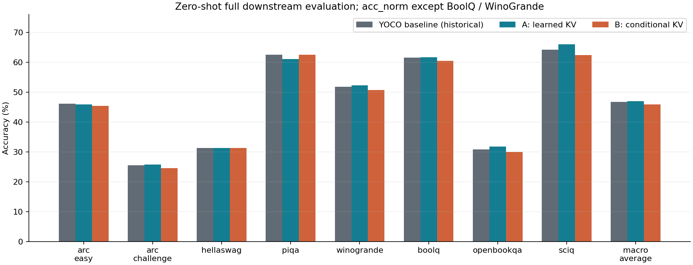
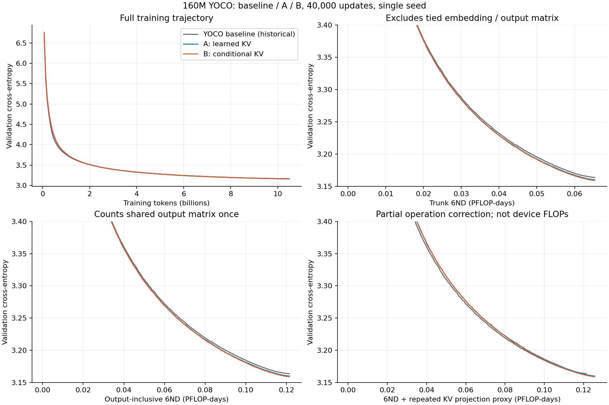
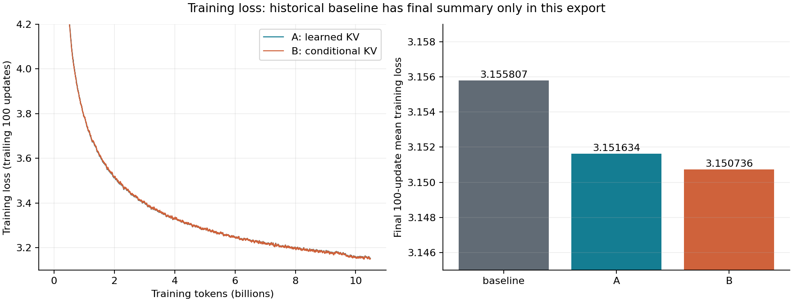

# YOCO 160M：Baseline、A、B 三组结果与计算量

核验日期：2026-11-04。三组均完成 **40,000 步、10,485,760,000 个训练 tokens**。A/B 已完成全部 16 项评测，每组八任务、21,465 道题，零样本、无 limit。

**结论：A 的验证 loss 略低，下游宏平均比历史 baseline 高 0.23 个百分点；B 的 loss 最低，但下游比 baseline 低 0.80 个百分点、比 A 低 1.03 个百分点。当前结果支持保留 A 作为后续候选，尚不足以证明普遍收益或计算效率优势。**

## 三组身份与比较边界

| 组别 | K/V 来源与权重 | 本次结果对应硬件 | 身份 |
|---|---|---|---|
| Baseline | 第六层输出生成一次共享 K/V | 32×V100 | 已有 YOCO last-layer KV 复现 |
| A / learned_kv | 六层各自产生候选 K/V，以六个全局 softmax 权重融合 | 8×A800 | 本次已完成运行 |
| B / conditional_kv | 六层各自产生候选 K/V，由 hidden states 生成每 token 权重 | 8×A800 | 本次已完成运行 |

A/B 在第七层前融合一次，后六层共享融合 K/V；K/V 使用相同配比。A 新增 6 个参数，B 新增 774 个参数。初始配比均为六层等权，seed=42。实际产物中的 world_size=8，评测环境报告 A800；配置文件名里的 A100 和旧四卡 H100 计划不作为实际硬件证据。

表中 baseline 不是 Transformer，也不是历史两卡 baseline（后者 loss=3.288449）。A/B 是同一配置、数据锁和执行环境下的直接比较；32×V100 baseline 是历史参考。其原始 token 分片哈希、验证样本身份和 task YAML 未在本轮重新核实，硬件及软件版本也不同。因此三组差异是描述性结果，不能直接归因于融合设计。

三组配置均为：12 层、宽度 768、FFN 2304、序列长 2048、共享输入/输出 embedding、每步 262144 tokens、2048 条验证序列；AdamW，LR=1.5e-4，warmup=375，40000 步 schedule，weight decay=0.05，FP16 mixed / FP32 parameters。Baseline 使用 microbatch=4、累积=1、32 ranks；A/B 使用 microbatch=4、累积=4、8 ranks。配置摘录见 [training_protocol.json](training_protocol.json)。

A/B 数据为固定 revision 的 FineWeb-Edu sample-10BT；准备后的训练池共 9,683,617,678 tokens。D 使用实际消费的 10,485,760,000 tokens，约为池大小的 1.083 倍，不应称为 10.49B 个互不重复 tokens。

## Loss 与八项下游

| 指标 | Baseline | A | B |
|---|---:|---:|---:|
| 最终验证 CE | 3.163661 | 3.160054 | 3.159059 |
| 验证 PPL | 23.657046 | 23.571879 | 23.548433 |
| 最后 100 步平均训练 loss | 3.155807 | 3.151634 | 3.150736 |
| 八项下游宏平均（%） | 46.7113 | 46.9417 | 45.9075 |

训练 loss 取日志中最后 100 个成功 update 的算术均值；验证 CE 使用最终第 40000 步。不能用单步训练 loss 替代验证 loss。

| 任务 | 指标 | 题数 | Baseline % | A % | B % | A−Base pp | B−Base pp |
|---|---|---:|---:|---:|---:|---:|---:|
| arc_easy | acc_norm | 2376 | 46.09 | 45.83 | 45.37 | -0.25 | -0.72 |
| arc_challenge | acc_norm | 1172 | 25.51 | 25.68 | 24.49 | +0.17 | -1.02 |
| hellaswag | acc_norm | 10042 | 31.33 | 31.25 | 31.25 | -0.08 | -0.08 |
| piqa | acc_norm | 1838 | 62.46 | 61.10 | 62.51 | -1.36 | +0.05 |
| winogrande | acc | 1267 | 51.78 | 52.25 | 50.75 | +0.47 | -1.03 |
| boolq | acc | 3270 | 61.53 | 61.62 | 60.49 | +0.09 | -1.04 |
| openbookqa | acc_norm | 500 | 30.80 | 31.80 | 30.00 | +1.00 | -0.80 |
| sciq | acc_norm | 1000 | 64.20 | 66.00 | 62.40 | +1.80 | -1.80 |
| 等权宏平均 | — | 21465 | 46.71 | 46.94 | 45.91 | +0.23 | -0.80 |

宏平均先计算每个任务的完整 accuracy，再对八任务等权平均，不按题数加权。BoolQ、WinoGrande 使用 acc，其余六项使用 acc_norm。CSV 保留未四舍五入的 accuracy、标准误和百分点差值。

A/B 按 doc_id 对齐后逐题核对 doc、prompt、target 的哈希，重新计算所有 accuracy。对每个任务内的配对正确性差值做 10,000 次有放回 bootstrap，再对八任务等权平均：B−A 为 **−1.0343 pp，95% 区间 [−1.6679, −0.3845] pp**。bootstrap seed=42；该区间仅反映这两个固定 checkpoint 的样本不确定性，不能替代多训练 seed 验证。没有 baseline 的逐题配对原始记录，不给 baseline 差值虚构配对显著性。

## Marin 风格 6ND：先说清 N 与 D

统一计算 `C = 6 × N × D`；`PFLOP-days = C / 8.64e19`。这是参数量与训练 tokens 的计算代理，不是硬件实测 FLOPs，也不是 GPU-days。D 是成功训练 update 消费的 tokens，重复采样也计入；评测、checkpoint、失败的 overflow 尝试均不计入这个 D。

这里同时保留两种口径，与现有 Marin 导出中区分主干和输出头的做法一致：

- **Trunk 6ND**：N 排除输入 embedding 和输出矩阵，保留其他参数。三组输入与输出矩阵共享同一个参数，只减去一次共享矩阵。
- **Output-inclusive 6ND**：计入输出矩阵一次，输入 lookup 不另计。由于本模型权重共享，此 N 数值等于去重后的总参数数。不要对共享矩阵减两次，也不要把输出投影计算当成零。

共享矩阵为 `100288 × 768 = 77,021,184` 个参数。通过实际 model 构建的参数计数核对，并与运行 started 日志一致。

| 指标 | Baseline | A | B |
|---|---:|---:|---:|
| 总参数 / 输出头计入的 N | 166,708,224 | 166,708,230 | 166,708,998 |
| 主干 N | 89,687,040 | 89,687,046 | 89,687,814 |
| 训练 tokens D | 10,485,760,000 | 10,485,760,000 | 10,485,760,000 |
| Trunk 6ND（PFLOP-days） | 0.065308109 | 0.065308114 | 0.065308673 |
| Output-inclusive 6ND（PFLOP-days） | 0.121393224 | 0.121393228 | 0.121393788 |
| 额外五次 K/V 投影代理（PFLOP-days） | 0.000000000 | 0.004294967 | 0.004294967 |
| Output-inclusive + 重复 KV 投影（PFLOP-days） | 0.121393224 | 0.125688196 | 0.125688755 |

**A/B 参数几乎不增加，不等于训练计算量几乎不增加。** 实现对六个来源分别运行同一套 K/V 投影，baseline 只运行一次。按一次乘加计 2 FLOPs、前向与反向合计约为前向的三倍，额外投影估算为 `6 × (6−1) × (768×768 + 768×768) × D = 3.710851743744e17 FLOPs`，即 `0.004294967296 PFLOP-days`。相当于 baseline 输出头计入的 6ND 的约 **3.54%**。

“6ND + 重复 KV”只是对重复投影的局部修正：仍未完整计入 retention/attention 的 token 间运算、归一化、路由评分与 softmax、加权聚合、激活重计算、通信、优化器、overflow 重试及评测。因此不能称其为完整真实 FLOPs，也不能据此证明每 FLOP 收益。

三组验证曲线各有 160 个原始验证点，未平滑；其余三幅子图放大后期 loss。A/B 训练曲线使用 trailing 100-update 均值；本次 baseline 只有已公开的最终训练 loss 汇总和完整验证曲线，没有伪造其逐步训练曲线。三个同规模方法不能用来拟合跨模型规模的 scaling law。

## 到达同一 loss 的训练量

每 250 步验证一次；下表为首次实测达到阈值的 step，不插值。这些阈值在当前日志中首次达到后均保持达到至结束。每 250 步对应 65,536,000 tokens，不能声称有更细的定位精度。

| 验证 CE 阈值 | Baseline step | A step | B step |
|---|---:|---:|---:|
| 4.000000 | 2500 | 2750 | 2500 |
| 3.500000 | 8000 | 8000 | 8000 |
| 3.300000 | 17500 | 17250 | 17250 |
| 3.200000 | 29750 | 29250 | 29000 |
| 3.170000 | 37000 | 36000 | 35750 |
| 3.163661 | 40000 | 38000 | 37750 |

以历史 baseline 最终 CE=3.163661 为阈值，A 在 38000 步达到、B 在 37750 步达到，对应 tokens 少 5.00% / 5.625%。这是历史曲线的描述性对照；初期阈值 4.0 上 A 反而晚 250 步，不能泛称全程更快。额外 K/V 计算和历史协议差异也意味着“少 tokens”不能直接改写成“省同等比例 FLOPs”。完整 tokens 与两种 6ND 阈值见 [loss_thresholds.csv](loss_thresholds.csv)。

## 实际时间与证据边界

| 指标 | Baseline / 32×V100 | A / 8×A800 | B / 8×A800 |
|---|---:|---:|---:|
| 成功 update 时间（小时） | 21.8758 | 7.5111 | 7.6047 |
| 成功 update GPU-hours | 700.024 | 60.089 | 60.838 |
| 开始至最终验证（小时） | 24.7140 | 7.8333 | 7.9289 |
| 成功 update 平均 tokens/s | 133,148 | 387,787 | 383,014 |
| rank0 峰值显存（GiB） | 12.263 | 13.281 | 13.419 |

成功 update 时间为 rank0 每条成功 train 记录 seconds 的和，包含该 update 的训练及同步开销，排除验证、checkpoint 和独立 overflow 重试；GPU-hours 为其乘卡数。开始至最终验证的时间包括中间 checkpoint、验证和 overflow，但不包括最后 checkpoint 的写入与下游评测。A/B 分别记录 11/12 次 overflow，最终均有完整 40000 个成功 update。峰值显存只观测 rank0，不能冒充所有卡的最大值。

A/B 同卡型同卡数，B 成功 update 总时间约比 A 高 1.25%；这是单次串行运行的观察，不是重复性能试验。Baseline 与 A/B 的硬件和软件环境不同，不使用表中时间比宣称方法加速。

## 产物、复算与脱敏

- [summary.json](summary.json)：完整精度结果、checkpoint 元数据 SHA256、协议和匿名源文件哈希。
- [downstream.csv](downstream.csv)、[training_summary.csv](training_summary.csv)：三组表格。
- [validation_curves.csv](validation_curves.csv)、[ab_training_curves.csv](ab_training_curves.csv)：完整数值曲线。
- [ab_paired_scores.csv](ab_paired_scores.csv)：仅 task、doc_id、两组正确性，供复算；不含题目、答案文本、prompt 或原始模型输出。
- 同名 PDF 图可用于论文或分享；[MANIFEST.sha256](MANIFEST.sha256) 校验整个发布目录。

用 `python3 tools/verify_ab_baseline.py` 检查公开数值与 manifest。用公开 CSV/JSON 重画图片：`python3 tools/plot_ab_baseline.py`。从私有回传文件重新核验并导出：`python3 tools/export_ab_baseline.py --raw PRIVATE_RAW_DIRECTORY --output evaluation/ab_baseline_20261104`。导出器校验 A/B 训练步序、完成标记、checkpoint 元数据 fingerprint、runtime 源码哈希、完整题数、指标复算和逐题配对身份。

本轮已重新从共享卷下载 42 个文件（185,351,848 bytes），本地写入后 SHA256 与下载字节一致；SSH 入口不可用，因此使用共享卷 API 回传，而非 SCP。对照此前本地核验记录的 32 个结果/provenance 文件 SHA256 全部一致。原始日志、机器环境、题目和完整 provenance 仅保存在本地忽略目录。发布采用字段白名单，排除服务器/用户名/挂载路径、凭据、作业/worker/GPU 标识、原始日志、模型 checkpoint 和语料。

A/B 的最终 checkpoint 元数据与全部评测 provenance 绑定已核对，runtime 源码与运行身份哈希一致；未下载或重新计算 checkpoint payload 全量哈希。Baseline 的证据来自此前仓库中的归档结果，不把它描述为本次重跑或重新完整验收。
