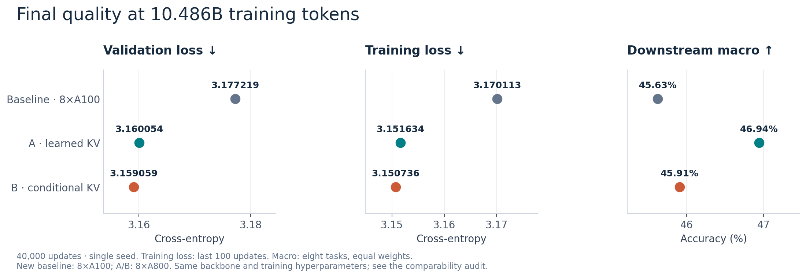
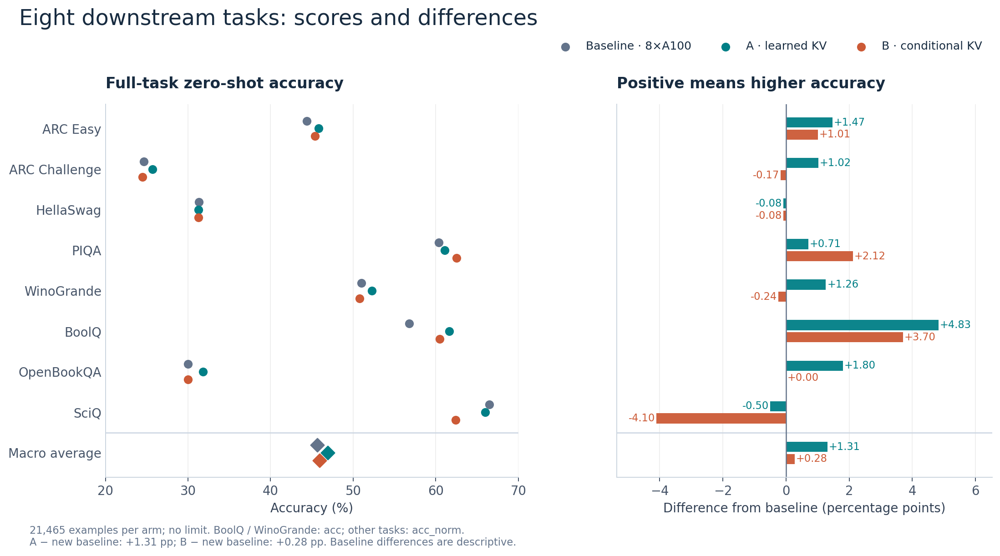
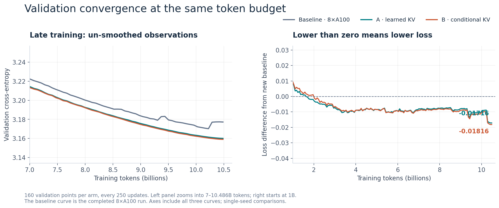
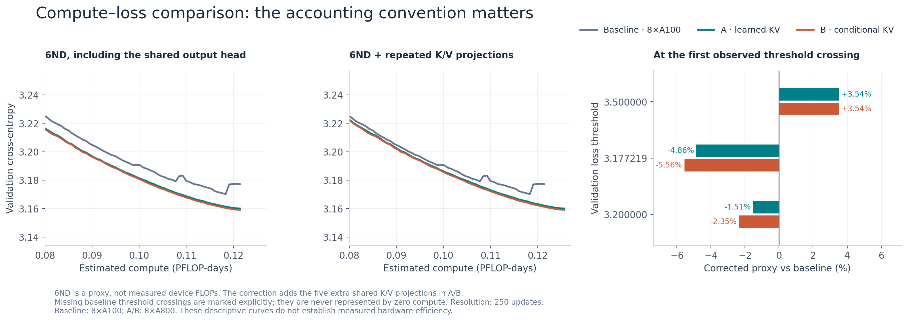
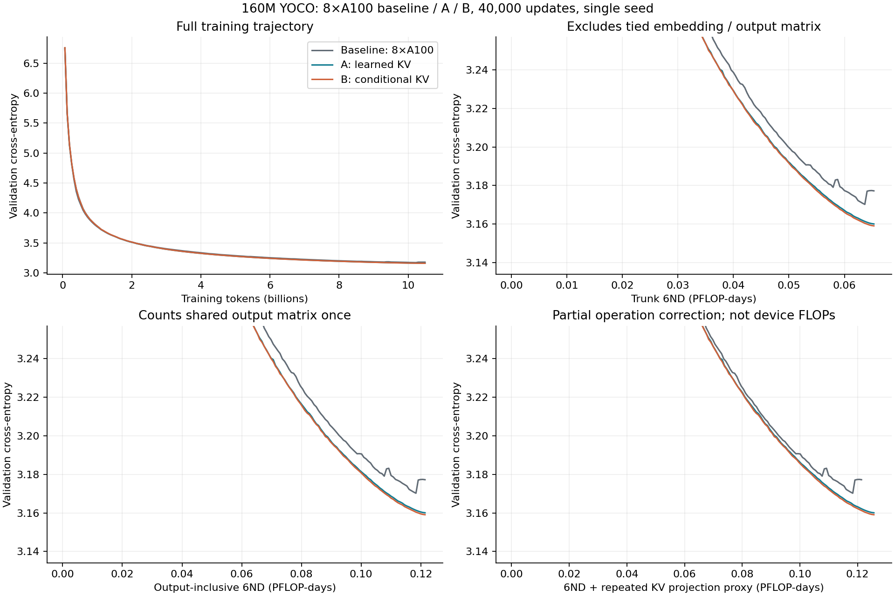
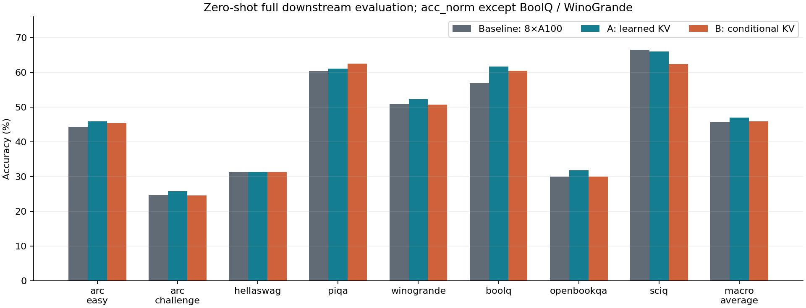
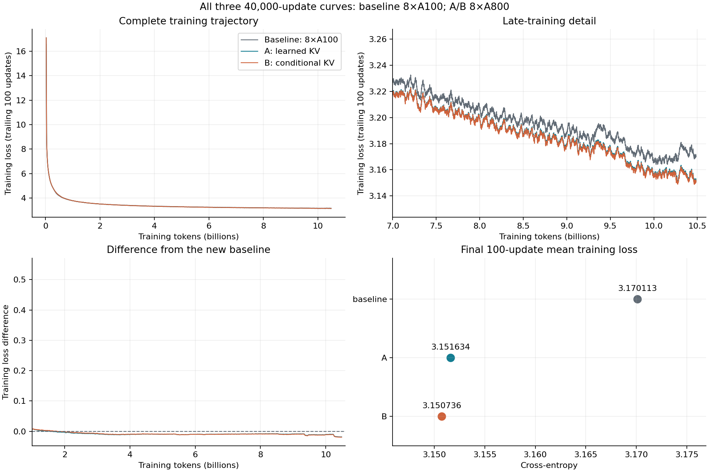

# 新 Baseline / A / B：七张对比图

Baseline 使用本次完成的 **8×A100** 运行，A/B 使用已发布的 **8×A800** 运行；三组同一 YOCO 基座、相同训练超参数、40000 步、10.486B tokens、八项完整评测。基座和初始公共参数的完整模型核查见[报告](../README.md)与[核查 JSON](../comparability_audit.json)。灰色为 baseline，青色为 A，橙色为 B。

## 1. 最终质量总览

比较最终验证 loss、最后 100 步平均训练 loss、八任务宏平均。当前 A 下游最高，B 的验证 loss 最低；图中 baseline 已替换为本机新运行。

[PDF](01_quality_summary.pdf) · [SVG](01_quality_summary.svg)

## 2. 八任务得分与相对 baseline 的差值

左图三组得分，右图 A/B 相对新 baseline 的百分点差值。坐标已按新差值重算；每组 21465 题，无 limit，宏平均为八任务等权。Baseline 差值属于描述性比较。

[PDF](02_downstream_comparison.pdf) · [SVG](02_downstream_comparison.svg)

## 3. 相同 token 预算的验证收敛

每组 160 个未平滑验证点。左图放大 7–10.486B tokens，右图为 A/B 减去新 baseline。完整保留三组的原始验证波动，未裁掉灰色曲线；三组均使用最终第 40000 步结果。

[PDF](03_validation_convergence.pdf) · [SVG](03_validation_convergence.svg)

## 4. Compute–loss 与同 loss 的计算代理

左图 output-inclusive 6ND，中图加上 A/B 额外五次 K/V 投影的局部代理，右图按首次观测达到阈值比较。本次 baseline 已达到 loss=3.2；缺失阈值仍明确标注，不显示为零。该代理不是实测硬件 FLOPs；详细首次/持续命中步数见[阈值 CSV](../loss_thresholds.csv)。

[PDF](04_compute_tradeoff.pdf) · [SVG](04_compute_tradeoff.svg) · [右图 CSV](compute_at_loss.csv)

## 5. 全程验证与四种横轴

[PDF](../loss_compute.pdf) · [SVG](../loss_compute.svg)

## 6. 八任务分组柱状图

[PDF](../downstream.pdf) · [SVG](../downstream.svg)

## 7. 三组完整训练 loss

现在包含 baseline 的全部 40000 步。展示全程、后期放大、相对 baseline 差值和最后 100 步均值；轨迹使用 trailing-100 平均，最终均值直接复算。

[PDF](../training_loss.pdf) · [SVG](../training_loss.svg)

复画使用 `python tools/plot_ab_baseline.py` 与 `python tools/plot_ab_comparisons.py`；这只读取公开数值，不启动训练或评测。[目录 manifest](../MANIFEST.sha256) 覆盖本目录。按本次核查范围，不以软件版本差异作为比较的判定项。
