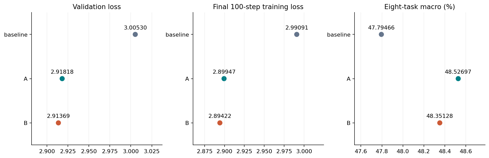
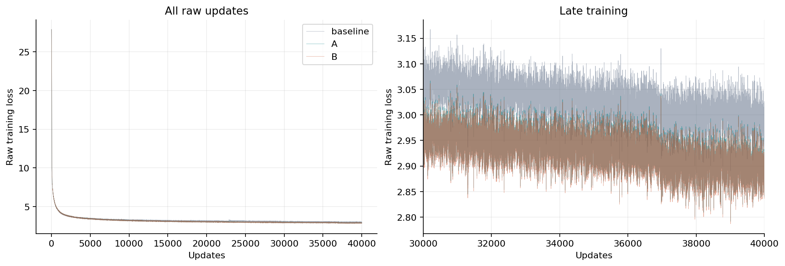
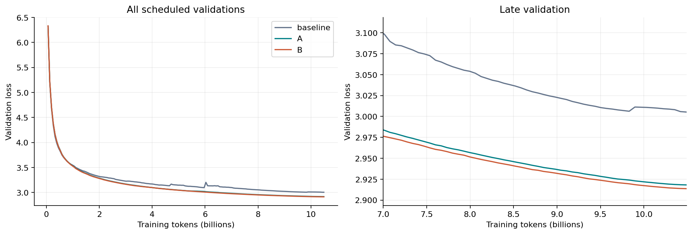
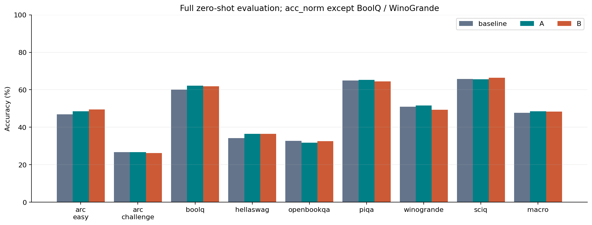
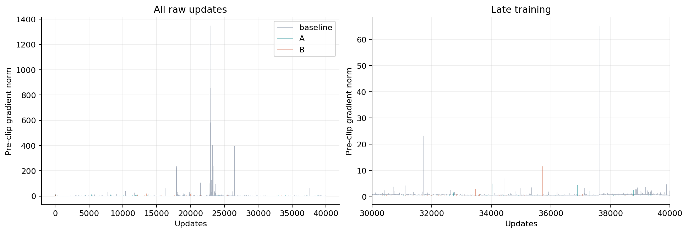
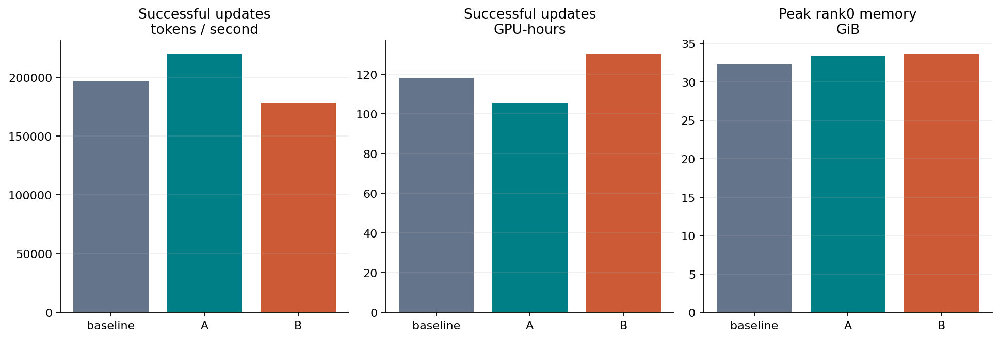
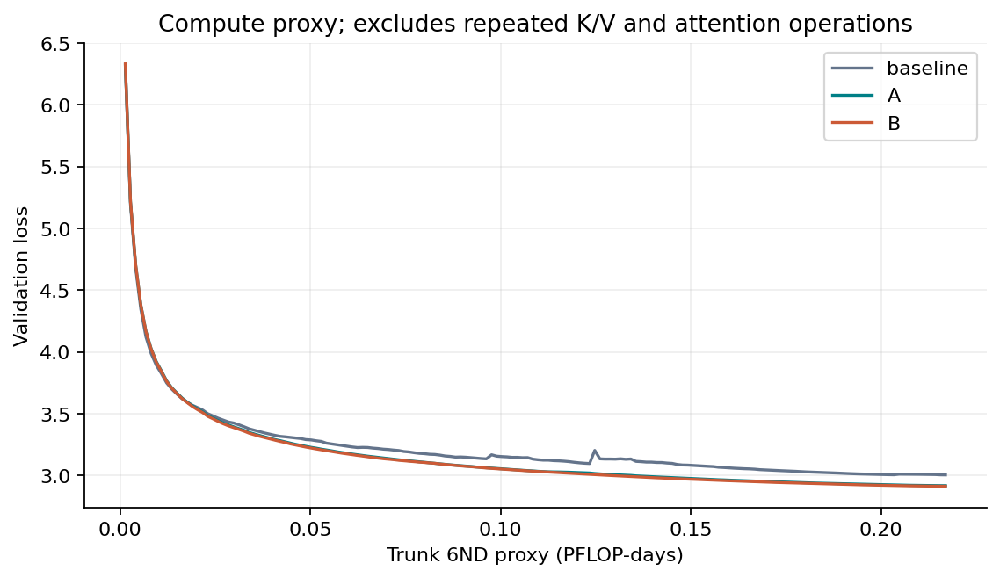

# YOCO-gRet 400M: baseline, method A and method B

Baseline, A and B each completed 40000 updates and eight full zero-shot tasks on 8xA100. All three configurations share the original seed-42 backbone initialization, data/tokenizer, FP16 mixed / FP32 parameters, batch and 40000-step schedule. All 24 retained baseline/A/B checkpoints and all paired task documents/prompts/targets were verified. Baseline was queued after B; historical A/B results were preserved.

| Arm | Parameters | Validation loss | Eight-task macro (%) |
| --- | ---: | ---: | ---: |
| baseline | 400590848 | 3.005298 | 47.7947 |
| A | 400590860 | 2.918184 | 48.5270 |
| B | 400591884 | 2.913688 | 48.3513 |

[Nine-model combined figures](../model_comparison_20261111/README.md) · [Final publication checks](../../docs/evidence/gret-400m-final-review-20261111.json)

[Numeric summary](summary.json) · [Raw training points](training_curves.csv) · [Validation points](validation_curves.csv) · [Task scores](downstream.csv) · [Source hashes](source_hashes.json)

[PDF](figures/01_quality_summary.pdf) · [SVG](figures/01_quality_summary.svg)

[PDF](figures/02_training_loss.pdf) · [SVG](figures/02_training_loss.svg)

[PDF](figures/03_validation_loss.pdf) · [SVG](figures/03_validation_loss.svg)

[PDF](figures/04_downstream.pdf) · [SVG](figures/04_downstream.svg)

[PDF](figures/05_gradient_norm.pdf) · [SVG](figures/05_gradient_norm.svg)

[PDF](figures/06_execution_cost.pdf) · [SVG](figures/06_execution_cost.svg)

[PDF](figures/07_loss_compute_proxy.pdf) · [SVG](figures/07_loss_compute_proxy.svg)

A has a historical compiled/repaired prefix; baseline and B use the repaired native path throughout. Timings do not isolate architecture effects. Successful-update timing excludes AMP failed attempts, validation, checkpoint I/O, setup and evaluation. Raw committed-lineage points are preserved; failed/replayed suffixes remain in local archives. The 6ND figures are proxies, not measured FLOPs. This single-seed result does not establish a stable downstream gain. All seven publication figures were visually reviewed; PDF/SVG validation and independent final checkpoint/evaluation checks are recorded in the linked evidence. The execution-cost title wrapping was refreshed with tools/refresh_400m_cost_figure.py; all numeric data remain unchanged.

Baseline has finite pre-clip gradient excursions (maximum1348.629), maximum validation regression0.106319,12 normal AMP rejected attempts,0 nonfinite forwards and0 checkpoint rollbacks. Raw plots preserve these events. Final baseline/A/B macro accuracies are47.7947%/48.5270%/48.3513%; A/B relative gains over baseline are1.5322%/1.1646%, descriptive for one seed.
