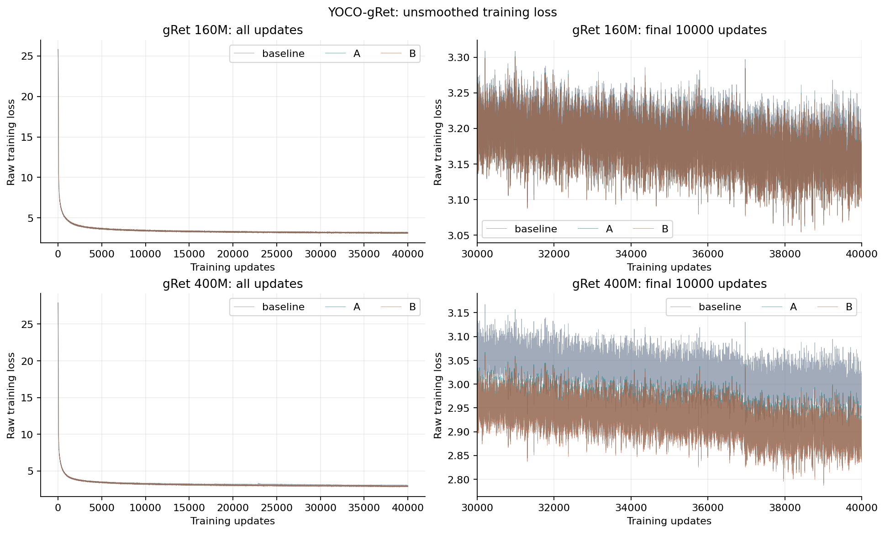
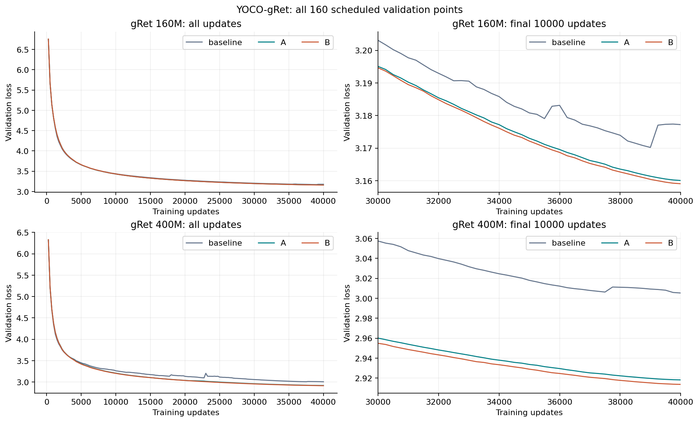
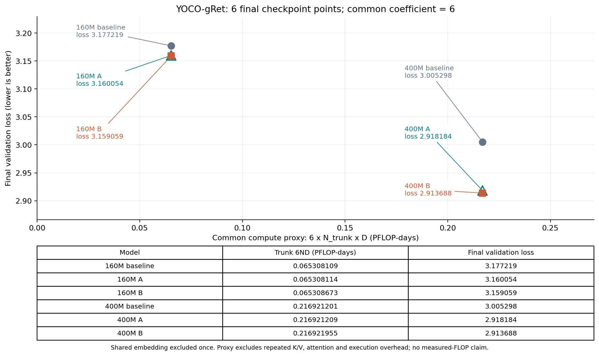
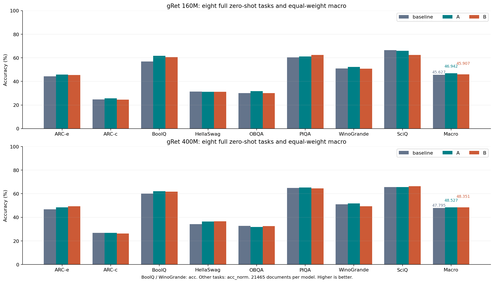
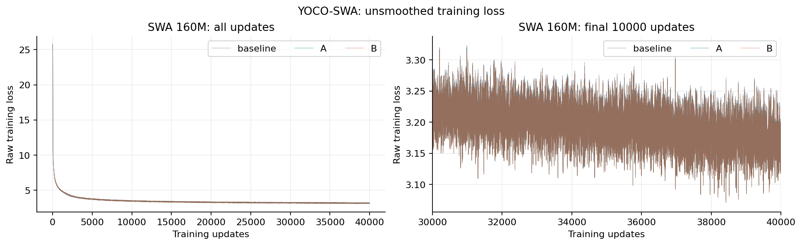
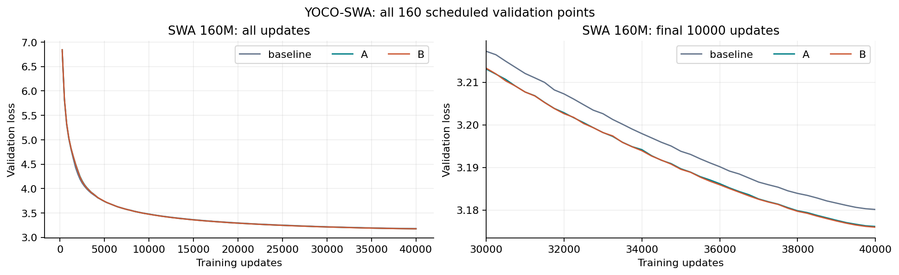
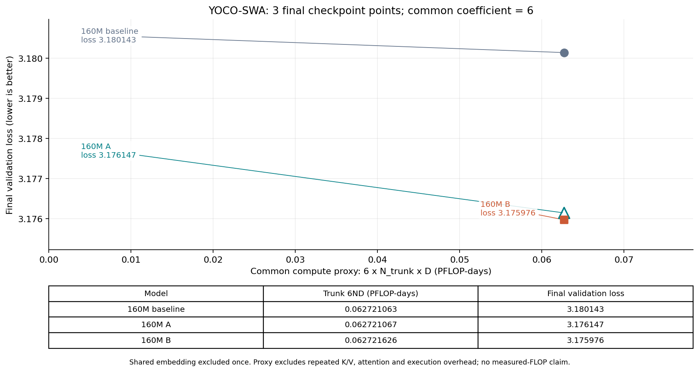
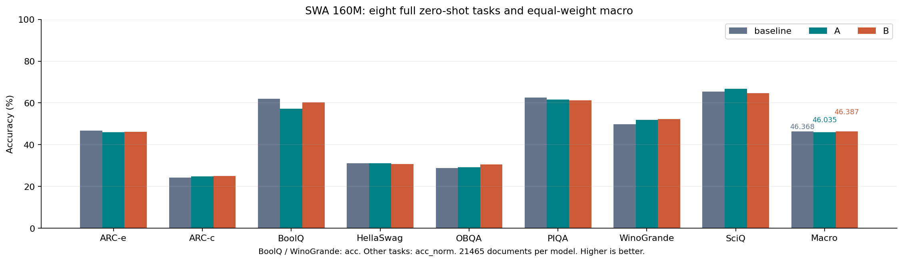
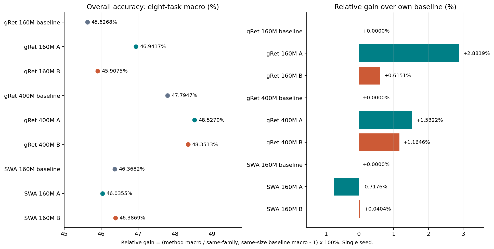

# YOCO：九组完整模型对比

2026-11-11汇总。gRet 160M、gRet 400M、SWA 160M各含baseline、方法A、方法B，共九组。每组40000步、10485760000训练tokens、seed42、八项完整零样本评测（21465条文档）。本次只读取既有训练和评测结果制图，没有重训或修改训练setting。

## 最终训练与验证结果

最终值固定取40000步；train末100步均值用来减少单batch噪声。Loss越低越好，准确率越高越好。

| 模型 | 参数量 | Train最后一步 | Train末100步均值 | Valid最终 | 综合准确率% ↑ | 相对baseline增幅 ↑ |
| --- | ---: | ---: | ---: | ---: | ---: | ---: |
| gRet 160M baseline | 166708224 | 3.163700 | 3.170113 | 3.177219 | 45.6268 | +0.0000% |
| gRet 160M A | 166708230 | 3.147619 | 3.151634 | 3.160054 | 46.9417 | +2.8819% |
| gRet 160M B | 166708998 | 3.145682 | 3.150736 | 3.159059 | 45.9075 | +0.6151% |
| gRet 400M baseline | 400590848 | 2.991544 | 2.990905 | 3.005298 | 47.7947 | +0.0000% |
| gRet 400M A | 400590860 | 2.901862 | 2.899469 | 2.918184 | 48.5270 | +1.5322% |
| gRet 400M B | 400591884 | 2.897144 | 2.894218 | 2.913688 | 48.3513 | +1.1646% |
| SWA 160M baseline | 163155456 | 3.168379 | 3.172976 | 3.180143 | 46.3682 | +0.0000% |
| SWA 160M A | 163155462 | 3.164779 | 3.168875 | 3.176147 | 46.0355 | -0.7176% |
| SWA 160M B | 163156230 | 3.163748 | 3.168725 | 3.175976 | 46.3869 | +0.0404% |

## 统一compute–loss口径：两张终点图

沿用160M报告的trunk 6ND定义，对九个模型统一使用共同系数 **κ=6**：

$$ C_{\mathrm{trunk}} = 6\,(N_{\mathrm{total}}-N_{\mathrm{embedding}})\,D, \qquad C_{\mathrm{PFLOP-days}}=C_{\mathrm{trunk}}/(8.64\times10^{19}). $$

这里D为实际训练tokens（各组均10485760000），共享输入embedding/输出矩阵只从N中扣除一次。gRet为六个40000步checkpoint终点，SWA为三个终点，纵轴均为最终validation loss。没有拟合系数、抖动点坐标或用最佳checkpoint替换最终点。同规模A/B新增参数很少，横坐标接近，图中保留真实位置并附精确数值表；A用空心三角区分接近的点。

这是共同6ND计算代理，未包括attention、retention操作、重计算、通信与执行开销，不能当作实测FLOPs。A/B对各来源重复K/V投影的局部增量代理单独列在[计算点CSV](compute_loss_points.csv)：`6 × (来源数−1) × 2 × dim² × D`；baseline增量为0。CSV同时列出output-inclusive 6ND，避免不同口径混用；两张主终点图统一采用trunk口径。

## 全量下游

单位%。BoolQ和WinoGrande用acc，其余六项用acc_norm。综合准确率为八任务等权宏平均，按未舍入的原分数计算。相对增幅=`(方法宏平均 / 同组同规模baseline宏平均 − 1) × 100%`，不是百分点差。

| 模型 | ARC-e | ARC-c | BoolQ | HellaSwag | OBQA | PIQA | WinoGrande | SciQ | 综合准确率 ↑ | 相对baseline增幅 ↑ |
| --- | ---: | ---: | ---: | ---: | ---: | ---: | ---: | ---: | ---: | ---: |
| gRet 160M baseline | 44.36 | 24.66 | 56.79 | 31.33 | 30.00 | 60.39 | 50.99 | 66.50 | 45.6268 | +0.0000% |
| gRet 160M A | 45.83 | 25.68 | 61.62 | 31.25 | 31.80 | 61.10 | 52.25 | 66.00 | 46.9417 | +2.8819% |
| gRet 160M B | 45.37 | 24.49 | 60.49 | 31.25 | 30.00 | 62.51 | 50.75 | 62.40 | 45.9075 | +0.6151% |
| gRet 400M baseline | 46.84 | 26.79 | 60.09 | 34.24 | 32.80 | 64.91 | 50.99 | 65.70 | 47.7947 | +0.0000% |
| gRet 400M A | 48.48 | 26.79 | 62.17 | 36.44 | 31.80 | 65.23 | 51.70 | 65.60 | 48.5270 | +1.5322% |
| gRet 400M B | 49.45 | 26.19 | 61.83 | 36.53 | 32.60 | 64.47 | 49.33 | 66.40 | 48.3513 | +1.1646% |
| SWA 160M baseline | 46.72 | 24.32 | 61.99 | 31.12 | 28.80 | 62.62 | 49.88 | 65.50 | 46.3682 | +0.0000% |
| SWA 160M A | 45.96 | 24.74 | 57.22 | 31.02 | 29.20 | 61.59 | 51.85 | 66.70 | 46.0355 | -0.7176% |
| SWA 160M B | 46.13 | 25.09 | 60.28 | 30.74 | 30.60 | 61.32 | 52.25 | 64.70 | 46.3869 | +0.0404% |

## 图表

### gRet训练loss：160M与400M，各三组原始曲线及末段放大



[PDF](figures/01_train_loss_gret.pdf) · [SVG](figures/01_train_loss_gret.svg)

### gRet验证loss：160M与400M各160个定期验证点



[PDF](figures/03_valid_loss_gret.pdf) · [SVG](figures/03_valid_loss_gret.svg)

### gRet compute–loss：160M/400M baseline/A/B共6个终点



[PDF](figures/05_compute_loss_gret.pdf) · [SVG](figures/05_compute_loss_gret.svg)

### gRet八项下游与综合准确率



[PDF](figures/07_downstream_gret.pdf) · [SVG](figures/07_downstream_gret.svg)

### SWA训练loss：三组原始曲线及末段放大



[PDF](figures/02_train_loss_swa.pdf) · [SVG](figures/02_train_loss_swa.svg)

### SWA验证loss：三组各160个定期验证点



[PDF](figures/04_valid_loss_swa.pdf) · [SVG](figures/04_valid_loss_swa.svg)

### SWA compute–loss：160M baseline/A/B共3个终点



[PDF](figures/06_compute_loss_swa.pdf) · [SVG](figures/06_compute_loss_swa.svg)

### SWA八项下游与综合准确率



[PDF](figures/08_downstream_swa.pdf) · [SVG](figures/08_downstream_swa.svg)

### 九组综合准确率及相对各自baseline的百分比增幅



[PDF](figures/09_downstream_macro_and_relative_gain.pdf) · [SVG](figures/09_downstream_macro_and_relative_gain.svg)

## 数据与复算

- [全部数值、公式和来源SHA](summary.json) · [模型汇总CSV](model_summary.csv) · [compute–loss九个终点CSV](compute_loss_points.csv) · [下游与相对增幅CSV](downstream.csv)。
- [gRet 160M报告](../ab_baseline_20261104/README.md)：[原始训练CSV](../ab_baseline_20261104/training_curves.csv)、[验证CSV](../ab_baseline_20261104/validation_curves.csv)。
- [gRet 400M三组完整报告](../gret_400m_3way_20261108T194918Z/README.md)：[原始训练CSV](../gret_400m_3way_20261108T194918Z/training_curves.csv)、[验证CSV](../gret_400m_3way_20261108T194918Z/validation_curves.csv)。
- [SWA 160M报告](../swa_160m_ab_20261107/README.md)：[原始训练CSV](../swa_160m_ab_20261107/training_curves.csv)、[验证CSV](../swa_160m_ab_20261107/validation_curves.csv)。
- 原始训练共360000行，定期验证共1440行，完整任务分数共72项。所有原始loss点保留，不平滑、不删尖峰；局部图范围包含全部被展示数据。
- [发布核验](../../docs/evidence/model-comparison-final-review-20261111.json)及[400M完整checkpoint/下游核验](../../docs/evidence/gret-400m-final-review-20261111.json)。

```bash
/root/miniconda3/envs/yoco/bin/python tools/export_model_comparison.py
/root/miniconda3/envs/yoco/bin/python tools/refresh_400m_cost_figure.py
```

## 比较范围

单seed结果只作描述，不证明稳定收益。gRet160M的baseline使用A100，A/B沿用A800发布结果，保存策略和执行优化有差别；原始A/B初始化payload未包含在公开导出中。400M A有历史编译/修复前缀，400M baseline/B全程使用已修复native路径，不能将耗时差异单独归因于融合结构。SWA与gRet的实际参数量不同。

400M baseline的原始记录存在有限但明显的裁剪前梯度尖峰（最大1348.629）、验证loss相对先前最优值最大回升0.106319，以及12次正常AMP拒绝尝试；没有非有限前向或checkpoint回退。图中完整保留这些波动，不将“训练完成”解释为“无尖峰”。A/B的结果同样保留实际训练来源。该语料为用户已批准的固定FineWeb复现配方，不宣称与论文原始语料完全一致。
