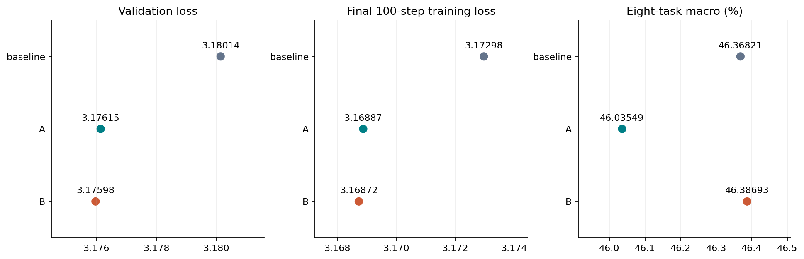
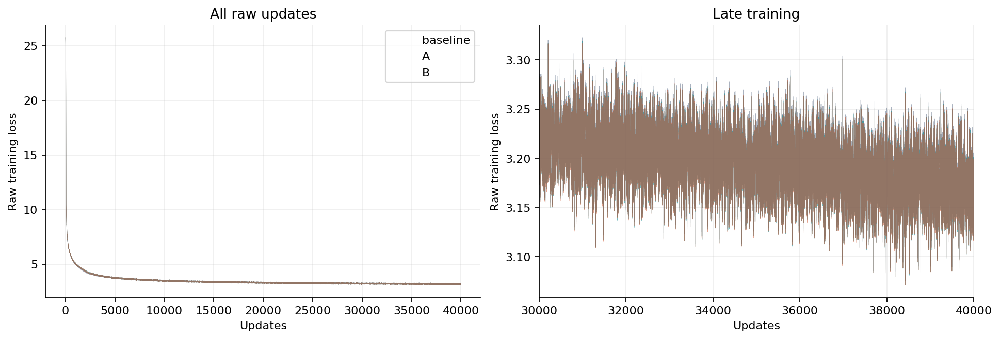
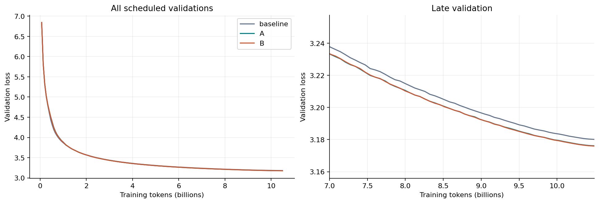
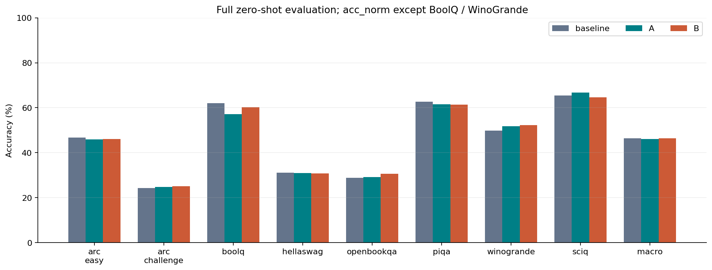
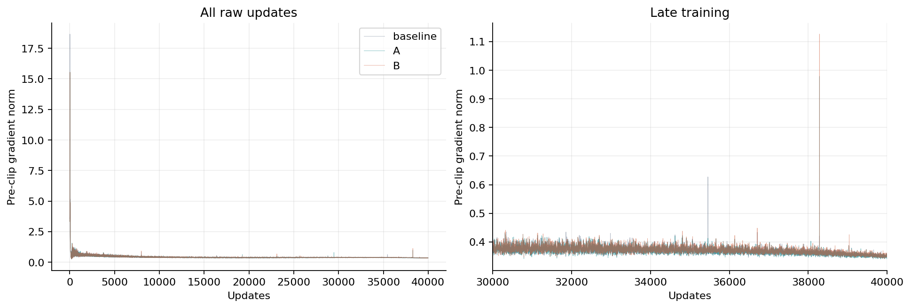
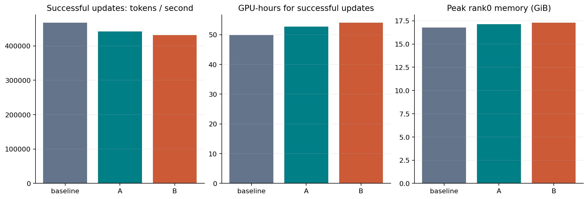
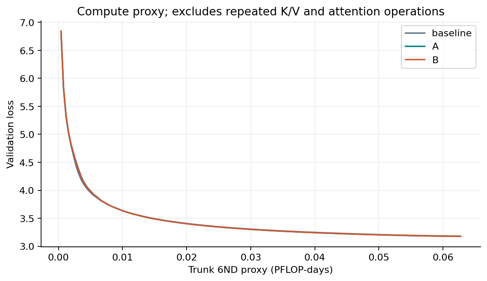

# YOCO-SWA 160M baseline / A / B

All three arms completed 40000 updates and eight full zero-shot tasks on 8×A100 each, with bitwise-equal common backbone initialization. Window1024; FP16 mixed / FP32 parameters; 10485760000 tokens per arm; seed42.

| Arm | Parameters | Validation loss | Eight-task macro (%) |
| --- | ---: | ---: | ---: |
| baseline | 163155456 | 3.180143 | 46.3682 |
| A | 163155462 | 3.176147 | 46.0355 |
| B | 163156230 | 3.175976 | 46.3869 |

[Numeric summary](summary.json) · [Raw training curves](training_curves.csv) · [Scheduled validation curves](validation_curves.csv) · [Task scores](downstream.csv) · [Source hashes](source_hashes.json)

[PDF](figures/01_quality_summary.pdf) · [SVG](figures/01_quality_summary.svg)

[PDF](figures/02_training_loss.pdf) · [SVG](figures/02_training_loss.svg)

[PDF](figures/03_validation_loss.pdf) · [SVG](figures/03_validation_loss.svg)

[PDF](figures/04_downstream.pdf) · [SVG](figures/04_downstream.svg)

[PDF](figures/05_gradient_norm.pdf) · [SVG](figures/05_gradient_norm.svg)

[PDF](figures/06_execution_cost.pdf) · [SVG](figures/06_execution_cost.svg)

[PDF](figures/07_loss_compute_proxy.pdf) · [SVG](figures/07_loss_compute_proxy.svg)

Single seed: differences are descriptive. Only successful updates are timed; AMP retries, validation, checkpoint I/O, setup and evaluation are excluded. Discarded successful suffix timings are reported separately. 6ND is a proxy, not measured FLOPs. Published tables contain numeric evidence; private task texts and logs remain local.
