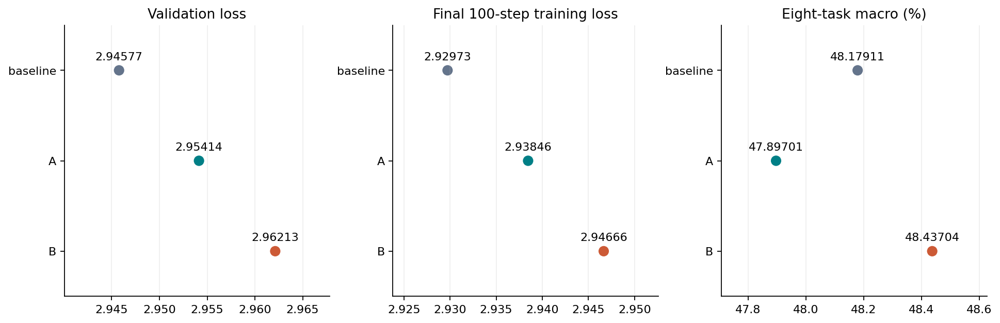
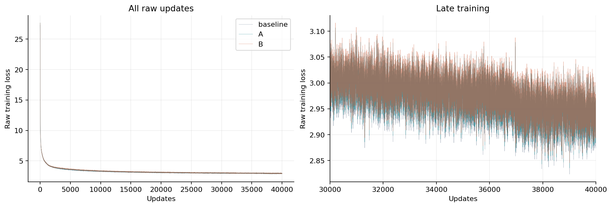
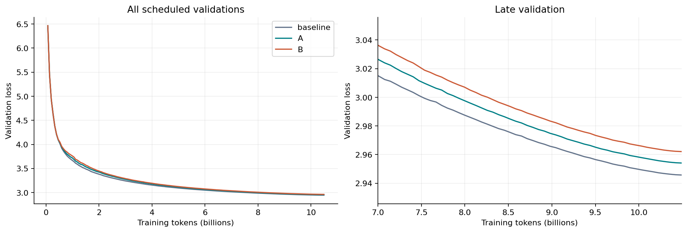
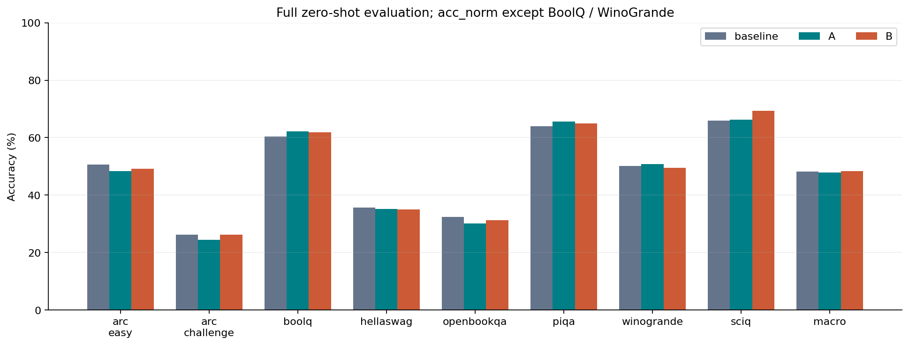
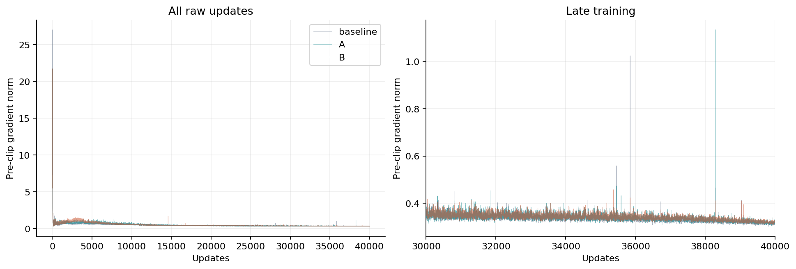
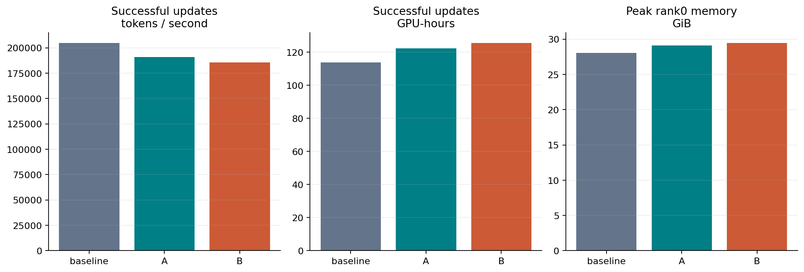
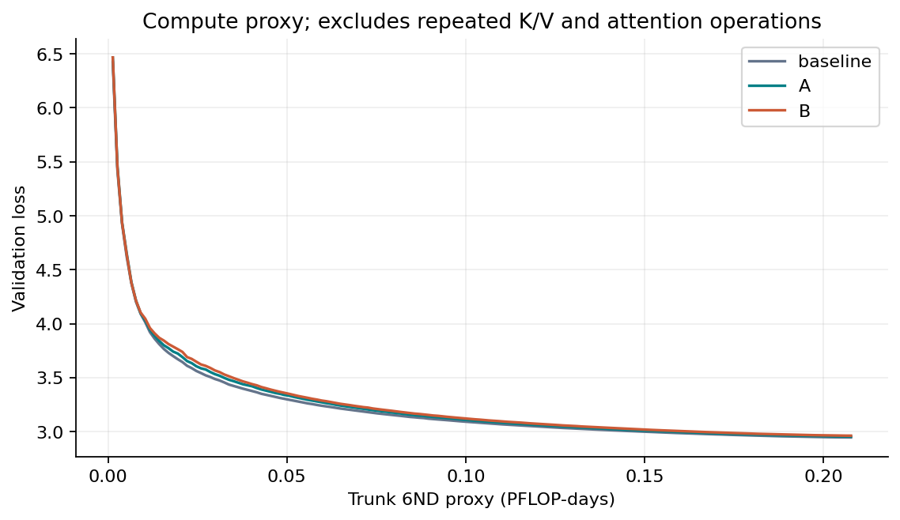

# YOCO-SWA 400M baseline / A / B

All three arms completed 40000 updates and eight full zero-shot tasks on 8×A100 each, with bitwise-equal common backbone initialization. Window1024; FP16 mixed / FP32 parameters; 10485760000 tokens per arm; seed42.

| Arm | Parameters | Final train loss | Last100 train mean | Final validation loss | Eight-task macro (%) ↑ | Relative gain (%) ↑ |
| --- | ---: | ---: | ---: | ---: | ---: | ---: |
| baseline | 387958784 | 2.931540 | 2.929726 | 2.945771 | 48.1791 | +0.0000 |
| A | 387958796 | 2.939230 | 2.938457 | 2.954141 | 47.8970 | -0.5855 |
| B | 387959820 | 2.948470 | 2.946656 | 2.962127 | 48.4370 | +0.5354 |

Final checkpoint = update 40000. Relative gain = (method macro / baseline macro - 1) × 100%, not a percentage-point difference. Baseline has the lowest validation loss; B has the highest eight-task macro for these fixed single-seed checkpoints.

[Final verification](../../docs/evidence/swa-400m-final-review-20261114.json) · [Settings and execution history](../../docs/SWA_400M_AB.md)

[Numeric summary](summary.json) · [Raw training curves](training_curves.csv) · [Scheduled validation curves](validation_curves.csv) · [Task scores](downstream.csv) · [Source hashes](source_hashes.json)

[PDF](figures/01_quality_summary.pdf) · [SVG](figures/01_quality_summary.svg)

[PDF](figures/02_training_loss.pdf) · [SVG](figures/02_training_loss.svg)

[PDF](figures/03_validation_loss.pdf) · [SVG](figures/03_validation_loss.svg)

[PDF](figures/04_downstream.pdf) · [SVG](figures/04_downstream.svg)

[PDF](figures/05_gradient_norm.pdf) · [SVG](figures/05_gradient_norm.svg)

[PDF](figures/06_execution_cost.pdf) · [SVG](figures/06_execution_cost.svg)

[PDF](figures/07_loss_compute_proxy.pdf) · [SVG](figures/07_loss_compute_proxy.svg)

Single seed: differences are descriptive. Only successful updates are timed; AMP retries, validation, checkpoint I/O, setup and evaluation are excluded. Discarded successful suffix timings are reported separately. 6ND is a proxy, not measured FLOPs. Published tables contain numeric evidence; private task texts and logs remain local.

Completed full pipeline: 2026-11-13 13:10 CST. All 24 retained checkpoints were SHA/finite-state checked by the automatic exporter; final three full payloads were independently rechecked for publication. The 24 rank scaler timelines (all8 ranks per arm) matched the original AMP policy through40000 successful updates. Normal AMP rejected attempts: baseline6 / A6 / B8; no nonfinite forwards or checkpoint rollbacks. All 160 scheduled validation points per arm are nonincreasing. Original raw training and pre-clip gradient fluctuations remain visible.
